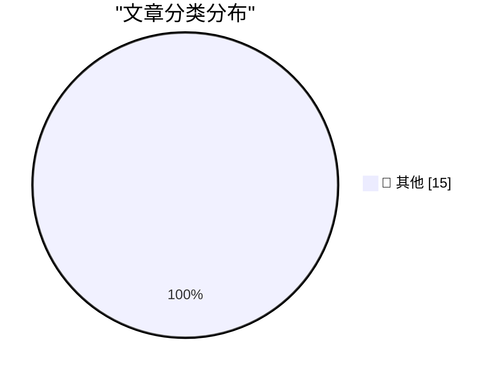

# 📰 AI 博客每日精选 — 2026-10-12

> 来自 Karpathy 推荐的 92 个顶级技术博客，AI 精选 Top 15

## 🏆 今日必读

🥇 **Dwarf Fortress uses version control now**

[Dwarf Fortress uses version control now](https://simonwillison.net/2026/Oct/11/dwarf-fortress/) — simonwillison.net · 1 天前 · 📝 其他

> Dwarf Fortress uses version control now

🥈 **Python 3.15.0 added to actions/python-versions**

[Python 3.15.0 added to actions/python-versions](https://simonwillison.net/2026/Oct/10/python-actions/) — simonwillison.net · 1 天前 · 📝 其他

> Python 3.15.0 added to actions/python-versions

🥉 **Don't diagnose your opponents**

[Don't diagnose your opponents](https://seangoedecke.com/dont-diagnose-your-opponents/) — seangoedecke.com · 1 天前 · 📝 其他

> Don't diagnose your opponents

---

## 📊 数据概览

| 扫描源 | 抓取文章 | 时间范围 | 精选 |
|:---:|:---:|:---:|:---:|
| 84/92 | 2562 篇 → 17 篇 | 48h | **15 篇** |

### 分类分布

---

## 📝 其他

### 1. Dwarf Fortress uses version control now

[Dwarf Fortress uses version control now](https://simonwillison.net/2026/Oct/11/dwarf-fortress/) — **simonwillison.net** · 1 天前 · ⭐ 15/30

> Dwarf Fortress uses version control now

---

### 2. Python 3.15.0 added to actions/python-versions

[Python 3.15.0 added to actions/python-versions](https://simonwillison.net/2026/Oct/10/python-actions/) — **simonwillison.net** · 1 天前 · ⭐ 15/30

> Python 3.15.0 added to actions/python-versions

---

### 3. Don't diagnose your opponents

[Don't diagnose your opponents](https://seangoedecke.com/dont-diagnose-your-opponents/) — **seangoedecke.com** · 1 天前 · ⭐ 15/30

> Don't diagnose your opponents

---

### 4. ★ X Once Again Marks the Spot

[★ X Once Again Marks the Spot](https://daringfireball.net/2026/10/x_once_again_marks_the_spot) — **daringfireball.net** · 6 小时前 · ⭐ 15/30

> ★ X Once Again Marks the Spot

---

### 5. Apple Only Started Suggesting iOS 26 Users Upgrade to 27 Three Days Ago

[Apple Only Started Suggesting iOS 26 Users Upgrade to 27 Three Days Ago](https://www.macrumors.com/2026/10/08/apple-now-pushing-ios-27/) — **daringfireball.net** · 8 小时前 · ⭐ 15/30

> Apple Only Started Suggesting iOS 26 Users Upgrade to 27 Three Days Ago

---

### 6. Sunnny

[Sunnny](https://sunnny.com/) — **daringfireball.net** · 1 天前 · ⭐ 15/30

> Sunnny

---

### 7. ‘Proof-of-Human’

[‘Proof-of-Human’](https://x.com/bzamayo/status/2108498107184934914) — **daringfireball.net** · 1 天前 · ⭐ 15/30

> ‘Proof-of-Human’

---

### 8. Why I Get Bored

[Why I Get Bored](https://idiallo.com/byte-size/why-i-get-bored) — **idiallo.com** · 11 小时前 · ⭐ 15/30

> Why I Get Bored

---

### 9. I paid people to try and follow my README

[I paid people to try and follow my README](https://shkspr.mobi/blog/2026/10/i-paid-people-to-try-and-follow-my-readme/) — **shkspr.mobi** · 15 小时前 · ⭐ 15/30

> I paid people to try and follow my README

---

### 10. Some quick thoughts on Unit Testing ActivityPub

[Some quick thoughts on Unit Testing ActivityPub](https://shkspr.mobi/blog/2026/10/some-thoughts-on-unit-testing-activitypub/) — **shkspr.mobi** · 1 天前 · ⭐ 15/30

> Some quick thoughts on Unit Testing ActivityPub

---

### 11. Inside a 1980s filter chip that uses switched capacitors

[Inside a 1980s filter chip that uses switched capacitors](http://www.righto.com/feeds/5504631233106574875/comments/default) — **righto.com** · 1 天前 · ⭐ 15/30

> Inside a 1980s filter chip that uses switched capacitors

---

### 12. Just say no to OpenAI and Anthropic

[Just say no to OpenAI and Anthropic](https://micahflee.com/just-say-no-to-openai-and-anthropic/) — **micahflee.com** · 4 小时前 · ⭐ 15/30

> Just say no to OpenAI and Anthropic

---

### 13. This Week in Package Management: 10 October 2026

[This Week in Package Management: 10 October 2026](https://nesbitt.io/2026/10/10/this-week-in-package-management.html) — **nesbitt.io** · 1 天前 · ⭐ 15/30

> This Week in Package Management: 10 October 2026

---

### 14. Reading List 10/10/26

[Reading List 10/10/26](https://www.construction-physics.com/p/reading-list-101026) — **construction-physics.com** · 1 天前 · ⭐ 15/30

> Reading List 10/10/26

---

### 15. Ward Christensen, telecommunications pioneer

[Ward Christensen, telecommunications pioneer](https://dfarq.homeip.net/ward-christensen-telecommunications-pioneer/?utm_source=rss&#038;utm_medium=rss&#038;utm_campaign=ward-christensen-telecommunications-pioneer) — **dfarq.homeip.net** · 16 小时前 · ⭐ 15/30

> Ward Christensen, telecommunications pioneer

---

*生成于 2026-10-12 03:07 | 扫描 84 源 → 获取 2562 篇 → 精选 15 篇*
*基于 [Hacker News Popularity Contest 2025](https://refactoringenglish.com/tools/hn-popularity/) RSS 源列表，由 [Andrej Karpathy](https://x.com/karpathy) 推荐*
*由「懂点儿AI」制作，欢迎关注同名微信公众号获取更多 AI 实用技巧 💡*
