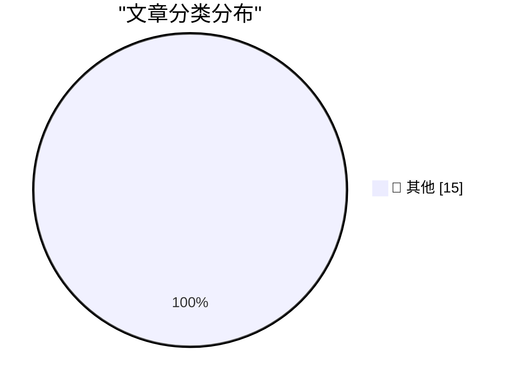

# 📰 AI 博客每日精选 — 2026-10-17

> 来自 Karpathy 推荐的 92 个顶级技术博客，AI 精选 Top 15

## 🏆 今日必读

🥇 **Quoting Addy Osmani, Morgan Westlee Lunt, and Qing Wang**

[Quoting Addy Osmani, Morgan Westlee Lunt, and Qing Wang](https://simonwillison.net/2026/Oct/16/code-review/) — simonwillison.net · 3 小时前 · 📝 其他

> Quoting Addy Osmani, Morgan Westlee Lunt, and Qing Wang

🥈 **Chirp Pong**

[Chirp Pong](https://simonwillison.net/2026/Oct/15/chirp-pong/) — simonwillison.net · 1 天前 · 📝 其他

> Chirp Pong

🥉 **Anthropic tells investors quarterly revenue up nearly 50% to $16.8bn ahead of IPO**

[Anthropic tells investors quarterly revenue up nearly 50% to $16.8bn ahead of IPO](https://simonwillison.net/2026/Oct/15/anthropic-tells-investors/) — simonwillison.net · 1 天前 · 📝 其他

> Anthropic tells investors quarterly revenue up nearly 50% to $16.8bn ahead of IPO

---

## 📊 数据概览

| 扫描源 | 抓取文章 | 时间范围 | 精选 |
|:---:|:---:|:---:|:---:|
| 82/92 | 2506 篇 → 28 篇 | 48h | **15 篇** |

### 分类分布

---

## 📝 其他

### 1. Quoting Addy Osmani, Morgan Westlee Lunt, and Qing Wang

[Quoting Addy Osmani, Morgan Westlee Lunt, and Qing Wang](https://simonwillison.net/2026/Oct/16/code-review/) — **simonwillison.net** · 3 小时前 · ⭐ 15/30

> Quoting Addy Osmani, Morgan Westlee Lunt, and Qing Wang

---

### 2. Chirp Pong

[Chirp Pong](https://simonwillison.net/2026/Oct/15/chirp-pong/) — **simonwillison.net** · 1 天前 · ⭐ 15/30

> Chirp Pong

---

### 3. Anthropic tells investors quarterly revenue up nearly 50% to $16.8bn ahead of IPO

[Anthropic tells investors quarterly revenue up nearly 50% to $16.8bn ahead of IPO](https://simonwillison.net/2026/Oct/15/anthropic-tells-investors/) — **simonwillison.net** · 1 天前 · ⭐ 15/30

> Anthropic tells investors quarterly revenue up nearly 50% to $16.8bn ahead of IPO

---

### 4. LaTeX renderer

[LaTeX renderer](https://simonwillison.net/2026/Oct/15/latex/) — **simonwillison.net** · 1 天前 · ⭐ 15/30

> LaTeX renderer

---

### 5. AI is driving a boom in modestly successful software projects

[AI is driving a boom in modestly successful software projects](https://seangoedecke.com/ai-is-driving-a-boom-in-modestly-successful-software/) — **seangoedecke.com** · 1 天前 · ⭐ 15/30

> AI is driving a boom in modestly successful software projects

---

### 6. The Late Charlie Munger on Elon Musk and Tesla

[The Late Charlie Munger on Elon Musk and Tesla](https://www.cnbc.com/make-it/2020/02/14/charlie-munger-shares-opinion-of-tesla-ceo-elon-musk.html) — **daringfireball.net** · 36 分钟前 · ⭐ 15/30

> The Late Charlie Munger on Elon Musk and Tesla

---

### 7. Apple: ‘Strengthening App Review Guidelines Against Nonconsensual Intimate Imagery and Bait-And-Switch Apps’

[Apple: ‘Strengthening App Review Guidelines Against Nonconsensual Intimate Imagery and Bait-And-Switch Apps’](https://developer.apple.com/news/?id=vvzx6cul) — **daringfireball.net** · 59 分钟前 · ⭐ 15/30

> Apple: ‘Strengthening App Review Guidelines Against Nonconsensual Intimate Imagery and Bait-And-Switch Apps’

---

### 8. Apple TV Started at $69 in 2015

[Apple TV Started at $69 in 2015](https://www.macrumors.com/2015/03/09/tim-cook-apple-tv-now-costs-69/) — **daringfireball.net** · 1 小时前 · ⭐ 15/30

> Apple TV Started at $69 in 2015

---

### 9. Strange Times Make for Strange Bedfellows

[Strange Times Make for Strange Bedfellows](https://x.com/finkd/status/2110778025629347999) — **daringfireball.net** · 2 小时前 · ⭐ 15/30

> Strange Times Make for Strange Bedfellows

---

### 10. How They Got Duo Support in NetNewsWire

[How They Got Duo Support in NetNewsWire](https://netnewswire.blog/2026/10/16/how-we-got-duo-support.html) — **daringfireball.net** · 5 小时前 · ⭐ 15/30

> How They Got Duo Support in NetNewsWire

---

### 11. ★ Real Artists Ship, Tesla Edition

[★ Real Artists Ship, Tesla Edition](https://daringfireball.net/2026/10/real_artists_ship_tesla_edition) — **daringfireball.net** · 5 小时前 · ⭐ 15/30

> ★ Real Artists Ship, Tesla Edition

---

### 12. Shyam Sankar, CTO of Palantir, Says AI Researchers Have Started Smoking Because They’re Convinced AI (Claude, Probably) Is Going to Cure Cancer

[Shyam Sankar, CTO of Palantir, Says AI Researchers Have Started Smoking Because They’re Convinced AI (Claude, Probably) Is Going to Cure Cancer](https://www.cbsnews.com/news/shyam-sankar-chief-technology-officer-palantir-face-the-nation-transcript-10-11-2026/) — **daringfireball.net** · 8 小时前 · ⭐ 15/30

> Shyam Sankar, CTO of Palantir, Says AI Researchers Have Started Smoking Because They’re Convinced AI (Claude, Probably) Is Going to Cure Cancer

---

### 13. iPhone Duo Pre-Orders Launched, and Three Hours Later It’s Sold Out Through the End of January

[iPhone Duo Pre-Orders Launched, and Three Hours Later It’s Sold Out Through the End of January](https://www.macrumors.com/2026/10/16/iphone-duo-sold-out-for-christmas/) — **daringfireball.net** · 10 小时前 · ⭐ 15/30

> iPhone Duo Pre-Orders Launched, and Three Hours Later It’s Sold Out Through the End of January

---

### 14. ★ Initial Thoughts on This Week’s New Apple TV 4K (4th Generation) and HomePod Mini 2

[★ Initial Thoughts on This Week’s New Apple TV 4K (4th Generation) and HomePod Mini 2](https://daringfireball.net/2026/10/thoughts_on_new_apple_tv_4k_and_homepod_mini_2) — **daringfireball.net** · 1 天前 · ⭐ 15/30

> ★ Initial Thoughts on This Week’s New Apple TV 4K (4th Generation) and HomePod Mini 2

---

### 15. Secret Documents Reveal Donors Behind $330 Million for Trump’s Ballroom — Apple and Nvidia Top the List at $25 Million Each

[Secret Documents Reveal Donors Behind $330 Million for Trump’s Ballroom — Apple and Nvidia Top the List at $25 Million Each](https://www.washingtonpost.com/investigations/2026/10/15/secret-documents-reveal-donors-behind-330-million-trumps-ballroom/) — **daringfireball.net** · 1 天前 · ⭐ 15/30

> Secret Documents Reveal Donors Behind $330 Million for Trump’s Ballroom — Apple and Nvidia Top the List at $25 Million Each

---

*生成于 2026-10-17 01:59 | 扫描 82 源 → 获取 2506 篇 → 精选 15 篇*
*基于 [Hacker News Popularity Contest 2025](https://refactoringenglish.com/tools/hn-popularity/) RSS 源列表，由 [Andrej Karpathy](https://x.com/karpathy) 推荐*
*由「懂点儿AI」制作，欢迎关注同名微信公众号获取更多 AI 实用技巧 💡*
