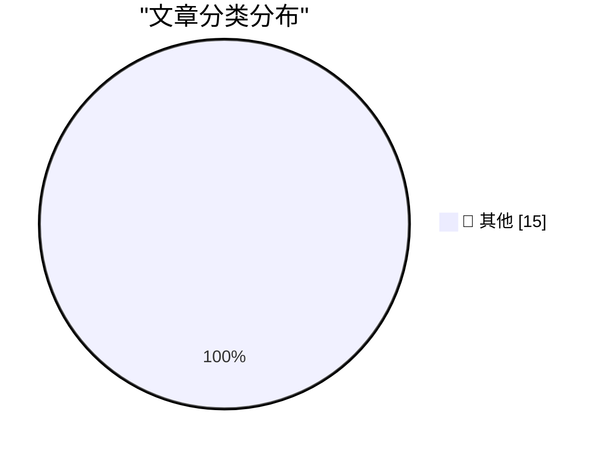

# 📰 AI 博客每日精选 — 2026-10-18

> 来自 Karpathy 推荐的 92 个顶级技术博客，AI 精选 Top 15

## 🏆 今日必读

🥇 **Quoting Addy Osmani, Morgan Westlee Lunt, and Qing Wang**

[Quoting Addy Osmani, Morgan Westlee Lunt, and Qing Wang](https://simonwillison.net/2026/Oct/16/code-review/) — simonwillison.net · 1 天前 · 📝 其他

> Quoting Addy Osmani, Morgan Westlee Lunt, and Qing Wang

🥈 **Writing is no longer proof of work**

[Writing is no longer proof of work](https://seangoedecke.com/writing-is-no-longer-proof-of-work/) — seangoedecke.com · 1 小时前 · 📝 其他

> Writing is no longer proof of work

🥉 **Whatever You Say Bounces Off Me and Sticks to You**

[Whatever You Say Bounces Off Me and Sticks to You](https://www.reuters.com/business/retail-consumer/openai-employee-who-left-apple-took-files-about-unreleased-device-openai-alleges-2026-10-14/) — daringfireball.net · 1 小时前 · 📝 其他

> Whatever You Say Bounces Off Me and Sticks to You

---

## 📊 数据概览

| 扫描源 | 抓取文章 | 时间范围 | 精选 |
|:---:|:---:|:---:|:---:|
| 81/92 | 2482 篇 → 29 篇 | 48h | **15 篇** |

### 分类分布

---

## 📝 其他

### 1. Quoting Addy Osmani, Morgan Westlee Lunt, and Qing Wang

[Quoting Addy Osmani, Morgan Westlee Lunt, and Qing Wang](https://simonwillison.net/2026/Oct/16/code-review/) — **simonwillison.net** · 1 天前 · ⭐ 15/30

> Quoting Addy Osmani, Morgan Westlee Lunt, and Qing Wang

---

### 2. Writing is no longer proof of work

[Writing is no longer proof of work](https://seangoedecke.com/writing-is-no-longer-proof-of-work/) — **seangoedecke.com** · 1 小时前 · ⭐ 15/30

> Writing is no longer proof of work

---

### 3. Whatever You Say Bounces Off Me and Sticks to You

[Whatever You Say Bounces Off Me and Sticks to You](https://www.reuters.com/business/retail-consumer/openai-employee-who-left-apple-took-files-about-unreleased-device-openai-alleges-2026-10-14/) — **daringfireball.net** · 1 小时前 · ⭐ 15/30

> Whatever You Say Bounces Off Me and Sticks to You

---

### 4. ★ HomeView Thoughts and Observations

[★ HomeView Thoughts and Observations](https://daringfireball.net/2026/10/homeview_thoughts_and_observations) — **daringfireball.net** · 8 小时前 · ⭐ 15/30

> ★ HomeView Thoughts and Observations

---

### 5. Apple TV Price History, Charted

[Apple TV Price History, Charted](https://glog.glennf.com/blog/2026/10/17/apple-tv-price-history/) — **daringfireball.net** · 11 小时前 · ⭐ 15/30

> Apple TV Price History, Charted

---

### 6. The Late Charlie Munger on Elon Musk and Tesla

[The Late Charlie Munger on Elon Musk and Tesla](https://www.cnbc.com/make-it/2020/02/14/charlie-munger-shares-opinion-of-tesla-ceo-elon-musk.html) — **daringfireball.net** · 1 天前 · ⭐ 15/30

> The Late Charlie Munger on Elon Musk and Tesla

---

### 7. Apple: ‘Strengthening App Review Guidelines Against Nonconsensual Intimate Imagery and Bait-And-Switch Apps’

[Apple: ‘Strengthening App Review Guidelines Against Nonconsensual Intimate Imagery and Bait-And-Switch Apps’](https://developer.apple.com/news/?id=vvzx6cul) — **daringfireball.net** · 1 天前 · ⭐ 15/30

> Apple: ‘Strengthening App Review Guidelines Against Nonconsensual Intimate Imagery and Bait-And-Switch Apps’

---

### 8. Apple TV Started at $69 in 2015

[Apple TV Started at $69 in 2015](https://www.macrumors.com/2015/03/09/tim-cook-apple-tv-now-costs-69/) — **daringfireball.net** · 1 天前 · ⭐ 15/30

> Apple TV Started at $69 in 2015

---

### 9. Strange Times Make for Strange Bedfellows

[Strange Times Make for Strange Bedfellows](https://x.com/finkd/status/2110778025629347999) — **daringfireball.net** · 1 天前 · ⭐ 15/30

> Strange Times Make for Strange Bedfellows

---

### 10. How They Got Duo Support in NetNewsWire

[How They Got Duo Support in NetNewsWire](https://netnewswire.blog/2026/10/16/how-we-got-duo-support.html) — **daringfireball.net** · 1 天前 · ⭐ 15/30

> How They Got Duo Support in NetNewsWire

---

### 11. ★ Real Artists Ship, Tesla Edition

[★ Real Artists Ship, Tesla Edition](https://daringfireball.net/2026/10/real_artists_ship_tesla_edition) — **daringfireball.net** · 1 天前 · ⭐ 15/30

> ★ Real Artists Ship, Tesla Edition

---

### 12. Shyam Sankar, CTO of Palantir, Says AI Researchers Have Started Smoking Because They’re Convinced AI (Claude, Probably) Is Going to Cure Cancer

[Shyam Sankar, CTO of Palantir, Says AI Researchers Have Started Smoking Because They’re Convinced AI (Claude, Probably) Is Going to Cure Cancer](https://www.cbsnews.com/news/shyam-sankar-chief-technology-officer-palantir-face-the-nation-transcript-10-11-2026/) — **daringfireball.net** · 1 天前 · ⭐ 15/30

> Shyam Sankar, CTO of Palantir, Says AI Researchers Have Started Smoking Because They’re Convinced AI (Claude, Probably) Is Going to Cure Cancer

---

### 13. iPhone Duo Pre-Orders Launched, and Three Hours Later It’s Sold Out Through the End of January

[iPhone Duo Pre-Orders Launched, and Three Hours Later It’s Sold Out Through the End of January](https://www.macrumors.com/2026/10/16/iphone-duo-sold-out-for-christmas/) — **daringfireball.net** · 1 天前 · ⭐ 15/30

> iPhone Duo Pre-Orders Launched, and Three Hours Later It’s Sold Out Through the End of January

---

### 14. This video is 2 minutes long

[This video is 2 minutes long](https://idiallo.com/byte-size/two-minutes-long-video) — **idiallo.com** · 1 天前 · ⭐ 15/30

> This video is 2 minutes long

---

### 15. Pluralistic: Israeli ad-tech company was a delivery system for "mercenary spyware" (17 Oct 2026)

[Pluralistic: Israeli ad-tech company was a delivery system for "mercenary spyware" (17 Oct 2026)](https://pluralistic.net/2026/10/17/mercenary-spyware/) — **pluralistic.net** · 15 小时前 · ⭐ 15/30

> Pluralistic: Israeli ad-tech company was a delivery system for "mercenary spyware" (17 Oct 2026)

---

*生成于 2026-10-18 01:58 | 扫描 81 源 → 获取 2482 篇 → 精选 15 篇*
*基于 [Hacker News Popularity Contest 2025](https://refactoringenglish.com/tools/hn-popularity/) RSS 源列表，由 [Andrej Karpathy](https://x.com/karpathy) 推荐*
*由「懂点儿AI」制作，欢迎关注同名微信公众号获取更多 AI 实用技巧 💡*
