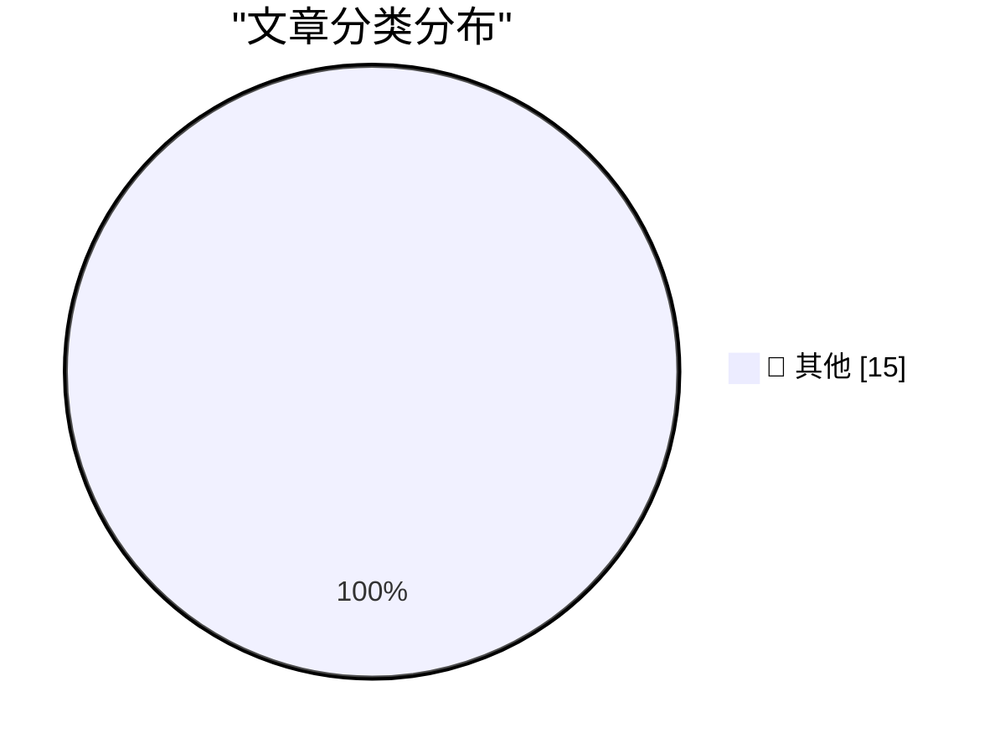

# 📰 AI 博客每日精选 — 2026-10-20

> 来自 Karpathy 推荐的 92 个顶级技术博客，AI 精选 Top 15

## 🏆 今日必读

🥇 **My obituary for programming**

[My obituary for programming](https://simonwillison.net/2026/Oct/19/my-obituary-for-programming/) — simonwillison.net · 2 小时前 · 📝 其他

> My obituary for programming

🥈 **llm-tools-datasette 0.1.1**

[llm-tools-datasette 0.1.1](https://simonwillison.net/2026/Oct/18/llm-tools-datasette/) — simonwillison.net · 1 天前 · 📝 其他

> llm-tools-datasette 0.1.1

🥉 **llm-echo 0.5**

[llm-echo 0.5](https://simonwillison.net/2026/Oct/18/llm-echo/) — simonwillison.net · 1 天前 · 📝 其他

> llm-echo 0.5

---

## 📊 数据概览

| 扫描源 | 抓取文章 | 时间范围 | 精选 |
|:---:|:---:|:---:|:---:|
| 81/92 | 2482 篇 → 31 篇 | 48h | **15 篇** |

### 分类分布

---

## 📝 其他

### 1. My obituary for programming

[My obituary for programming](https://simonwillison.net/2026/Oct/19/my-obituary-for-programming/) — **simonwillison.net** · 2 小时前 · ⭐ 15/30

> My obituary for programming

---

### 2. llm-tools-datasette 0.1.1

[llm-tools-datasette 0.1.1](https://simonwillison.net/2026/Oct/18/llm-tools-datasette/) — **simonwillison.net** · 1 天前 · ⭐ 15/30

> llm-tools-datasette 0.1.1

---

### 3. llm-echo 0.5

[llm-echo 0.5](https://simonwillison.net/2026/Oct/18/llm-echo/) — **simonwillison.net** · 1 天前 · ⭐ 15/30

> llm-echo 0.5

---

### 4. Laypeople support technical fields for technology, not art

[Laypeople support technical fields for technology, not art](https://seangoedecke.com/laypeople-support-technical-fields-for-technology-not-art/) — **seangoedecke.com** · 2 小时前 · ⭐ 15/30

> Laypeople support technical fields for technology, not art

---

### 5. What requirements don't you have?

[What requirements don't you have?](https://seangoedecke.com/what-requirements-dont-you-have/) — **seangoedecke.com** · 1 天前 · ⭐ 15/30

> What requirements don't you have?

---

### 6. Feds Suspect Ransom Negotiator Ran ShinyHunters Extortion Site

[Feds Suspect Ransom Negotiator Ran ShinyHunters Extortion Site](https://krebsonsecurity.com/2026/10/feds-suspect-ransom-negotiator-ran-shinyhunters-extortion-site/) — **krebsonsecurity.com** · 12 小时前 · ⭐ 15/30

> Feds Suspect Ransom Negotiator Ran ShinyHunters Extortion Site

---

### 7. Barack Obama on the Trump Administration’s Intimidation Campaign Against Congresswoman Ilhan Omar

[Barack Obama on the Trump Administration’s Intimidation Campaign Against Congresswoman Ilhan Omar](https://x.com/BarackObama/status/2111819687524774170) — **daringfireball.net** · 1 小时前 · ⭐ 15/30

> Barack Obama on the Trump Administration’s Intimidation Campaign Against Congresswoman Ilhan Omar

---

### 8. From the DF Archive: Should a CEO Be a Nerd About Their Company’s Products?

[From the DF Archive: Should a CEO Be a Nerd About Their Company’s Products?](https://daringfireball.net/linked/2022/10/11/ceos-as-nerds) — **daringfireball.net** · 3 小时前 · ⭐ 15/30

> From the DF Archive: Should a CEO Be a Nerd About Their Company’s Products?

---

### 9. Apple Event, in Los Angeles, Next Week: ‘Pro and Tell’

[Apple Event, in Los Angeles, Next Week: ‘Pro and Tell’](https://x.com/gregjoz/status/2112212372182249831) — **daringfireball.net** · 4 小时前 · ⭐ 15/30

> Apple Event, in Los Angeles, Next Week: ‘Pro and Tell’

---

### 10. ★ Estimated Arrival Dates for DF Readers’ Pre-Ordered iPhone Duos

[★ Estimated Arrival Dates for DF Readers’ Pre-Ordered iPhone Duos](https://daringfireball.net/2026/10/estimated_arrival_dates_for_preordered_iphone_duos) — **daringfireball.net** · 4 小时前 · ⭐ 15/30

> ★ Estimated Arrival Dates for DF Readers’ Pre-Ordered iPhone Duos

---

### 11. Netflix Shitcanned Film Chief Dan Lin Too

[Netflix Shitcanned Film Chief Dan Lin Too](https://deadline.com/2026/10/netflix-dan-lin-out-1237167562/) — **daringfireball.net** · 5 小时前 · ⭐ 15/30

> Netflix Shitcanned Film Chief Dan Lin Too

---

### 12. Ex-Apple Employee Fred Potter on HomeView

[Ex-Apple Employee Fred Potter on HomeView](https://www.linkedin.com/posts/frpotter_tonight-im-looking-back-through-the-photo-share-7515791565718454272-ue-R/) — **daringfireball.net** · 8 小时前 · ⭐ 15/30

> Ex-Apple Employee Fred Potter on HomeView

---

### 13. Netflix Lays Off 6 Percent of Staff

[Netflix Lays Off 6 Percent of Staff](https://www.wsj.com/business/media/netflix-eliminates-about-6-of-staff-in-biggest-cuts-since-2022-0a2d8ec3?st=NtEg5v&amp;reflink=desktopwebshare_permalink) — **daringfireball.net** · 9 小时前 · ⭐ 15/30

> Netflix Lays Off 6 Percent of Staff

---

### 14. Time Magazine Profiles John Ternus

[Time Magazine Profiles John Ternus](https://time.com/collection/best-inventions/2026/apple-iphone-duo/) — **daringfireball.net** · 10 小时前 · ⭐ 15/30

> Time Magazine Profiles John Ternus

---

### 15. Tom the Dancing Bug’s Inner Hive, and Harvey Richards, the Greatest Lawyer in the History of Fiction

[Tom the Dancing Bug’s Inner Hive, and Harvey Richards, the Greatest Lawyer in the History of Fiction](https://tomthedancingbug.com/the-inner-hive/) — **daringfireball.net** · 1 天前 · ⭐ 15/30

> Tom the Dancing Bug’s Inner Hive, and Harvey Richards, the Greatest Lawyer in the History of Fiction

---

*生成于 2026-10-20 02:30 | 扫描 81 源 → 获取 2482 篇 → 精选 15 篇*
*基于 [Hacker News Popularity Contest 2025](https://refactoringenglish.com/tools/hn-popularity/) RSS 源列表，由 [Andrej Karpathy](https://x.com/karpathy) 推荐*
*由「懂点儿AI」制作，欢迎关注同名微信公众号获取更多 AI 实用技巧 💡*
