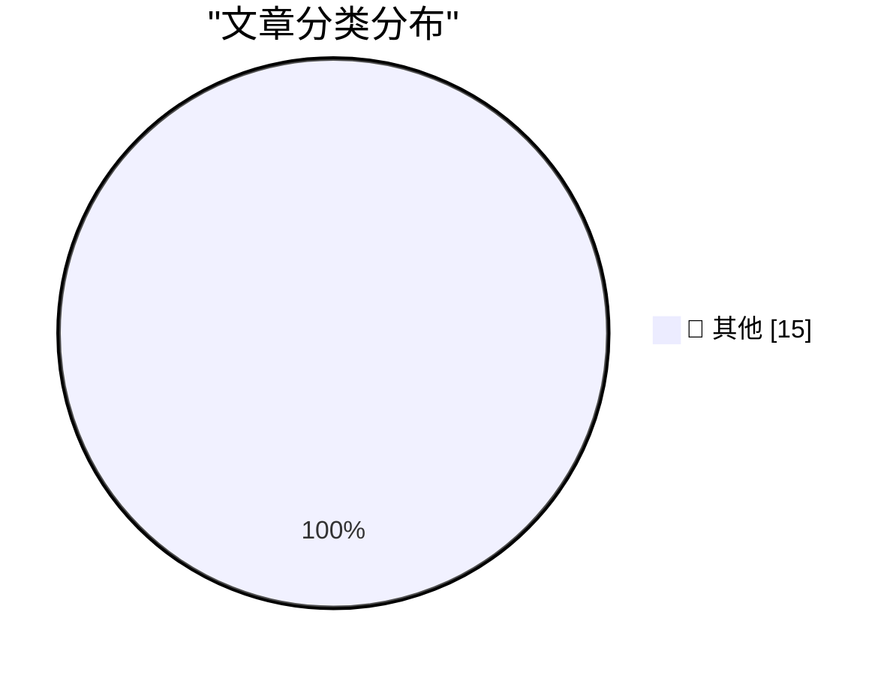

# 📰 AI 博客每日精选 — 2026-10-24

> 来自 Karpathy 推荐的 92 个顶级技术博客，AI 精选 Top 15

## 🏆 今日必读

🥇 **Quick Study**

[Quick Study](https://simonwillison.net/2026/Oct/23/quick-study-painter/) — simonwillison.net · 4 小时前 · 📝 其他

> Quick Study

🥈 **Introducing Kimi K3.1 Pro**

[Introducing Kimi K3.1 Pro](https://simonwillison.net/2026/Oct/23/kimi-k31-pro/) — simonwillison.net · 6 小时前 · 📝 其他

> Introducing Kimi K3.1 Pro

🥉 **DE STAAT - FREEDOM (Official Music Video)**

[DE STAAT - FREEDOM (Official Music Video)](https://simonwillison.net/2026/Oct/22/de-staat-freedom/) — simonwillison.net · 1 天前 · 📝 其他

> DE STAAT - FREEDOM (Official Music Video)

---

## 📊 数据概览

| 扫描源 | 抓取文章 | 时间范围 | 精选 |
|:---:|:---:|:---:|:---:|
| 84/92 | 2564 篇 → 31 篇 | 48h | **15 篇** |

### 分类分布

---

## 📝 其他

### 1. Quick Study

[Quick Study](https://simonwillison.net/2026/Oct/23/quick-study-painter/) — **simonwillison.net** · 4 小时前 · ⭐ 15/30

> Quick Study

---

### 2. Introducing Kimi K3.1 Pro

[Introducing Kimi K3.1 Pro](https://simonwillison.net/2026/Oct/23/kimi-k31-pro/) — **simonwillison.net** · 6 小时前 · ⭐ 15/30

> Introducing Kimi K3.1 Pro

---

### 3. DE STAAT - FREEDOM (Official Music Video)

[DE STAAT - FREEDOM (Official Music Video)](https://simonwillison.net/2026/Oct/22/de-staat-freedom/) — **simonwillison.net** · 1 天前 · ⭐ 15/30

> DE STAAT - FREEDOM (Official Music Video)

---

### 4. Donating Agent Skills to the Agentic AI Foundation

[Donating Agent Skills to the Agentic AI Foundation](https://simonwillison.net/2026/Oct/22/donating-agent-skills/) — **simonwillison.net** · 1 天前 · ⭐ 15/30

> Donating Agent Skills to the Agentic AI Foundation

---

### 5. Quoting Armin Ronacher

[Quoting Armin Ronacher](https://simonwillison.net/2026/Oct/22/armin-ronacher/) — **simonwillison.net** · 1 天前 · ⭐ 15/30

> Quoting Armin Ronacher

---

### 6. Ubiquiti's $99 Vape Detector is actually pretty good

[Ubiquiti's $99 Vape Detector is actually pretty good](https://www.jeffgeerling.com/blog/2026/ubiquiti-vape-detector-teardown/) — **jeffgeerling.com** · 13 小时前 · ⭐ 15/30

> Ubiquiti's $99 Vape Detector is actually pretty good

---

### 7. Software is slow because of bad design, not slow languages

[Software is slow because of bad design, not slow languages](https://seangoedecke.com/software-is-slow-because-of-bad-design-not-slow-languages/) — **seangoedecke.com** · 1 天前 · ⭐ 15/30

> Software is slow because of bad design, not slow languages

---

### 8. The Verge’s Duo Review: ‘Apple’s Folding Phone Is a Messy, Expensive Good Time’

[The Verge’s Duo Review: ‘Apple’s Folding Phone Is a Messy, Expensive Good Time’](https://www.theverge.com/tech/1015028/iphone-duo-review) — **daringfireball.net** · 9 小时前 · ⭐ 15/30

> The Verge’s Duo Review: ‘Apple’s Folding Phone Is a Messy, Expensive Good Time’

---

### 9. Joanna Stern Reviews the Duo: ‘The Good, the Bad, and the Buggy’

[Joanna Stern Reviews the Duo: ‘The Good, the Bad, and the Buggy’](https://www.youtube.com/watch?v=bxDTWuL9GxY) — **daringfireball.net** · 11 小时前 · ⭐ 15/30

> Joanna Stern Reviews the Duo: ‘The Good, the Bad, and the Buggy’

---

### 10. Apple Highlights 50+ iPhone Apps That Have Already Been Optimized for the Duo

[Apple Highlights 50+ iPhone Apps That Have Already Been Optimized for the Duo](https://www.apple.com/newsroom/2026/10/developers-bring-incredible-new-app-experiences-to-iphone-duo/) — **daringfireball.net** · 1 天前 · ⭐ 15/30

> Apple Highlights 50+ iPhone Apps That Have Already Been Optimized for the Duo

---

### 11. Updates to My iPhone Duo Review

[Updates to My iPhone Duo Review](https://daringfireball.net/2026/10/the_iphone_duo) — **daringfireball.net** · 1 天前 · ⭐ 15/30

> Updates to My iPhone Duo Review

---

### 12. Productivity

[Productivity](https://idiallo.com/byte-size/productivity-video) — **idiallo.com** · 1 天前 · ⭐ 15/30

> Productivity

---

### 13. Pluralistic: Critique and writing (23 Oct 2026)

[Pluralistic: Critique and writing (23 Oct 2026)](https://pluralistic.net/2026/10/23/better-to-give/) — **pluralistic.net** · 5 小时前 · ⭐ 15/30

> Pluralistic: Critique and writing (23 Oct 2026)

---

### 14. More phishing messages via Booking.com and Novotel

[More phishing messages via Booking.com and Novotel](https://shkspr.mobi/blog/2026/10/more-phishing-messages-via-booking-com-and-novotel/) — **shkspr.mobi** · 14 小时前 · ⭐ 15/30

> More phishing messages via Booking.com and Novotel

---

### 15. Gadget Review: Mokin 17 Port USB-C Tower ★★☆☆☆

[Gadget Review: Mokin 17 Port USB-C Tower ★★☆☆☆](https://shkspr.mobi/blog/2026/10/gadget-review-mokin-17-port-usb-c-tower/) — **shkspr.mobi** · 1 天前 · ⭐ 15/30

> Gadget Review: Mokin 17 Port USB-C Tower ★★☆☆☆

---

*生成于 2026-10-24 02:22 | 扫描 84 源 → 获取 2564 篇 → 精选 15 篇*
*基于 [Hacker News Popularity Contest 2025](https://refactoringenglish.com/tools/hn-popularity/) RSS 源列表，由 [Andrej Karpathy](https://x.com/karpathy) 推荐*
*由「懂点儿AI」制作，欢迎关注同名微信公众号获取更多 AI 实用技巧 💡*
