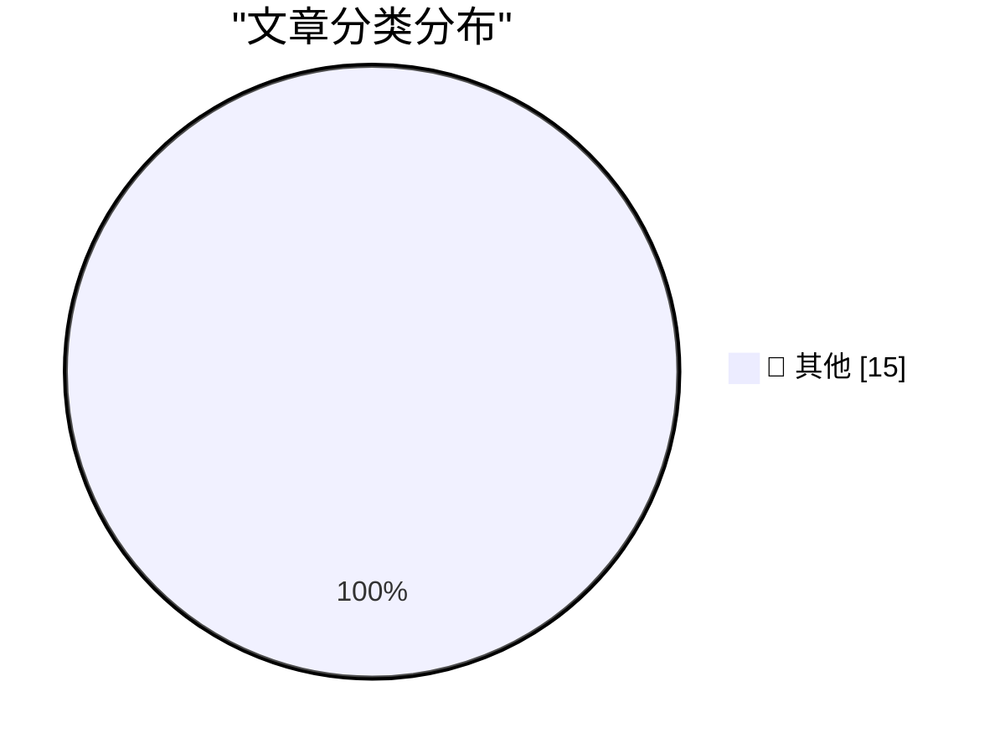

# 📰 AI 博客每日精选 — 2026-10-25

> 来自 Karpathy 推荐的 92 个顶级技术博客，AI 精选 Top 15

## 🏆 今日必读

🥇 **battledrones v14: Compass Rose, a four player map**

[battledrones v14: Compass Rose, a four player map](https://simonwillison.net/2026/Oct/24/battledrones/) — simonwillison.net · 22 小时前 · 📝 其他

> battledrones v14: Compass Rose, a four player map

🥈 **Quick Study**

[Quick Study](https://simonwillison.net/2026/Oct/23/quick-study-painter/) — simonwillison.net · 1 天前 · 📝 其他

> Quick Study

🥉 **Introducing Kimi K3.1 Pro**

[Introducing Kimi K3.1 Pro](https://simonwillison.net/2026/Oct/23/kimi-k31-pro/) — simonwillison.net · 1 天前 · 📝 其他

> Introducing Kimi K3.1 Pro

---

## 📊 数据概览

| 扫描源 | 抓取文章 | 时间范围 | 精选 |
|:---:|:---:|:---:|:---:|
| 84/92 | 2566 篇 → 33 篇 | 48h | **15 篇** |

### 分类分布

---

## 📝 其他

### 1. battledrones v14: Compass Rose, a four player map

[battledrones v14: Compass Rose, a four player map](https://simonwillison.net/2026/Oct/24/battledrones/) — **simonwillison.net** · 22 小时前 · ⭐ 15/30

> battledrones v14: Compass Rose, a four player map

---

### 2. Quick Study

[Quick Study](https://simonwillison.net/2026/Oct/23/quick-study-painter/) — **simonwillison.net** · 1 天前 · ⭐ 15/30

> Quick Study

---

### 3. Introducing Kimi K3.1 Pro

[Introducing Kimi K3.1 Pro](https://simonwillison.net/2026/Oct/23/kimi-k31-pro/) — **simonwillison.net** · 1 天前 · ⭐ 15/30

> Introducing Kimi K3.1 Pro

---

### 4. Ubiquiti's $99 Vape Detector is actually pretty good

[Ubiquiti's $99 Vape Detector is actually pretty good](https://www.jeffgeerling.com/blog/2026/ubiquiti-vape-detector-teardown/) — **jeffgeerling.com** · 1 天前 · ⭐ 15/30

> Ubiquiti's $99 Vape Detector is actually pretty good

---

### 5. Don't anthropomorphize big tech companies

[Don't anthropomorphize big tech companies](https://seangoedecke.com/dont-anthropomorphize-big-tech-companies/) — **seangoedecke.com** · 2 小时前 · ⭐ 15/30

> Don't anthropomorphize big tech companies

---

### 6. Nicole Nguyen’s Duo Review for the WSJ

[Nicole Nguyen’s Duo Review for the WSJ](https://www.wsj.com/tech/personal-tech/iphone-duo-review-cafcbbe7?st=GaYVMf) — **daringfireball.net** · 3 小时前 · ⭐ 15/30

> Nicole Nguyen’s Duo Review for the WSJ

---

### 7. Reuters and the WSJ on the Duo Launch

[Reuters and the WSJ on the Duo Launch](https://www.reuters.com/business/retail-consumer/apple-bets-iphone-duo-can-remake-foldable-market-sales-begin-2026-10-22/) — **daringfireball.net** · 4 小时前 · ⭐ 15/30

> Reuters and the WSJ on the Duo Launch

---

### 8. Marion Barry Meets the iPhone Duo

[Marion Barry Meets the iPhone Duo](https://www.theverge.com/tech/1017623/iphone-duo-broken-cracked-screen) — **daringfireball.net** · 4 小时前 · ⭐ 15/30

> Marion Barry Meets the iPhone Duo

---

### 9. MKBHD’s Duo Review

[MKBHD’s Duo Review](https://youtu.be/ESABTN4VtrA) — **daringfireball.net** · 5 小时前 · ⭐ 15/30

> MKBHD’s Duo Review

---

### 10. Tim Pan’s iPhone Duo Review

[Tim Pan’s iPhone Duo Review](https://www.youtube.com/watch?v=8pCccpKjjos) — **daringfireball.net** · 6 小时前 · ⭐ 15/30

> Tim Pan’s iPhone Duo Review

---

### 11. Apple Built a Photo-Realistic Functional Original iPod for Apple Music’s 404 Page

[Apple Built a Photo-Realistic Functional Original iPod for Apple Music’s 404 Page](https://music.apple.com/404) — **daringfireball.net** · 10 小时前 · ⭐ 15/30

> Apple Built a Photo-Realistic Functional Original iPod for Apple Music’s 404 Page

---

### 12. Chan Karunamuni on the Duo’s Open/Close Translucent Transition

[Chan Karunamuni on the Duo’s Open/Close Translucent Transition](https://x.com/chan_k/status/2113622379050246243) — **daringfireball.net** · 11 小时前 · ⭐ 15/30

> Chan Karunamuni on the Duo’s Open/Close Translucent Transition

---

### 13. The Verge’s Duo Review: ‘Apple’s Folding Phone Is a Messy, Expensive Good Time’

[The Verge’s Duo Review: ‘Apple’s Folding Phone Is a Messy, Expensive Good Time’](https://www.theverge.com/tech/1015028/iphone-duo-review) — **daringfireball.net** · 1 天前 · ⭐ 15/30

> The Verge’s Duo Review: ‘Apple’s Folding Phone Is a Messy, Expensive Good Time’

---

### 14. Joanna Stern Reviews the Duo: ‘The Good, the Bad, and the Buggy’

[Joanna Stern Reviews the Duo: ‘The Good, the Bad, and the Buggy’](https://www.youtube.com/watch?v=bxDTWuL9GxY) — **daringfireball.net** · 1 天前 · ⭐ 15/30

> Joanna Stern Reviews the Duo: ‘The Good, the Bad, and the Buggy’

---

### 15. Pluralistic: Critique and writing (23 Oct 2026)

[Pluralistic: Critique and writing (23 Oct 2026)](https://pluralistic.net/2026/10/23/better-to-give/) — **pluralistic.net** · 1 天前 · ⭐ 15/30

> Pluralistic: Critique and writing (23 Oct 2026)

---

*生成于 2026-10-25 02:09 | 扫描 84 源 → 获取 2566 篇 → 精选 15 篇*
*基于 [Hacker News Popularity Contest 2025](https://refactoringenglish.com/tools/hn-popularity/) RSS 源列表，由 [Andrej Karpathy](https://x.com/karpathy) 推荐*
*由「懂点儿AI」制作，欢迎关注同名微信公众号获取更多 AI 实用技巧 💡*
