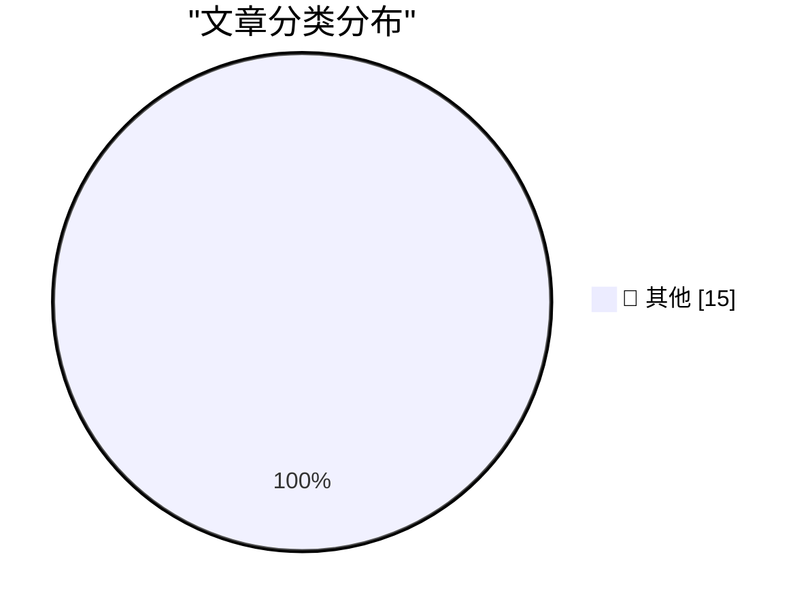

# 📰 AI 博客每日精选 — 2026-10-27

> 来自 Karpathy 推荐的 92 个顶级技术博客，AI 精选 Top 15

## 🏆 今日必读

🥇 **GPT-6.1 Terra**

[GPT-6.1 Terra](https://simonwillison.net/2026/Oct/26/gpt-61-terra/) — simonwillison.net · 2 小时前 · 📝 其他

> GPT-6.1 Terra

🥈 **Quoting Jason Koebler**

[Quoting Jason Koebler](https://simonwillison.net/2026/Oct/26/jason-koebler/) — simonwillison.net · 7 小时前 · 📝 其他

> Quoting Jason Koebler

🥉 **webframe: evaluated as a scraper and a sandbox**

[webframe: evaluated as a scraper and a sandbox](https://simonwillison.net/2026/Oct/26/webframe-evaluation/) — simonwillison.net · 10 小时前 · 📝 其他

> webframe: evaluated as a scraper and a sandbox

---

## 📊 数据概览

| 扫描源 | 抓取文章 | 时间范围 | 精选 |
|:---:|:---:|:---:|:---:|
| 83/92 | 2539 篇 → 28 篇 | 48h | **15 篇** |

### 分类分布

---

## 📝 其他

### 1. GPT-6.1 Terra

[GPT-6.1 Terra](https://simonwillison.net/2026/Oct/26/gpt-61-terra/) — **simonwillison.net** · 2 小时前 · ⭐ 15/30

> GPT-6.1 Terra

---

### 2. Quoting Jason Koebler

[Quoting Jason Koebler](https://simonwillison.net/2026/Oct/26/jason-koebler/) — **simonwillison.net** · 7 小时前 · ⭐ 15/30

> Quoting Jason Koebler

---

### 3. webframe: evaluated as a scraper and a sandbox

[webframe: evaluated as a scraper and a sandbox](https://simonwillison.net/2026/Oct/26/webframe-evaluation/) — **simonwillison.net** · 10 小时前 · ⭐ 15/30

> webframe: evaluated as a scraper and a sandbox

---

### 4. Seam Cutter

[Seam Cutter](https://simonwillison.net/2026/Oct/25/seam-cutter/) — **simonwillison.net** · 1 天前 · ⭐ 15/30

> Seam Cutter

---

### 5. The NYT Seemingly Does Marissa Mayer Dirty

[The NYT Seemingly Does Marissa Mayer Dirty](https://www.nytimes.com/2026/10/25/style/marissa-mayer-ai-assistants-women.html?unlocked_article_code=1.L1E.xBwx.X_EjBGNsRNqr) — **daringfireball.net** · 2 小时前 · ⭐ 15/30

> The NYT Seemingly Does Marissa Mayer Dirty

---

### 6. Apple Issues Statement on iPhone Duo’s Crack Problem

[Apple Issues Statement on iPhone Duo’s Crack Problem](https://9to5mac.com/2026/10/26/apple-responds-to-reports-of-iphone-duos-inner-display-cracking/) — **daringfireball.net** · 2 小时前 · ⭐ 15/30

> Apple Issues Statement on iPhone Duo’s Crack Problem

---

### 7. Glenn Fleishman on Apple Notes and Markdown

[Glenn Fleishman on Apple Notes and Markdown](https://sixcolors.com/post/2026/10/why-notes-will-never-let-us-edit-markdown/) — **daringfireball.net** · 6 小时前 · ⭐ 15/30

> Glenn Fleishman on Apple Notes and Markdown

---

### 8. ★ Apple Announces New A20 Pro iPad Mini

[★ Apple Announces New A20 Pro iPad Mini](https://daringfireball.net/2026/10/apple_announces_new_a20_pro_ipad_mini) — **daringfireball.net** · 8 小时前 · ⭐ 15/30

> ★ Apple Announces New A20 Pro iPad Mini

---

### 9. A Simple Two-Step Shortcuts Shortcut Lets You Lock the iPhone Duo When You Close It

[A Simple Two-Step Shortcuts Shortcut Lets You Lock the iPhone Duo When You Close It](https://x.com/viticci/status/2113888099784638932) — **daringfireball.net** · 9 小时前 · ⭐ 15/30

> A Simple Two-Step Shortcuts Shortcut Lets You Lock the iPhone Duo When You Close It

---

### 10. Tiny Computers for iPhone Duo

[Tiny Computers for iPhone Duo](https://www.fountaininteractive.com/TinyComputers/) — **daringfireball.net** · 11 小时前 · ⭐ 15/30

> Tiny Computers for iPhone Duo

---

### 11. Sunnny

[Sunnny](https://sunnny.com/) — **daringfireball.net** · 1 天前 · ⭐ 15/30

> Sunnny

---

### 12. Duo Users Are Registering the Base of Their Index Finger as a Touch ID Coping Strategy

[Duo Users Are Registering the Base of Their Index Finger as a Touch ID Coping Strategy](https://www.reddit.com/r/iPhoneDuo/comments/1xehtcj/best_fingerprint_method/) — **daringfireball.net** · 1 天前 · ⭐ 15/30

> Duo Users Are Registering the Base of Their Index Finger as a Touch ID Coping Strategy

---

### 13. The Talk Show: ‘Lubricate the Inside of the Hinge’

[The Talk Show: ‘Lubricate the Inside of the Hinge’](https://daringfireball.net/thetalkshow/2026/10/25/ep-456) — **daringfireball.net** · 1 天前 · ⭐ 15/30

> The Talk Show: ‘Lubricate the Inside of the Hinge’

---

### 14. iPhone Portrait Mode, 10 Years In

[iPhone Portrait Mode, 10 Years In](https://x.com/johnnie/status/2114007844605612167) — **daringfireball.net** · 1 天前 · ⭐ 15/30

> iPhone Portrait Mode, 10 Years In

---

### 15. Pluralistic: Sovereign citizens, but for news (26 Oct 2026)

[Pluralistic: Sovereign citizens, but for news (26 Oct 2026)](https://pluralistic.net/2026/10/26/abandon-hope/) — **pluralistic.net** · 10 小时前 · ⭐ 15/30

> Pluralistic: Sovereign citizens, but for news (26 Oct 2026)

---

*生成于 2026-10-27 02:47 | 扫描 83 源 → 获取 2539 篇 → 精选 15 篇*
*基于 [Hacker News Popularity Contest 2025](https://refactoringenglish.com/tools/hn-popularity/) RSS 源列表，由 [Andrej Karpathy](https://x.com/karpathy) 推荐*
*由「懂点儿AI」制作，欢迎关注同名微信公众号获取更多 AI 实用技巧 💡*
