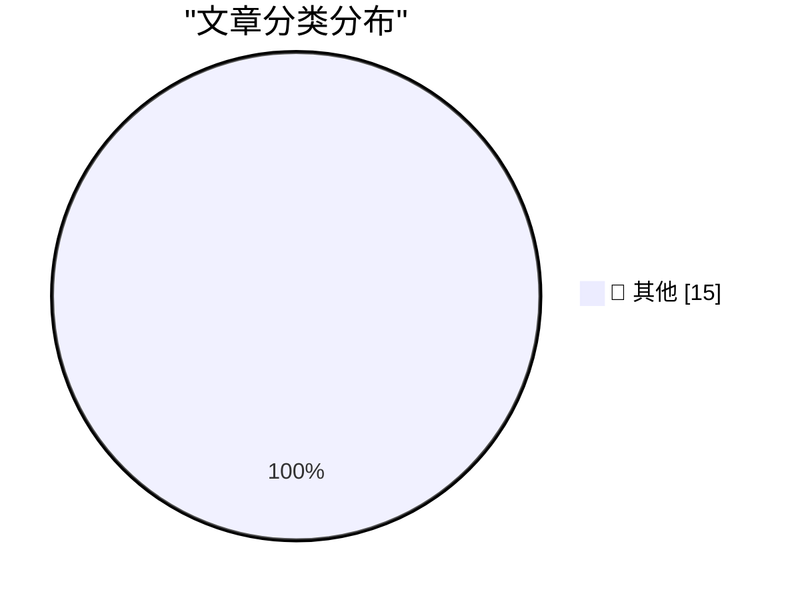

# 📰 AI 博客每日精选 — 2026-10-29

> 来自 Karpathy 推荐的 92 个顶级技术博客，AI 精选 Top 15

## 🏆 今日必读

🥇 **Quoting Ted Sanders**

[Quoting Ted Sanders](https://simonwillison.net/2026/Oct/28/ted-sanders/) — simonwillison.net · 3 小时前 · 📝 其他

> Quoting Ted Sanders

🥈 **GitHub Octoverse 2026**

[GitHub Octoverse 2026](https://simonwillison.net/2026/Oct/28/github-octoverse-2026/) — simonwillison.net · 10 小时前 · 📝 其他

> GitHub Octoverse 2026

🥉 **The October inflection point for vibe game development**

[The October inflection point for vibe game development](https://simonwillison.net/2026/Oct/28/vibe-game-development/) — simonwillison.net · 13 小时前 · 📝 其他

> The October inflection point for vibe game development

---

## 📊 数据概览

| 扫描源 | 抓取文章 | 时间范围 | 精选 |
|:---:|:---:|:---:|:---:|
| 83/92 | 2539 篇 → 34 篇 | 48h | **15 篇** |

### 分类分布

---

## 📝 其他

### 1. Quoting Ted Sanders

[Quoting Ted Sanders](https://simonwillison.net/2026/Oct/28/ted-sanders/) — **simonwillison.net** · 3 小时前 · ⭐ 15/30

> Quoting Ted Sanders

---

### 2. GitHub Octoverse 2026

[GitHub Octoverse 2026](https://simonwillison.net/2026/Oct/28/github-octoverse-2026/) — **simonwillison.net** · 10 小时前 · ⭐ 15/30

> GitHub Octoverse 2026

---

### 3. The October inflection point for vibe game development

[The October inflection point for vibe game development](https://simonwillison.net/2026/Oct/28/vibe-game-development/) — **simonwillison.net** · 13 小时前 · ⭐ 15/30

> The October inflection point for vibe game development

---

### 4. Quoting Terk Terkowitz

[Quoting Terk Terkowitz](https://simonwillison.net/2026/Oct/28/terk-terkowitz/) — **simonwillison.net** · 17 小时前 · ⭐ 15/30

> Quoting Terk Terkowitz

---

### 5. Game Boy Color on My Conference Badge

[Game Boy Color on My Conference Badge](https://simonwillison.net/2026/Oct/27/game-boy-color-on-my-conference-badge/) — **simonwillison.net** · 1 天前 · ⭐ 15/30

> Game Boy Color on My Conference Badge

---

### 6. Noctua Fan Swap on a Calnex Rb/GPS Frequency Reference

[Noctua Fan Swap on a Calnex Rb/GPS Frequency Reference](https://www.jeffgeerling.com/blog/2026/noctua-fan-swap-calnex-rb-gps-frequency-reference/) — **jeffgeerling.com** · 1 天前 · ⭐ 15/30

> Noctua Fan Swap on a Calnex Rb/GPS Frequency Reference

---

### 7. Getting good at AI takes time and practice

[Getting good at AI takes time and practice](https://seangoedecke.com/getting-good-at-ai-takes-time-and-practice/) — **seangoedecke.com** · 1 天前 · ⭐ 15/30

> Getting good at AI takes time and practice

---

### 8. Guessing the Name: MacBook Studio?

[Guessing the Name: MacBook Studio?](https://www.macrumors.com/2026/10/28/macbook-studio/) — **daringfireball.net** · 12 小时前 · ⭐ 15/30

> Guessing the Name: MacBook Studio?

---

### 9. Siri AI Expands to More Languages in OS 27.2

[Siri AI Expands to More Languages in OS 27.2](https://nr.apple.com/Du9G9W8Nq1) — **daringfireball.net** · 1 天前 · ⭐ 15/30

> Siri AI Expands to More Languages in OS 27.2

---

### 10. Apple Creator Studio Updated With a Slew of AI Features, Along With a New Open JSON File Format for Keynote

[Apple Creator Studio Updated With a Slew of AI Features, Along With a New Open JSON File Format for Keynote](https://www.apple.com/newsroom/2026/10/apple-creator-studio-adds-powerful-new-ai-features-and-even-more-creative-tools/) — **daringfireball.net** · 1 天前 · ⭐ 15/30

> Apple Creator Studio Updated With a Slew of AI Features, Along With a New Open JSON File Format for Keynote

---

### 11. ★ Prestructured WYSIWYG

[★ Prestructured WYSIWYG](https://daringfireball.net/2026/10/prestructured_wysiwyg) — **daringfireball.net** · 1 天前 · ⭐ 15/30

> ★ Prestructured WYSIWYG

---

### 12. What’s Left for ‘Pro and Tell’ Week: Touch-Enabled OLED MacBooks

[What’s Left for ‘Pro and Tell’ Week: Touch-Enabled OLED MacBooks](https://www.macrumors.com/2026/10/27/macbook-pro-with-touchscreen-tomorrow/) — **daringfireball.net** · 1 天前 · ⭐ 15/30

> What’s Left for ‘Pro and Tell’ Week: Touch-Enabled OLED MacBooks

---

### 13. Apple Also Announces iMac With M6

[Apple Also Announces iMac With M6](https://www.apple.com/newsroom/2026/10/apple-unveils-new-imac-with-m6/) — **daringfireball.net** · 1 天前 · ⭐ 15/30

> Apple Also Announces iMac With M6

---

### 14. [Sponsor] WorkOS: Let Agents Sign Up for Your App Without a Browser

[[Sponsor] WorkOS: Let Agents Sign Up for Your App Without a Browser](https://workos.com/auth-md?utm_source=daringfireball&amp;utm_medium=newsletter&amp;utm_campaign=q42026) — **daringfireball.net** · 1 天前 · ⭐ 15/30

> [Sponsor] WorkOS: Let Agents Sign Up for Your App Without a Browser

---

### 15. Apple Introduces New Base MacBook Pro With M6, 14-Inch-Only

[Apple Introduces New Base MacBook Pro With M6, 14-Inch-Only](https://www.apple.com/newsroom/2026/10/apple-introduces-the-new-14-inch-macbook-pro-with-m6/) — **daringfireball.net** · 1 天前 · ⭐ 15/30

> Apple Introduces New Base MacBook Pro With M6, 14-Inch-Only

---

*生成于 2026-10-29 03:19 | 扫描 83 源 → 获取 2539 篇 → 精选 15 篇*
*基于 [Hacker News Popularity Contest 2025](https://refactoringenglish.com/tools/hn-popularity/) RSS 源列表，由 [Andrej Karpathy](https://x.com/karpathy) 推荐*
*由「懂点儿AI」制作，欢迎关注同名微信公众号获取更多 AI 实用技巧 💡*
