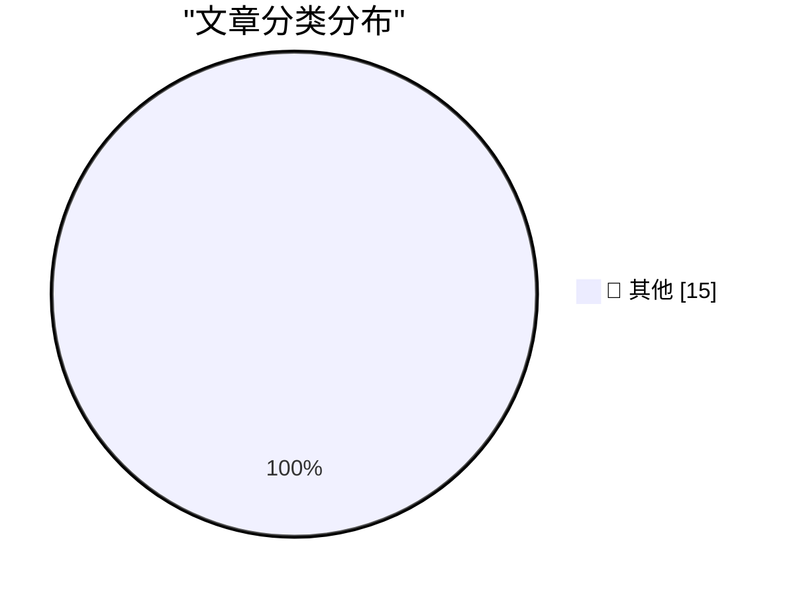

# 📰 AI 博客每日精选 — 2026-10-31

> 来自 Karpathy 推荐的 92 个顶级技术博客，AI 精选 Top 15

## 🏆 今日必读

🥇 **dbreunig/nesformer**

[dbreunig/nesformer](https://simonwillison.net/2026/Oct/30/nesformer/) — simonwillison.net · 5 小时前 · 📝 其他

> dbreunig/nesformer

🥈 **API credits benefit for eligible ChatGPT subscriptions**

[API credits benefit for eligible ChatGPT subscriptions](https://simonwillison.net/2026/Oct/29/api-credits/) — simonwillison.net · 1 天前 · 📝 其他

> API credits benefit for eligible ChatGPT subscriptions

🥉 **Building a multiplayer game world with autonomous Fable-class models**

[Building a multiplayer game world with autonomous Fable-class models](https://simonwillison.net/2026/Oct/29/how-i-built-the-most-ai-pilled-company-in-the-world/) — simonwillison.net · 1 天前 · 📝 其他

> Building a multiplayer game world with autonomous Fable-class models

---

## 📊 数据概览

| 扫描源 | 抓取文章 | 时间范围 | 精选 |
|:---:|:---:|:---:|:---:|
| 84/92 | 2565 篇 → 27 篇 | 48h | **15 篇** |

### 分类分布

---

## 📝 其他

### 1. dbreunig/nesformer

[dbreunig/nesformer](https://simonwillison.net/2026/Oct/30/nesformer/) — **simonwillison.net** · 5 小时前 · ⭐ 15/30

> dbreunig/nesformer

---

### 2. API credits benefit for eligible ChatGPT subscriptions

[API credits benefit for eligible ChatGPT subscriptions](https://simonwillison.net/2026/Oct/29/api-credits/) — **simonwillison.net** · 1 天前 · ⭐ 15/30

> API credits benefit for eligible ChatGPT subscriptions

---

### 3. Building a multiplayer game world with autonomous Fable-class models

[Building a multiplayer game world with autonomous Fable-class models](https://simonwillison.net/2026/Oct/29/how-i-built-the-most-ai-pilled-company-in-the-world/) — **simonwillison.net** · 1 天前 · ⭐ 15/30

> Building a multiplayer game world with autonomous Fable-class models

---

### 4. Quoting Ben Hylak

[Quoting Ben Hylak](https://simonwillison.net/2026/Oct/29/ben-hylak/) — **simonwillison.net** · 1 天前 · ⭐ 15/30

> Quoting Ben Hylak

---

### 5. Rejoice, leap seconds are dead!

[Rejoice, leap seconds are dead!](https://www.jeffgeerling.com/blog/2026/rejoice-the-utc-leap-second-is-dead/) — **jeffgeerling.com** · 13 小时前 · ⭐ 15/30

> Rejoice, leap seconds are dead!

---

### 6. Elegance and intelligence are anticorrelated

[Elegance and intelligence are anticorrelated](https://seangoedecke.com/elegance-and-intelligence-are-anticorrelated/) — **seangoedecke.com** · 1 天前 · ⭐ 15/30

> Elegance and intelligence are anticorrelated

---

### 7. Sponsorship Openings for Daring Fireball (Including The Talk Show)

[Sponsorship Openings for Daring Fireball (Including The Talk Show)](https://daringfireball.net/feeds/sponsors/) — **daringfireball.net** · 4 小时前 · ⭐ 15/30

> Sponsorship Openings for Daring Fireball (Including The Talk Show)

---

### 8. ★ MacBook Pro Pricing and Configurations for M6, M5 Pro, and M5 Max

[★ MacBook Pro Pricing and Configurations for M6, M5 Pro, and M5 Max](https://daringfireball.net/2026/10/macbook_pro_pricing_and_configurations_for_m6_m5_pro_and_m5_max) — **daringfireball.net** · 5 小时前 · ⭐ 15/30

> ★ MacBook Pro Pricing and Configurations for M6, M5 Pro, and M5 Max

---

### 9. The Only Good Easter Eggs Are Whole-Assed Easter Eggs

[The Only Good Easter Eggs Are Whole-Assed Easter Eggs](https://unsung.aresluna.org/apples-ipod-recreation/) — **daringfireball.net** · 9 小时前 · ⭐ 15/30

> The Only Good Easter Eggs Are Whole-Assed Easter Eggs

---

### 10. GM to Pay $220 Million After Betraying Their Own Drivers’ Privacy

[GM to Pay $220 Million After Betraying Their Own Drivers’ Privacy](https://www.reuters.com/business/autos-transportation/gm-pay-220-million-settle-allegations-it-violated-consumers-privacy-2026-10-29/) — **daringfireball.net** · 9 小时前 · ⭐ 15/30

> GM to Pay $220 Million After Betraying Their Own Drivers’ Privacy

---

### 11. Patrick Stewart Dies at 86

[Patrick Stewart Dies at 86](https://www.hollywoodreporter.com/movies/movie-news/patrick-stewart-dead-star-trek-x-men-1236742932/) — **daringfireball.net** · 10 小时前 · ⭐ 15/30

> Patrick Stewart Dies at 86

---

### 12. Apple Drops App Store Commission by a Whopping 4 Percentage Points in Taiwan

[Apple Drops App Store Commission by a Whopping 4 Percentage Points in Taiwan](https://developer.apple.com/news/?id=w9mxlhek) — **daringfireball.net** · 1 天前 · ⭐ 15/30

> Apple Drops App Store Commission by a Whopping 4 Percentage Points in Taiwan

---

### 13. A Health Update From Craig Hockenberry

[A Health Update From Craig Hockenberry](https://furbo.org/2026/10/28/a-health-update/) — **daringfireball.net** · 1 天前 · ⭐ 15/30

> A Health Update From Craig Hockenberry

---

### 14. Rolfe Winkler at The WSJ: ‘The Beleaguered Chip Sellers Getting Their Revenge on Apple’

[Rolfe Winkler at The WSJ: ‘The Beleaguered Chip Sellers Getting Their Revenge on Apple’](https://www.wsj.com/tech/apple-iphone-memory-chips-ai-c0084cc9?st=FNAyaT) — **daringfireball.net** · 1 天前 · ⭐ 15/30

> Rolfe Winkler at The WSJ: ‘The Beleaguered Chip Sellers Getting Their Revenge on Apple’

---

### 15. The Space Shuttle Discovery’s Starboard Side ‘s’ Is Upside Down

[The Space Shuttle Discovery’s Starboard Side ‘s’ Is Upside Down](https://www.theautopian.com/a-typography-geek-pointed-out-something-about-the-space-shuttle-discovery-and-now-i-cant-unsee-it/) — **daringfireball.net** · 1 天前 · ⭐ 15/30

> The Space Shuttle Discovery’s Starboard Side ‘s’ Is Upside Down

---

*生成于 2026-10-31 03:05 | 扫描 84 源 → 获取 2565 篇 → 精选 15 篇*
*基于 [Hacker News Popularity Contest 2025](https://refactoringenglish.com/tools/hn-popularity/) RSS 源列表，由 [Andrej Karpathy](https://x.com/karpathy) 推荐*
*由「懂点儿AI」制作，欢迎关注同名微信公众号获取更多 AI 实用技巧 💡*
