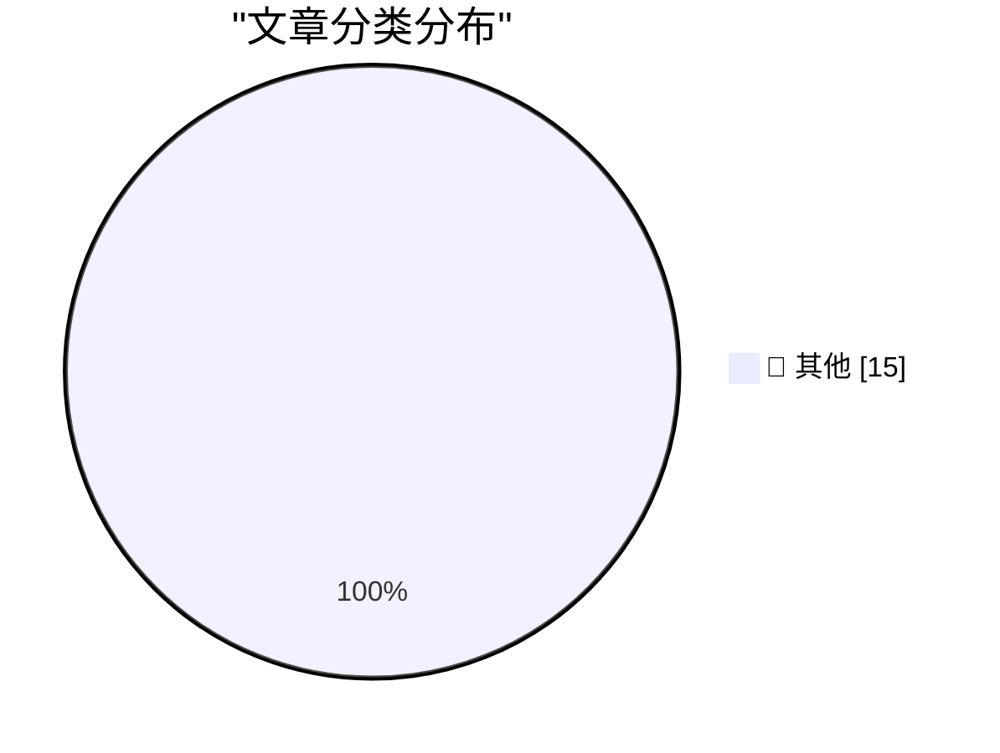

# 📰 AI 博客每日精选 — 2026-11-01

> 来自 Karpathy 推荐的 92 个顶级技术博客，AI 精选 Top 15

## 🏆 今日必读

🥇 **How We Took Over ChatGPT Accounts**

[How We Took Over ChatGPT Accounts](https://simonwillison.net/2026/Oct/31/how-we-took-over-chatgpt-accounts/) — simonwillison.net · 3 小时前 · 📝 其他

> How We Took Over ChatGPT Accounts

🥈 **datasette-llm 0.1a9**

[datasette-llm 0.1a9](https://simonwillison.net/2026/Oct/31/datasette-llm/) — simonwillison.net · 4 小时前 · 📝 其他

> datasette-llm 0.1a9

🥉 **dbreunig/nesformer**

[dbreunig/nesformer](https://simonwillison.net/2026/Oct/30/nesformer/) — simonwillison.net · 1 天前 · 📝 其他

> dbreunig/nesformer

---

## 📊 数据概览

| 扫描源 | 抓取文章 | 时间范围 | 精选 |
|:---:|:---:|:---:|:---:|
| 82/92 | 2545 篇 → 20 篇 | 48h | **15 篇** |

### 分类分布

---

## 📝 其他

### 1. How We Took Over ChatGPT Accounts

[How We Took Over ChatGPT Accounts](https://simonwillison.net/2026/Oct/31/how-we-took-over-chatgpt-accounts/) — **simonwillison.net** · 3 小时前 · ⭐ 15/30

> How We Took Over ChatGPT Accounts

---

### 2. datasette-llm 0.1a9

[datasette-llm 0.1a9](https://simonwillison.net/2026/Oct/31/datasette-llm/) — **simonwillison.net** · 4 小时前 · ⭐ 15/30

> datasette-llm 0.1a9

---

### 3. dbreunig/nesformer

[dbreunig/nesformer](https://simonwillison.net/2026/Oct/30/nesformer/) — **simonwillison.net** · 1 天前 · ⭐ 15/30

> dbreunig/nesformer

---

### 4. Rejoice, leap seconds are dead!

[Rejoice, leap seconds are dead!](https://www.jeffgeerling.com/blog/2026/rejoice-the-utc-leap-second-is-dead/) — **jeffgeerling.com** · 1 天前 · ⭐ 15/30

> Rejoice, leap seconds are dead!

---

### 5. Fast and slow ways to improve your reputation

[Fast and slow ways to improve your reputation](https://seangoedecke.com/how-to-get-assigned-interesting-work/) — **seangoedecke.com** · 3 小时前 · ⭐ 15/30

> Fast and slow ways to improve your reputation

---

### 6. Sponsorship Openings for Daring Fireball (Including The Talk Show)

[Sponsorship Openings for Daring Fireball (Including The Talk Show)](https://daringfireball.net/feeds/sponsors/) — **daringfireball.net** · 1 天前 · ⭐ 15/30

> Sponsorship Openings for Daring Fireball (Including The Talk Show)

---

### 7. ★ MacBook Pro Pricing and Configurations for M6, M5 Pro, and M5 Max

[★ MacBook Pro Pricing and Configurations for M6, M5 Pro, and M5 Max](https://daringfireball.net/2026/10/macbook_pro_pricing_and_configurations_for_m6_m5_pro_and_m5_max) — **daringfireball.net** · 1 天前 · ⭐ 15/30

> ★ MacBook Pro Pricing and Configurations for M6, M5 Pro, and M5 Max

---

### 8. The Only Good Easter Eggs Are Whole-Assed Easter Eggs

[The Only Good Easter Eggs Are Whole-Assed Easter Eggs](https://unsung.aresluna.org/apples-ipod-recreation/) — **daringfireball.net** · 1 天前 · ⭐ 15/30

> The Only Good Easter Eggs Are Whole-Assed Easter Eggs

---

### 9. GM to Pay $220 Million After Betraying Their Own Drivers’ Privacy

[GM to Pay $220 Million After Betraying Their Own Drivers’ Privacy](https://www.reuters.com/business/autos-transportation/gm-pay-220-million-settle-allegations-it-violated-consumers-privacy-2026-10-29/) — **daringfireball.net** · 1 天前 · ⭐ 15/30

> GM to Pay $220 Million After Betraying Their Own Drivers’ Privacy

---

### 10. Patrick Stewart Dies at 86

[Patrick Stewart Dies at 86](https://www.hollywoodreporter.com/movies/movie-news/patrick-stewart-dead-star-trek-x-men-1236742932/) — **daringfireball.net** · 1 天前 · ⭐ 15/30

> Patrick Stewart Dies at 86

---

### 11. College will only cost $20 a month

[College will only cost $20 a month](https://idiallo.com/blog/college-will-cost-20-dollars) — **idiallo.com** · 1 天前 · ⭐ 15/30

> College will only cost $20 a month

---

### 12. Pluralistic: Formalities (31 Oct 2026)

[Pluralistic: Formalities (31 Oct 2026)](https://pluralistic.net/2026/10/31/burn-berne/) — **pluralistic.net** · 11 小时前 · ⭐ 15/30

> Pluralistic: Formalities (31 Oct 2026)

---

### 13. The Microsoft building that was reportedly haunted

[The Microsoft building that was reportedly haunted](https://devblogs.microsoft.com/oldnewthing/20261030-00/?p=112815/) — **devblogs.microsoft.com/oldnewthing** · 1 天前 · ⭐ 15/30

> The Microsoft building that was reportedly haunted

---

### 14. Notes from October 2026

[Notes from October 2026](https://evanhahn.com/notes-from-october-2026/) — **evanhahn.com** · 21 小时前 · ⭐ 15/30

> Notes from October 2026

---

### 15. This Week in Package Management: 31 October 2026

[This Week in Package Management: 31 October 2026](https://nesbitt.io/2026/10/31/this-week-in-package-management.html) — **nesbitt.io** · 17 小时前 · ⭐ 15/30

> This Week in Package Management: 31 October 2026

---

*生成于 2026-11-01 03:01 | 扫描 82 源 → 获取 2545 篇 → 精选 15 篇*
*基于 [Hacker News Popularity Contest 2025](https://refactoringenglish.com/tools/hn-popularity/) RSS 源列表，由 [Andrej Karpathy](https://x.com/karpathy) 推荐*
*由「懂点儿AI」制作，欢迎关注同名微信公众号获取更多 AI 实用技巧 💡*
