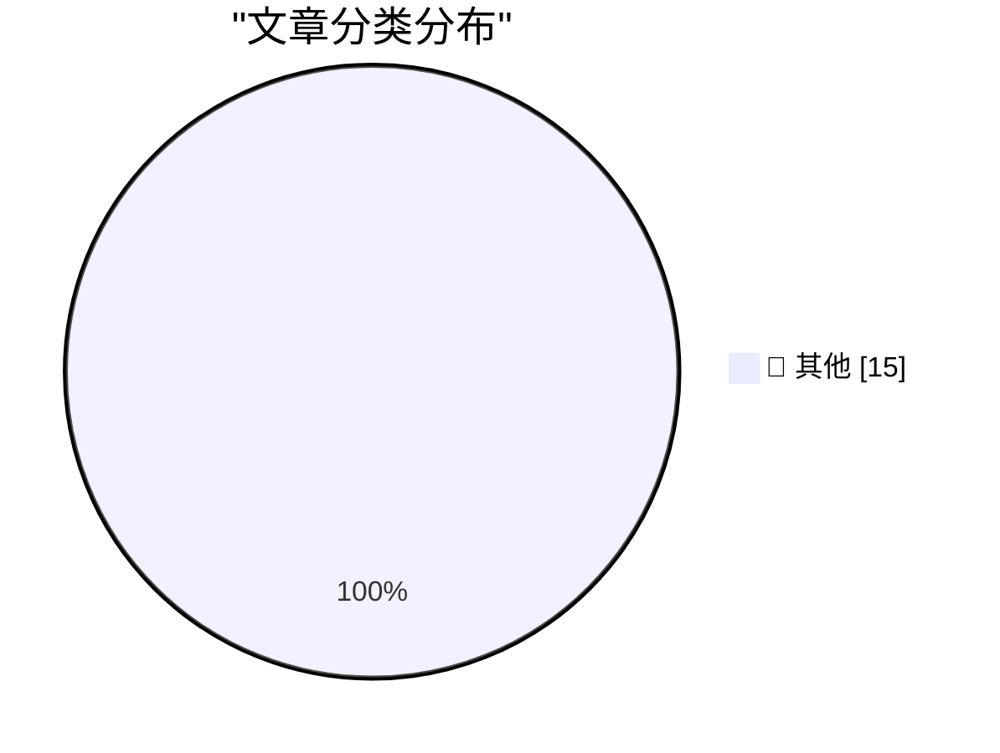

# 📰 AI 博客每日精选 — 2026-11-02

> 来自 Karpathy 推荐的 92 个顶级技术博客，AI 精选 Top 15

## 🏆 今日必读

🥇 **If in doubt, delete the uv.lock file**

[If in doubt, delete the uv.lock file](https://simonwillison.net/2026/Nov/1/delete-uv-lock-first/) — simonwillison.net · 3 小时前 · 📝 其他

> If in doubt, delete the uv.lock file

🥈 **Quoting Kyle Kingsbury**

[Quoting Kyle Kingsbury](https://simonwillison.net/2026/Nov/1/kyle-kingsbury/) — simonwillison.net · 10 小时前 · 📝 其他

> Quoting Kyle Kingsbury

🥉 **How We Took Over ChatGPT Accounts**

[How We Took Over ChatGPT Accounts](https://simonwillison.net/2026/Oct/31/how-we-took-over-chatgpt-accounts/) — simonwillison.net · 1 天前 · 📝 其他

> How We Took Over ChatGPT Accounts

---

## 📊 数据概览

| 扫描源 | 抓取文章 | 时间范围 | 精选 |
|:---:|:---:|:---:|:---:|
| 83/92 | 2571 篇 → 17 篇 | 48h | **15 篇** |

### 分类分布

---

## 📝 其他

### 1. If in doubt, delete the uv.lock file

[If in doubt, delete the uv.lock file](https://simonwillison.net/2026/Nov/1/delete-uv-lock-first/) — **simonwillison.net** · 3 小时前 · ⭐ 15/30

> If in doubt, delete the uv.lock file

---

### 2. Quoting Kyle Kingsbury

[Quoting Kyle Kingsbury](https://simonwillison.net/2026/Nov/1/kyle-kingsbury/) — **simonwillison.net** · 10 小时前 · ⭐ 15/30

> Quoting Kyle Kingsbury

---

### 3. How We Took Over ChatGPT Accounts

[How We Took Over ChatGPT Accounts](https://simonwillison.net/2026/Oct/31/how-we-took-over-chatgpt-accounts/) — **simonwillison.net** · 1 天前 · ⭐ 15/30

> How We Took Over ChatGPT Accounts

---

### 4. datasette-llm 0.1a9

[datasette-llm 0.1a9](https://simonwillison.net/2026/Oct/31/datasette-llm/) — **simonwillison.net** · 1 天前 · ⭐ 15/30

> datasette-llm 0.1a9

---

### 5. Fast and slow ways to improve your reputation

[Fast and slow ways to improve your reputation](https://seangoedecke.com/how-to-get-assigned-interesting-work/) — **seangoedecke.com** · 1 天前 · ⭐ 15/30

> Fast and slow ways to improve your reputation

---

### 6. WorkOS: Let Agents Sign Up for Your App Without a Browser

[WorkOS: Let Agents Sign Up for Your App Without a Browser](https://workos.com/auth-md?utm_source=daringfireball&amp;utm_medium=newsletter&amp;utm_campaign=q42026) — **daringfireball.net** · 6 小时前 · ⭐ 15/30

> WorkOS: Let Agents Sign Up for Your App Without a Browser

---

### 7. Pluralistic: Formalities (31 Oct 2026)

[Pluralistic: Formalities (31 Oct 2026)](https://pluralistic.net/2026/10/31/burn-berne/) — **pluralistic.net** · 1 天前 · ⭐ 15/30

> Pluralistic: Formalities (31 Oct 2026)

---

### 8. 10 Years on Mastodon

[10 Years on Mastodon](https://shkspr.mobi/blog/2026/11/10-years-on-mastodon/) — **shkspr.mobi** · 14 小时前 · ⭐ 15/30

> 10 Years on Mastodon

---

### 9. Gig Review: The Witcher in Concert ★★★★☆

[Gig Review: The Witcher in Concert ★★★★☆](https://shkspr.mobi/blog/2026/10/gig-review-the-witcher-in-concert/) — **shkspr.mobi** · 1 天前 · ⭐ 15/30

> Gig Review: The Witcher in Concert ★★★★☆

---

### 10. A unified view of poles and polars

[A unified view of poles and polars](https://www.johndcook.com/blog/2026/11/01/projective-poles-and-polars/) — **johndcook.com** · 6 小时前 · ⭐ 15/30

> A unified view of poles and polars

---

### 11. A Mastodon bot powered by iOS Shortcuts

[A Mastodon bot powered by iOS Shortcuts](https://evanhahn.com/mastodon-bot-with-ios-shortcuts/) — **evanhahn.com** · 16 小时前 · ⭐ 15/30

> A Mastodon bot powered by iOS Shortcuts

---

### 12. Notes from October 2026

[Notes from October 2026](https://evanhahn.com/notes-from-october-2026/) — **evanhahn.com** · 1 天前 · ⭐ 15/30

> Notes from October 2026

---

### 13. This Week in Package Management: 31 October 2026

[This Week in Package Management: 31 October 2026](https://nesbitt.io/2026/10/31/this-week-in-package-management.html) — **nesbitt.io** · 1 天前 · ⭐ 15/30

> This Week in Package Management: 31 October 2026

---

### 14. Reading List 10/31/26

[Reading List 10/31/26](https://www.construction-physics.com/p/reading-list-103126) — **construction-physics.com** · 1 天前 · ⭐ 15/30

> Reading List 10/31/26

---

### 15. IBM PC/XT drives stuck in the bay? How to free them

[IBM PC/XT drives stuck in the bay? How to free them](https://dfarq.homeip.net/ibm-pc-xt-drives-stuck-in-the-bay-how-to-free-them/?utm_source=rss&#038;utm_medium=rss&#038;utm_campaign=ibm-pc-xt-drives-stuck-in-the-bay-how-to-free-them) — **dfarq.homeip.net** · 15 小时前 · ⭐ 15/30

> IBM PC/XT drives stuck in the bay? How to free them

---

*生成于 2026-11-02 03:11 | 扫描 83 源 → 获取 2571 篇 → 精选 15 篇*
*基于 [Hacker News Popularity Contest 2025](https://refactoringenglish.com/tools/hn-popularity/) RSS 源列表，由 [Andrej Karpathy](https://x.com/karpathy) 推荐*
*由「懂点儿AI」制作，欢迎关注同名微信公众号获取更多 AI 实用技巧 💡*
