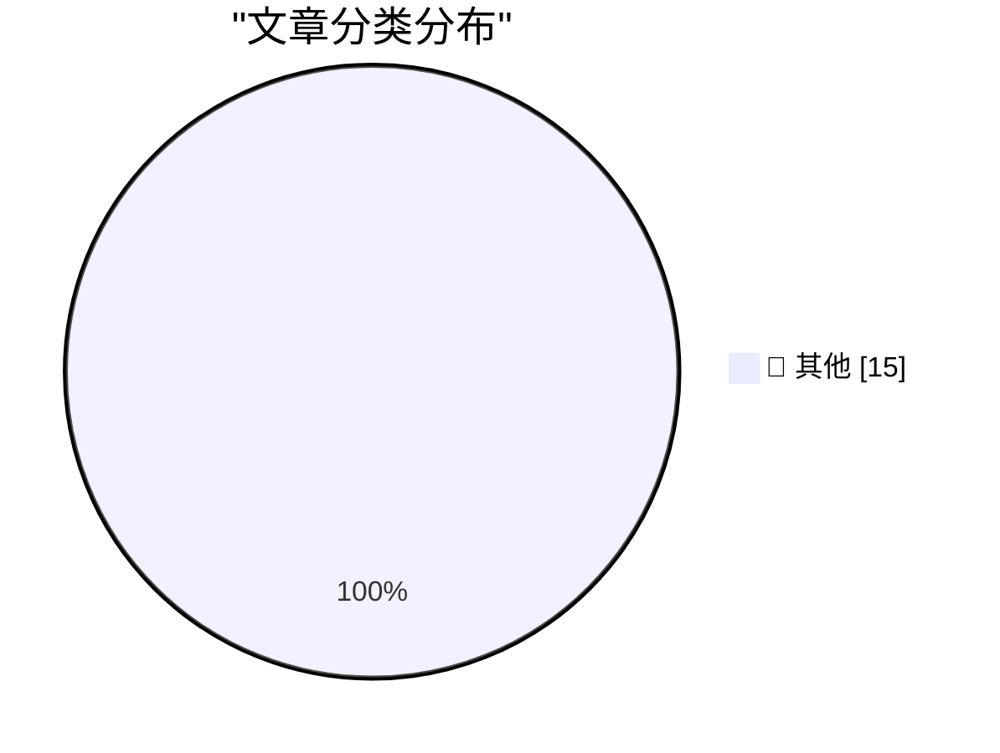

# 📰 AI 博客每日精选 — 2026-11-03

> 来自 Karpathy 推荐的 92 个顶级技术博客，AI 精选 Top 15

## 🏆 今日必读

🥇 **llm 0.37**

[llm 0.37](https://simonwillison.net/2026/Nov/2/llm/) — simonwillison.net · 4 小时前 · 📝 其他

> llm 0.37

🥈 **The U.S. Census Bureau and “Super Intelligence”**

[The U.S. Census Bureau and “Super Intelligence”](https://simonwillison.net/2026/Nov/2/census-bureau-super-intelligence/) — simonwillison.net · 14 小时前 · 📝 其他

> The U.S. Census Bureau and “Super Intelligence”

🥉 **If in doubt, delete the uv.lock file**

[If in doubt, delete the uv.lock file](https://simonwillison.net/2026/Nov/1/delete-uv-lock-first/) — simonwillison.net · 1 天前 · 📝 其他

> If in doubt, delete the uv.lock file

---

## 📊 数据概览

| 扫描源 | 抓取文章 | 时间范围 | 精选 |
|:---:|:---:|:---:|:---:|
| 83/92 | 2565 篇 → 24 篇 | 48h | **15 篇** |

### 分类分布

---

## 📝 其他

### 1. llm 0.37

[llm 0.37](https://simonwillison.net/2026/Nov/2/llm/) — **simonwillison.net** · 4 小时前 · ⭐ 15/30

> llm 0.37

---

### 2. The U.S. Census Bureau and “Super Intelligence”

[The U.S. Census Bureau and “Super Intelligence”](https://simonwillison.net/2026/Nov/2/census-bureau-super-intelligence/) — **simonwillison.net** · 14 小时前 · ⭐ 15/30

> The U.S. Census Bureau and “Super Intelligence”

---

### 3. If in doubt, delete the uv.lock file

[If in doubt, delete the uv.lock file](https://simonwillison.net/2026/Nov/1/delete-uv-lock-first/) — **simonwillison.net** · 1 天前 · ⭐ 15/30

> If in doubt, delete the uv.lock file

---

### 4. Quoting Kyle Kingsbury

[Quoting Kyle Kingsbury](https://simonwillison.net/2026/Nov/1/kyle-kingsbury/) — **simonwillison.net** · 1 天前 · ⭐ 15/30

> Quoting Kyle Kingsbury

---

### 5. LLMs are not superhuman at reading and writing neural network weights

[LLMs are not superhuman at reading and writing neural network weights](https://seangoedecke.com/llms-are-not-superhuman-at-reading-and-writing-neural-network-weights/) — **seangoedecke.com** · 4 小时前 · ⭐ 15/30

> LLMs are not superhuman at reading and writing neural network weights

---

### 6. Audience capture

[Audience capture](https://seangoedecke.com/audience-capture/) — **seangoedecke.com** · 4 小时前 · ⭐ 15/30

> Audience capture

---

### 7. Reliably aligning LLMs is impossible in principle

[Reliably aligning LLMs is impossible in principle](https://seangoedecke.com/alignment-is-impossible/) — **seangoedecke.com** · 1 天前 · ⭐ 15/30

> Reliably aligning LLMs is impossible in principle

---

### 8. Tech Firms Dismantle Botnet That Turned 1.3M TV Boxes Into Proxies

[Tech Firms Dismantle Botnet That Turned 1.3M TV Boxes Into Proxies](https://krebsonsecurity.com/2026/11/tech-firms-dismantle-botnet-that-turned-1-3m-tv-boxes-into-proxies/) — **krebsonsecurity.com** · 2 小时前 · ⭐ 15/30

> Tech Firms Dismantle Botnet That Turned 1.3M TV Boxes Into Proxies

---

### 9. Apple Announces Record $114.5B Fourth-Quarter Results

[Apple Announces Record $114.5B Fourth-Quarter Results](https://sixcolors.com/post/2026/11/apple-announces-record-114-5b-fourth-quarter-results/) — **daringfireball.net** · 4 小时前 · ⭐ 15/30

> Apple Announces Record $114.5B Fourth-Quarter Results

---

### 10. [Sponsor] OurCal

[[Sponsor] OurCal](https://ourcal.com/?utm_source=daringfireball&amp;utm_medium=sponsorship&amp;utm_content=rssitem) — **daringfireball.net** · 5 小时前 · ⭐ 15/30

> [Sponsor] OurCal

---

### 11. WorkOS: Let Agents Sign Up for Your App Without a Browser

[WorkOS: Let Agents Sign Up for Your App Without a Browser](https://workos.com/auth-md?utm_source=daringfireball&amp;utm_medium=newsletter&amp;utm_campaign=q42026) — **daringfireball.net** · 1 天前 · ⭐ 15/30

> WorkOS: Let Agents Sign Up for Your App Without a Browser

---

### 12. Prove you are not a child

[Prove you are not a child](https://idiallo.com/blog/prove-you-are-not-a-child) — **idiallo.com** · 4 小时前 · ⭐ 15/30

> Prove you are not a child

---

### 13. Pluralistic: Autodoxing (02 Nov 2026)

[Pluralistic: Autodoxing (02 Nov 2026)](https://pluralistic.net/2026/11/02/agony-verification/) — **pluralistic.net** · 20 小时前 · ⭐ 15/30

> Pluralistic: Autodoxing (02 Nov 2026)

---

### 14. Lorem Ipsum Dot Gov Dot UK

[Lorem Ipsum Dot Gov Dot UK](https://shkspr.mobi/blog/2026/11/lorem-ipsum-dot-gov-dot-uk/) — **shkspr.mobi** · 15 小时前 · ⭐ 15/30

> Lorem Ipsum Dot Gov Dot UK

---

### 15. 10 Years on Mastodon

[10 Years on Mastodon](https://shkspr.mobi/blog/2026/11/10-years-on-mastodon/) — **shkspr.mobi** · 1 天前 · ⭐ 15/30

> 10 Years on Mastodon

---

*生成于 2026-11-03 04:27 | 扫描 83 源 → 获取 2565 篇 → 精选 15 篇*
*基于 [Hacker News Popularity Contest 2025](https://refactoringenglish.com/tools/hn-popularity/) RSS 源列表，由 [Andrej Karpathy](https://x.com/karpathy) 推荐*
*由「懂点儿AI」制作，欢迎关注同名微信公众号获取更多 AI 实用技巧 💡*
