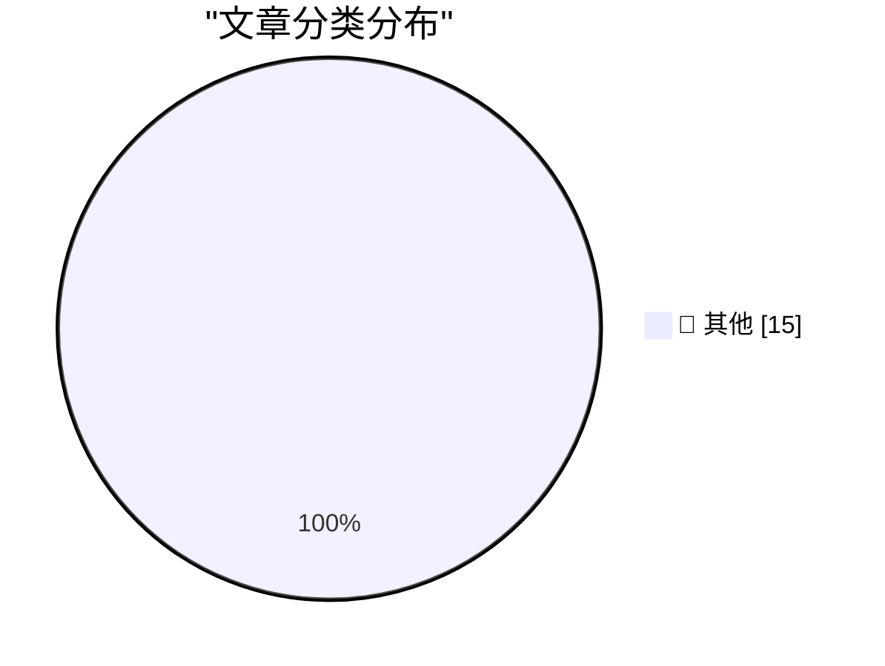

# 📰 AI 博客每日精选 — 2026-11-04

> 来自 Karpathy 推荐的 92 个顶级技术博客，AI 精选 Top 15

## 🏆 今日必读

🥇 **Qwen 3.8 27B on my laptop can interpret model weights, too**

[Qwen 3.8 27B on my laptop can interpret model weights, too](https://simonwillison.net/2026/Nov/3/qwen-can-interpret-model-weights/) — simonwillison.net · 11 小时前 · 📝 其他

> Qwen 3.8 27B on my laptop can interpret model weights, too

🥈 **I discovered a sound that leaks your exact location (and it's everywhere) - YouTube**

[I discovered a sound that leaks your exact location (and it's everywhere) - YouTube](https://simonwillison.net/2026/Nov/3/a-sound-that-leaks-your-exact-location/) — simonwillison.net · 22 小时前 · 📝 其他

> I discovered a sound that leaks your exact location (and it's everywhere) - YouTube

🥉 **October sponsors-only newsletter**

[October sponsors-only newsletter](https://simonwillison.net/2026/Nov/3/october-newsletter/) — simonwillison.net · 22 小时前 · 📝 其他

> October sponsors-only newsletter

---

## 📊 数据概览

| 扫描源 | 抓取文章 | 时间范围 | 精选 |
|:---:|:---:|:---:|:---:|
| 84/92 | 2577 篇 → 38 篇 | 48h | **15 篇** |

### 分类分布

---

## 📝 其他

### 1. Qwen 3.8 27B on my laptop can interpret model weights, too

[Qwen 3.8 27B on my laptop can interpret model weights, too](https://simonwillison.net/2026/Nov/3/qwen-can-interpret-model-weights/) — **simonwillison.net** · 11 小时前 · ⭐ 15/30

> Qwen 3.8 27B on my laptop can interpret model weights, too

---

### 2. I discovered a sound that leaks your exact location (and it's everywhere) - YouTube

[I discovered a sound that leaks your exact location (and it's everywhere) - YouTube](https://simonwillison.net/2026/Nov/3/a-sound-that-leaks-your-exact-location/) — **simonwillison.net** · 22 小时前 · ⭐ 15/30

> I discovered a sound that leaks your exact location (and it's everywhere) - YouTube

---

### 3. October sponsors-only newsletter

[October sponsors-only newsletter](https://simonwillison.net/2026/Nov/3/october-newsletter/) — **simonwillison.net** · 22 小时前 · ⭐ 15/30

> October sponsors-only newsletter

---

### 4. llm 0.37

[llm 0.37](https://simonwillison.net/2026/Nov/2/llm/) — **simonwillison.net** · 1 天前 · ⭐ 15/30

> llm 0.37

---

### 5. The U.S. Census Bureau and “Super Intelligence”

[The U.S. Census Bureau and “Super Intelligence”](https://simonwillison.net/2026/Nov/2/census-bureau-super-intelligence/) — **simonwillison.net** · 1 天前 · ⭐ 15/30

> The U.S. Census Bureau and “Super Intelligence”

---

### 6. LLMs are not superhuman at reading and writing neural network weights

[LLMs are not superhuman at reading and writing neural network weights](https://seangoedecke.com/llms-are-not-superhuman-at-reading-and-writing-neural-network-weights/) — **seangoedecke.com** · 1 天前 · ⭐ 15/30

> LLMs are not superhuman at reading and writing neural network weights

---

### 7. Audience capture

[Audience capture](https://seangoedecke.com/audience-capture/) — **seangoedecke.com** · 1 天前 · ⭐ 15/30

> Audience capture

---

### 8. Tech Firms Dismantle Botnet That Turned 1.3M TV Boxes Into Proxies

[Tech Firms Dismantle Botnet That Turned 1.3M TV Boxes Into Proxies](https://krebsonsecurity.com/2026/11/tech-firms-dismantle-botnet-that-turned-1-3m-tv-boxes-into-proxies/) — **krebsonsecurity.com** · 1 天前 · ⭐ 15/30

> Tech Firms Dismantle Botnet That Turned 1.3M TV Boxes Into Proxies

---

### 9. Apple Begins Opening Siri AI to Developers

[Apple Begins Opening Siri AI to Developers](https://developer.apple.com/news/?id=gdk2umrf) — **daringfireball.net** · 3 小时前 · ⭐ 15/30

> Apple Begins Opening Siri AI to Developers

---

### 10. iPad Mini (A20 Pro) Review Roundup

[iPad Mini (A20 Pro) Review Roundup](https://www.techmeme.com/261103/p15#a261103p15) — **daringfireball.net** · 4 小时前 · ⭐ 15/30

> iPad Mini (A20 Pro) Review Roundup

---

### 11. MKBHD on the New A20 Pro iPad Mini

[MKBHD on the New A20 Pro iPad Mini](https://www.youtube.com/watch?v=g6Die8gVFn0) — **daringfireball.net** · 4 小时前 · ⭐ 15/30

> MKBHD on the New A20 Pro iPad Mini

---

### 12. Safari 27.3 Beta Adds Vertical Tabs and Adaptive Dark Mode

[Safari 27.3 Beta Adds Vertical Tabs and Adaptive Dark Mode](https://www.macrumors.com/2026/11/03/ios-27-3-safari/) — **daringfireball.net** · 8 小时前 · ⭐ 15/30

> Safari 27.3 Beta Adds Vertical Tabs and Adaptive Dark Mode

---

### 13. The New York Times (et al.) Sues Brave for Copyright Infringement, Selling Scraped Content to AI Companies for Model Training

[The New York Times (et al.) Sues Brave for Copyright Infringement, Selling Scraped Content to AI Companies for Model Training](https://www.theverge.com/tech/1024588/brave-lawsuit-ai-scraping-new-york-times) — **daringfireball.net** · 11 小时前 · ⭐ 15/30

> The New York Times (et al.) Sues Brave for Copyright Infringement, Selling Scraped Content to AI Companies for Model Training

---

### 14. Steve Jobs on His Final Quarterly Analyst Call: ‘We Think the Open Versus Closed Argument Is Just a Smokescreen’

[Steve Jobs on His Final Quarterly Analyst Call: ‘We Think the Open Versus Closed Argument Is Just a Smokescreen’](https://www.macworld.com/article/208438/jobs_transcript.html) — **daringfireball.net** · 12 小时前 · ⭐ 15/30

> Steve Jobs on His Final Quarterly Analyst Call: ‘We Think the Open Versus Closed Argument Is Just a Smokescreen’

---

### 15. Chance Miller Reviews the New A20 Pro iPad Mini

[Chance Miller Reviews the New A20 Pro iPad Mini](https://9to5mac.com/2026/11/03/new-ipad-mini-a20-pro-review/) — **daringfireball.net** · 12 小时前 · ⭐ 15/30

> Chance Miller Reviews the New A20 Pro iPad Mini

---

*生成于 2026-11-04 03:45 | 扫描 84 源 → 获取 2577 篇 → 精选 15 篇*
*基于 [Hacker News Popularity Contest 2025](https://refactoringenglish.com/tools/hn-popularity/) RSS 源列表，由 [Andrej Karpathy](https://x.com/karpathy) 推荐*
*由「懂点儿AI」制作，欢迎关注同名微信公众号获取更多 AI 实用技巧 💡*
