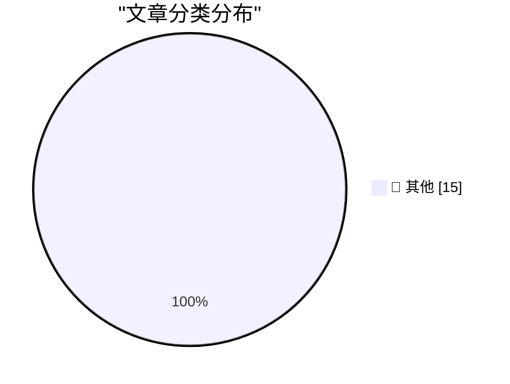

# 📰 AI 博客每日精选 — 2026-11-05

> 来自 Karpathy 推荐的 92 个顶级技术博客，AI 精选 Top 15

## 🏆 今日必读

🥇 **datasette-llm 0.1a10**

[datasette-llm 0.1a10](https://simonwillison.net/2026/Nov/4/datasette-llm/) — simonwillison.net · 12 小时前 · 📝 其他

> datasette-llm 0.1a10

🥈 **datasette-apps 0.3a0**

[datasette-apps 0.3a0](https://simonwillison.net/2026/Nov/4/datasette-apps/) — simonwillison.net · 1 天前 · 📝 其他

> datasette-apps 0.3a0

🥉 **datasette-agent 0.5a0**

[datasette-agent 0.5a0](https://simonwillison.net/2026/Nov/3/datasette-agent/) — simonwillison.net · 1 天前 · 📝 其他

> datasette-agent 0.5a0

---

## 📊 数据概览

| 扫描源 | 抓取文章 | 时间范围 | 精选 |
|:---:|:---:|:---:|:---:|
| 83/92 | 2552 篇 → 35 篇 | 48h | **15 篇** |

### 分类分布

---

## 📝 其他

### 1. datasette-llm 0.1a10

[datasette-llm 0.1a10](https://simonwillison.net/2026/Nov/4/datasette-llm/) — **simonwillison.net** · 12 小时前 · ⭐ 15/30

> datasette-llm 0.1a10

---

### 2. datasette-apps 0.3a0

[datasette-apps 0.3a0](https://simonwillison.net/2026/Nov/4/datasette-apps/) — **simonwillison.net** · 1 天前 · ⭐ 15/30

> datasette-apps 0.3a0

---

### 3. datasette-agent 0.5a0

[datasette-agent 0.5a0](https://simonwillison.net/2026/Nov/3/datasette-agent/) — **simonwillison.net** · 1 天前 · ⭐ 15/30

> datasette-agent 0.5a0

---

### 4. llm 0.37.1

[llm 0.37.1](https://simonwillison.net/2026/Nov/3/llm/) — **simonwillison.net** · 1 天前 · ⭐ 15/30

> llm 0.37.1

---

### 5. Qwen 3.8 27B on my laptop can interpret model weights, too

[Qwen 3.8 27B on my laptop can interpret model weights, too](https://simonwillison.net/2026/Nov/3/qwen-can-interpret-model-weights/) — **simonwillison.net** · 1 天前 · ⭐ 15/30

> Qwen 3.8 27B on my laptop can interpret model weights, too

---

### 6. I discovered a sound that leaks your exact location (and it's everywhere) - YouTube

[I discovered a sound that leaks your exact location (and it's everywhere) - YouTube](https://simonwillison.net/2026/Nov/3/a-sound-that-leaks-your-exact-location/) — **simonwillison.net** · 1 天前 · ⭐ 15/30

> I discovered a sound that leaks your exact location (and it's everywhere) - YouTube

---

### 7. October sponsors-only newsletter

[October sponsors-only newsletter](https://simonwillison.net/2026/Nov/3/october-newsletter/) — **simonwillison.net** · 1 天前 · ⭐ 15/30

> October sponsors-only newsletter

---

### 8. This Election Will Not Look Surprising in History

[This Election Will Not Look Surprising in History](https://apple.news/Afq6SKrYkTcCEHrCEQmxm5A?web_embed_link=aHR0cHM6Ly9uZXdzLWFzc2V0cy5hcHBsZS5jb20vZW1iZWRzLzY2ZDQzYzg0LTMyMWYtNGQ0Ny05Mzk4LWE3NjE3NDgwZWE2Yi9pbmRleC5odG1sI2NvbnRleHQ9TU9EQUwmc3RpY2t5PWZhbHNlJmVmZmVjdD1ub25lJmxpZ2h0X2JnX2NvbG9yPWU5ZWNmMiZkYXJrX2JnX2NvbG9yPTJkM2Q1NCZzY29wZT11cyZvcmlnaW49c2hhcnJvdyZsaXZlYWN0aXZpdGllcz10cnVlJm5mZl9jaWQ9NTZjMjQ1OTQtNDIxNC00NDM0LTlhNTgtNWE1YTIxM2ZkMTBi) — **daringfireball.net** · 12 小时前 · ⭐ 15/30

> This Election Will Not Look Surprising in History

---

### 9. ‘Political Reckoning Shatters Trump’s Grip on Washington’

[‘Political Reckoning Shatters Trump’s Grip on Washington’](https://www.wsj.com/politics/elections/a-political-reckoning-shatters-trumps-grip-on-washington-bd3c7705?st=xABDit) — **daringfireball.net** · 13 小时前 · ⭐ 15/30

> ‘Political Reckoning Shatters Trump’s Grip on Washington’

---

### 10. Apple Begins Opening Siri AI to Developers

[Apple Begins Opening Siri AI to Developers](https://developer.apple.com/news/?id=gdk2umrf) — **daringfireball.net** · 1 天前 · ⭐ 15/30

> Apple Begins Opening Siri AI to Developers

---

### 11. iPad Mini (A20 Pro) Review Roundup

[iPad Mini (A20 Pro) Review Roundup](https://www.techmeme.com/261103/p15#a261103p15) — **daringfireball.net** · 1 天前 · ⭐ 15/30

> iPad Mini (A20 Pro) Review Roundup

---

### 12. MKBHD on the New A20 Pro iPad Mini

[MKBHD on the New A20 Pro iPad Mini](https://www.youtube.com/watch?v=g6Die8gVFn0) — **daringfireball.net** · 1 天前 · ⭐ 15/30

> MKBHD on the New A20 Pro iPad Mini

---

### 13. Safari 27.3 Beta Adds Vertical Tabs and Adaptive Dark Mode

[Safari 27.3 Beta Adds Vertical Tabs and Adaptive Dark Mode](https://www.macrumors.com/2026/11/03/ios-27-3-safari/) — **daringfireball.net** · 1 天前 · ⭐ 15/30

> Safari 27.3 Beta Adds Vertical Tabs and Adaptive Dark Mode

---

### 14. The New York Times (et al.) Sues Brave for Copyright Infringement, Selling Scraped Content to AI Companies for Model Training

[The New York Times (et al.) Sues Brave for Copyright Infringement, Selling Scraped Content to AI Companies for Model Training](https://www.theverge.com/tech/1024588/brave-lawsuit-ai-scraping-new-york-times) — **daringfireball.net** · 1 天前 · ⭐ 15/30

> The New York Times (et al.) Sues Brave for Copyright Infringement, Selling Scraped Content to AI Companies for Model Training

---

### 15. Steve Jobs on His Final Quarterly Analyst Call: ‘We Think the Open Versus Closed Argument Is Just a Smokescreen’

[Steve Jobs on His Final Quarterly Analyst Call: ‘We Think the Open Versus Closed Argument Is Just a Smokescreen’](https://www.macworld.com/article/208438/jobs_transcript.html) — **daringfireball.net** · 1 天前 · ⭐ 15/30

> Steve Jobs on His Final Quarterly Analyst Call: ‘We Think the Open Versus Closed Argument Is Just a Smokescreen’

---

*生成于 2026-11-05 04:04 | 扫描 83 源 → 获取 2552 篇 → 精选 15 篇*
*基于 [Hacker News Popularity Contest 2025](https://refactoringenglish.com/tools/hn-popularity/) RSS 源列表，由 [Andrej Karpathy](https://x.com/karpathy) 推荐*
*由「懂点儿AI」制作，欢迎关注同名微信公众号获取更多 AI 实用技巧 💡*
