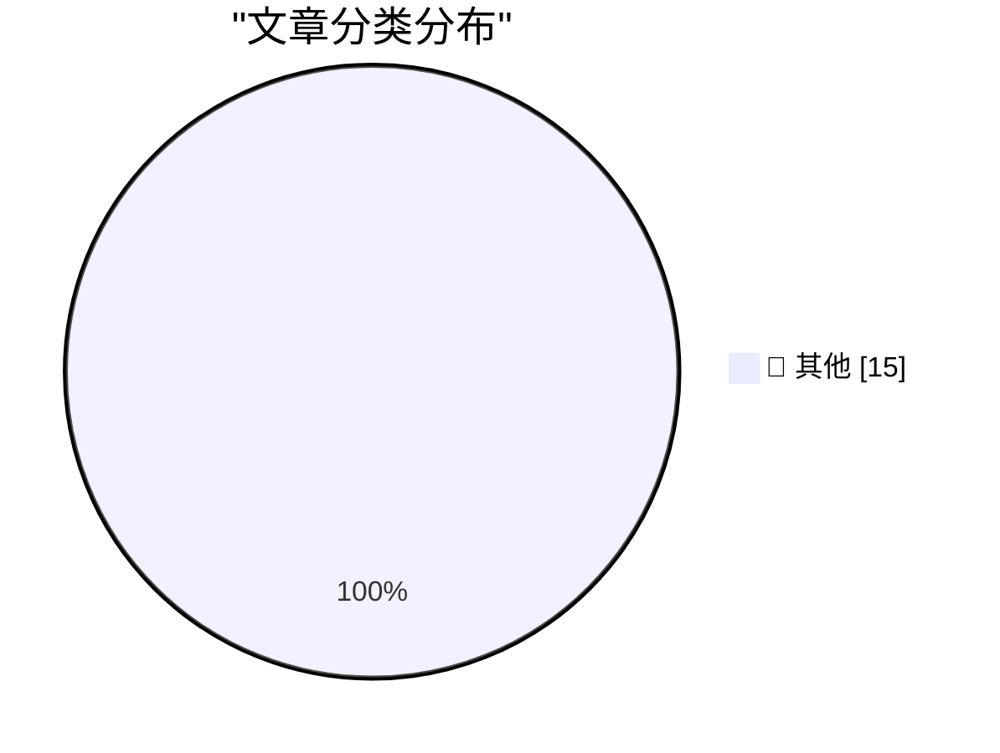

# 📰 AI 博客每日精选 — 2026-11-06

> 来自 Karpathy 推荐的 92 个顶级技术博客，AI 精选 Top 15

## 🏆 今日必读

🥇 **Quoting Paul Ford**

[Quoting Paul Ford](https://simonwillison.net/2026/Nov/5/paul-ford/) — simonwillison.net · 10 小时前 · 📝 其他

> Quoting Paul Ford

🥈 **datasette-llm 0.1a10**

[datasette-llm 0.1a10](https://simonwillison.net/2026/Nov/4/datasette-llm/) — simonwillison.net · 1 天前 · 📝 其他

> datasette-llm 0.1a10

🥉 **A database is a store for global variables**

[A database is a store for global variables](https://seangoedecke.com/a-database-is-a-store-for-global-variables/) — seangoedecke.com · 4 小时前 · 📝 其他

> A database is a store for global variables

---

## 📊 数据概览

| 扫描源 | 抓取文章 | 时间范围 | 精选 |
|:---:|:---:|:---:|:---:|
| 82/92 | 2543 篇 → 21 篇 | 48h | **15 篇** |

### 分类分布

---

## 📝 其他

### 1. Quoting Paul Ford

[Quoting Paul Ford](https://simonwillison.net/2026/Nov/5/paul-ford/) — **simonwillison.net** · 10 小时前 · ⭐ 15/30

> Quoting Paul Ford

---

### 2. datasette-llm 0.1a10

[datasette-llm 0.1a10](https://simonwillison.net/2026/Nov/4/datasette-llm/) — **simonwillison.net** · 1 天前 · ⭐ 15/30

> datasette-llm 0.1a10

---

### 3. A database is a store for global variables

[A database is a store for global variables](https://seangoedecke.com/a-database-is-a-store-for-global-variables/) — **seangoedecke.com** · 4 小时前 · ⭐ 15/30

> A database is a store for global variables

---

### 4. Want to Rent an Internet Address at the White House?

[Want to Rent an Internet Address at the White House?](https://krebsonsecurity.com/2026/11/want-to-rent-an-internet-address-at-the-white-house/) — **krebsonsecurity.com** · 23 小时前 · ⭐ 15/30

> Want to Rent an Internet Address at the White House?

---

### 5. Salon Ceases Publication

[Salon Ceases Publication](https://www.salon.com/2026/11/05/goodbye-from-salon/) — **daringfireball.net** · 6 小时前 · ⭐ 15/30

> Salon Ceases Publication

---

### 6. Meta Releases Mac Version of Edits

[Meta Releases Mac Version of Edits](https://edits.instagram.com/blog/edits-desktop-video-editor/) — **daringfireball.net** · 7 小时前 · ⭐ 15/30

> Meta Releases Mac Version of Edits

---

### 7. This Election Will Not Look Surprising in History

[This Election Will Not Look Surprising in History](https://apple.news/Afq6SKrYkTcCEHrCEQmxm5A?web_embed_link=aHR0cHM6Ly9uZXdzLWFzc2V0cy5hcHBsZS5jb20vZW1iZWRzLzY2ZDQzYzg0LTMyMWYtNGQ0Ny05Mzk4LWE3NjE3NDgwZWE2Yi9pbmRleC5odG1sI2NvbnRleHQ9TU9EQUwmc3RpY2t5PWZhbHNlJmVmZmVjdD1ub25lJmxpZ2h0X2JnX2NvbG9yPWU5ZWNmMiZkYXJrX2JnX2NvbG9yPTJkM2Q1NCZzY29wZT11cyZvcmlnaW49c2hhcnJvdyZsaXZlYWN0aXZpdGllcz10cnVlJm5mZl9jaWQ9NTZjMjQ1OTQtNDIxNC00NDM0LTlhNTgtNWE1YTIxM2ZkMTBi) — **daringfireball.net** · 1 天前 · ⭐ 15/30

> This Election Will Not Look Surprising in History

---

### 8. ‘Political Reckoning Shatters Trump’s Grip on Washington’

[‘Political Reckoning Shatters Trump’s Grip on Washington’](https://www.wsj.com/politics/elections/a-political-reckoning-shatters-trumps-grip-on-washington-bd3c7705?st=xABDit) — **daringfireball.net** · 1 天前 · ⭐ 15/30

> ‘Political Reckoning Shatters Trump’s Grip on Washington’

---

### 9. It's unbreakable in theory

[It's unbreakable in theory](https://idiallo.com/byte-size/unbreakable-in-theory) — **idiallo.com** · 7 小时前 · ⭐ 15/30

> It's unbreakable in theory

---

### 10. Goodhart's Law, but We Already Spent All Our Money

[Goodhart's Law, but We Already Spent All Our Money](https://idiallo.com/blog/we-spent-all-our-money-goodharts-law) — **idiallo.com** · 1 天前 · ⭐ 15/30

> Goodhart's Law, but We Already Spent All Our Money

---

### 11. Pluralistic: Without CDA 230, Facebook will own the internet forever (05 Nov 2026)

[Pluralistic: Without CDA 230, Facebook will own the internet forever (05 Nov 2026)](https://pluralistic.net/2026/11/05/see-you-in-court/) — **pluralistic.net** · 19 小时前 · ⭐ 15/30

> Pluralistic: Without CDA 230, Facebook will own the internet forever (05 Nov 2026)

---

### 12. Pluralistic: The AI fatfinger economy has come for my receipts app (04 Nov 2026)

[Pluralistic: The AI fatfinger economy has come for my receipts app (04 Nov 2026)](https://pluralistic.net/2026/11/04/genius-scan-is-neither/) — **pluralistic.net** · 1 天前 · ⭐ 15/30

> Pluralistic: The AI fatfinger economy has come for my receipts app (04 Nov 2026)

---

### 13. Gadget Review: Tozo NC9 Pro Bluetooth Headphones ★★★★⯪

[Gadget Review: Tozo NC9 Pro Bluetooth Headphones ★★★★⯪](https://shkspr.mobi/blog/2026/11/gadget-review-tozo-nc9-pro-bluetooth-headphones/) — **shkspr.mobi** · 15 小时前 · ⭐ 15/30

> Gadget Review: Tozo NC9 Pro Bluetooth Headphones ★★★★⯪

---

### 14. Book Review: Practice by Rosalind Brown ★★★★☆

[Book Review: Practice by Rosalind Brown ★★★★☆](https://shkspr.mobi/blog/2026/11/book-review-practice-by-rosalind-brown/) — **shkspr.mobi** · 1 天前 · ⭐ 15/30

> Book Review: Practice by Rosalind Brown ★★★★☆

---

### 15. There are things with ranks, but it’s not always clear what the ranks mean

[There are things with ranks, but it’s not always clear what the ranks mean](https://devblogs.microsoft.com/oldnewthing/20261104-00/?p=112830/) — **devblogs.microsoft.com/oldnewthing** · 1 天前 · ⭐ 15/30

> There are things with ranks, but it’s not always clear what the ranks mean

---

*生成于 2026-11-06 04:01 | 扫描 82 源 → 获取 2543 篇 → 精选 15 篇*
*基于 [Hacker News Popularity Contest 2025](https://refactoringenglish.com/tools/hn-popularity/) RSS 源列表，由 [Andrej Karpathy](https://x.com/karpathy) 推荐*
*由「懂点儿AI」制作，欢迎关注同名微信公众号获取更多 AI 实用技巧 💡*
