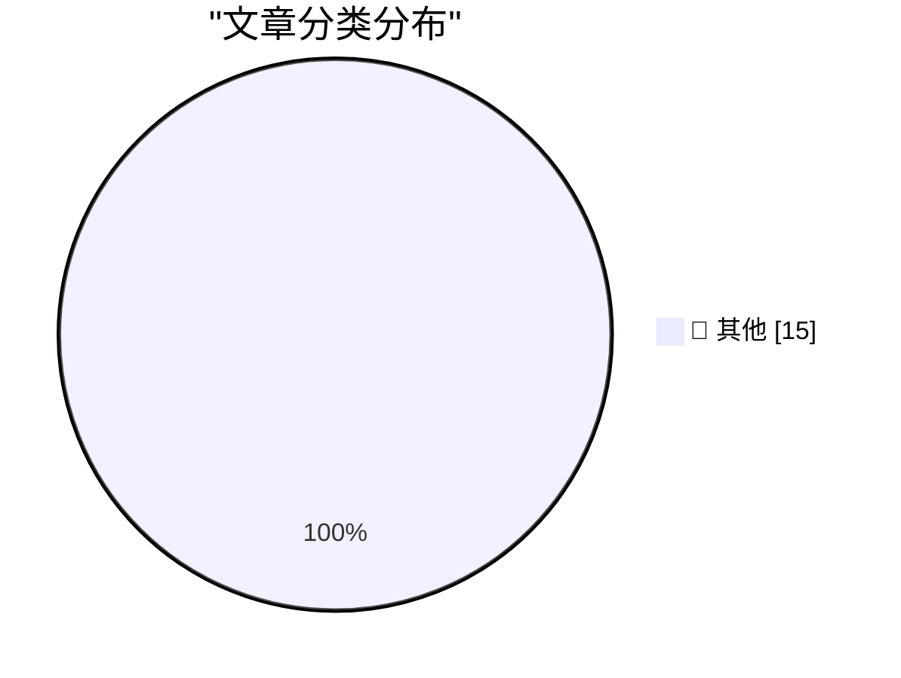

# 📰 AI 博客每日精选 — 2026-11-08

> 来自 Karpathy 推荐的 92 个顶级技术博客，AI 精选 Top 15

## 🏆 今日必读

🥇 **datasette #3046: Don't serve link: rel=next HTTP headers to Firefox for HTML pages**

[datasette #3046: Don't serve link: rel=next HTTP headers to Firefox for HTML pages](https://simonwillison.net/2026/Nov/7/link-rel-next/) — simonwillison.net · 3 小时前 · 📝 其他

> datasette #3046: Don't serve link: rel=next HTTP headers to Firefox for HTML pages

🥈 **Quoting Nilay Patel**

[Quoting Nilay Patel](https://simonwillison.net/2026/Nov/6/nilay-patel/) — simonwillison.net · 1 天前 · 📝 其他

> Quoting Nilay Patel

🥉 **Working with designers**

[Working with designers](https://seangoedecke.com/working-with-designers/) — seangoedecke.com · 1 天前 · 📝 其他

> Working with designers

---

## 📊 数据概览

| 扫描源 | 抓取文章 | 时间范围 | 精选 |
|:---:|:---:|:---:|:---:|
| 83/92 | 2570 篇 → 22 篇 | 48h | **15 篇** |

### 分类分布

---

## 📝 其他

### 1. datasette #3046: Don't serve link: rel=next HTTP headers to Firefox for HTML pages

[datasette #3046: Don't serve link: rel=next HTTP headers to Firefox for HTML pages](https://simonwillison.net/2026/Nov/7/link-rel-next/) — **simonwillison.net** · 3 小时前 · ⭐ 15/30

> datasette #3046: Don't serve link: rel=next HTTP headers to Firefox for HTML pages

---

### 2. Quoting Nilay Patel

[Quoting Nilay Patel](https://simonwillison.net/2026/Nov/6/nilay-patel/) — **simonwillison.net** · 1 天前 · ⭐ 15/30

> Quoting Nilay Patel

---

### 3. Working with designers

[Working with designers](https://seangoedecke.com/working-with-designers/) — **seangoedecke.com** · 1 天前 · ⭐ 15/30

> Working with designers

---

### 4. Yours Truly on Full Stack Creator, Talking About the New MacBook Pros With PROLED XDR Displays

[Yours Truly on Full Stack Creator, Talking About the New MacBook Pros With PROLED XDR Displays](https://www.youtube.com/watch?v=f2GZtWuUPl0) — **daringfireball.net** · 5 小时前 · ⭐ 15/30

> Yours Truly on Full Stack Creator, Talking About the New MacBook Pros With PROLED XDR Displays

---

### 5. ★ Touch and Glow

[★ Touch and Glow](https://daringfireball.net/2026/11/touch_and_glow) — **daringfireball.net** · 1 天前 · ⭐ 15/30

> ★ Touch and Glow

---

### 6. Apple Support: ‘About the Illuminated Apple Logo on MacBook Pro With PROLED XDR Display’

[Apple Support: ‘About the Illuminated Apple Logo on MacBook Pro With PROLED XDR Display’](https://support.apple.com/en-us/149248) — **daringfireball.net** · 1 天前 · ⭐ 15/30

> Apple Support: ‘About the Illuminated Apple Logo on MacBook Pro With PROLED XDR Display’

---

### 7. The President is Coping Well

[The President is Coping Well](https://www.wsj.com/politics/policy/trump-signs-proclamation-he-says-will-protect-oval-office-from-major-changes-93f3285b) — **daringfireball.net** · 1 天前 · ⭐ 15/30

> The President is Coping Well

---

### 8. Writing English is Solved

[Writing English is Solved](https://idiallo.com/byte-size/english-is-solved) — **idiallo.com** · 1 天前 · ⭐ 15/30

> Writing English is Solved

---

### 9. Pluralistic: JS Tan and Clarissa Redwine's "Against Tech Oligarchy" (07 Nov 2026)

[Pluralistic: JS Tan and Clarissa Redwine's "Against Tech Oligarchy" (07 Nov 2026)](https://pluralistic.net/2026/11/07/aeiou-but-sometimes-why/) — **pluralistic.net** · 14 小时前 · ⭐ 15/30

> Pluralistic: JS Tan and Clarissa Redwine's "Against Tech Oligarchy" (07 Nov 2026)

---

### 10. Book Review: When the Dust Settles - Stories of Love, Loss and Hope from an Expert in Disaster by Lucy Easthope ★★★★★

[Book Review: When the Dust Settles - Stories of Love, Loss and Hope from an Expert in Disaster by Lucy Easthope ★★★★★](https://shkspr.mobi/blog/2026/11/book-review-when-the-dust-settles-stories-of-love-loss-and-hope-from-an-expert-in-disaster-by-lucy-easthope/) — **shkspr.mobi** · 14 小时前 · ⭐ 15/30

> Book Review: When the Dust Settles - Stories of Love, Loss and Hope from an Expert in Disaster by Lucy Easthope ★★★★★

---

### 11. A video game which caused real world violence

[A video game which caused real world violence](https://shkspr.mobi/blog/2026/11/a-video-game-which-caused-real-world-violence/) — **shkspr.mobi** · 1 天前 · ⭐ 15/30

> A video game which caused real world violence

---

### 12. Why are we all worked up about atomicity when applying hot-patches if we can just suspend all the threads?

[Why are we all worked up about atomicity when applying hot-patches if we can just suspend all the threads?](https://devblogs.microsoft.com/oldnewthing/20261106-00/?p=112838/) — **devblogs.microsoft.com/oldnewthing** · 1 天前 · ⭐ 15/30

> Why are we all worked up about atomicity when applying hot-patches if we can just suspend all the threads?

---

### 13. Static site generators are weird

[Static site generators are weird](https://evanhahn.com/static-site-generators-are-weird/) — **evanhahn.com** · 1 天前 · ⭐ 15/30

> Static site generators are weird

---

### 14. This Week in Package Management: 7 November 2026

[This Week in Package Management: 7 November 2026](https://nesbitt.io/2026/11/07/this-week-in-package-management.html) — **nesbitt.io** · 17 小时前 · ⭐ 15/30

> This Week in Package Management: 7 November 2026

---

### 15. Weekend at Bernie’s II

[Weekend at Bernie’s II](https://nesbitt.io/2026/11/06/weekend-at-bernies-ii.html) — **nesbitt.io** · 1 天前 · ⭐ 15/30

> Weekend at Bernie’s II

---

*生成于 2026-11-08 03:08 | 扫描 83 源 → 获取 2570 篇 → 精选 15 篇*
*基于 [Hacker News Popularity Contest 2025](https://refactoringenglish.com/tools/hn-popularity/) RSS 源列表，由 [Andrej Karpathy](https://x.com/karpathy) 推荐*
*由「懂点儿AI」制作，欢迎关注同名微信公众号获取更多 AI 实用技巧 💡*
