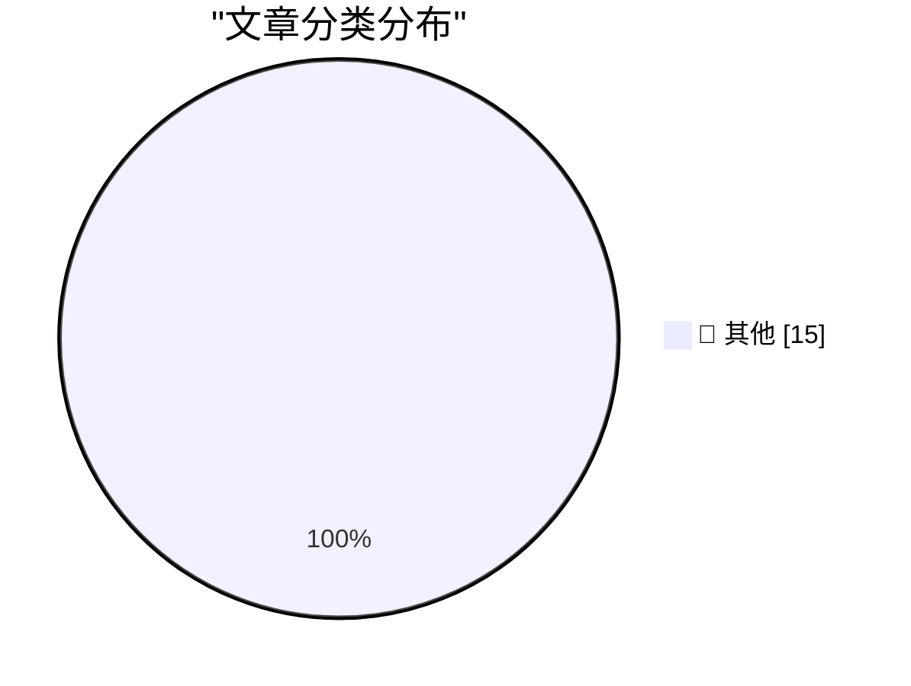

# 📰 AI 博客每日精选 — 2026-11-09

> 来自 Karpathy 推荐的 92 个顶级技术博客，AI 精选 Top 15

## 🏆 今日必读

🥇 **parse_number() as a SQLite extension: C vs Rust**

[parse_number() as a SQLite extension: C vs Rust](https://simonwillison.net/2026/Nov/8/sqlite-parse-number-c-vs-rust/) — simonwillison.net · 5 小时前 · 📝 其他

> parse_number() as a SQLite extension: C vs Rust

🥈 **datasette #3046: Don't serve link: rel=next HTTP headers to Firefox for HTML pages**

[datasette #3046: Don't serve link: rel=next HTTP headers to Firefox for HTML pages](https://simonwillison.net/2026/Nov/7/link-rel-next/) — simonwillison.net · 1 天前 · 📝 其他

> datasette #3046: Don't serve link: rel=next HTTP headers to Firefox for HTML pages

🥉 **LLMs are terrible at designing AI systems**

[LLMs are terrible at designing AI systems](https://seangoedecke.com/llms-are-terrible-at-designing-ai-systems/) — seangoedecke.com · 1 天前 · 📝 其他

> LLMs are terrible at designing AI systems

---

## 📊 数据概览

| 扫描源 | 抓取文章 | 时间范围 | 精选 |
|:---:|:---:|:---:|:---:|
| 83/92 | 2571 篇 → 19 篇 | 48h | **15 篇** |

### 分类分布

---

## 📝 其他

### 1. parse_number() as a SQLite extension: C vs Rust

[parse_number() as a SQLite extension: C vs Rust](https://simonwillison.net/2026/Nov/8/sqlite-parse-number-c-vs-rust/) — **simonwillison.net** · 5 小时前 · ⭐ 15/30

> parse_number() as a SQLite extension: C vs Rust

---

### 2. datasette #3046: Don't serve link: rel=next HTTP headers to Firefox for HTML pages

[datasette #3046: Don't serve link: rel=next HTTP headers to Firefox for HTML pages](https://simonwillison.net/2026/Nov/7/link-rel-next/) — **simonwillison.net** · 1 天前 · ⭐ 15/30

> datasette #3046: Don't serve link: rel=next HTTP headers to Firefox for HTML pages

---

### 3. LLMs are terrible at designing AI systems

[LLMs are terrible at designing AI systems](https://seangoedecke.com/llms-are-terrible-at-designing-ai-systems/) — **seangoedecke.com** · 1 天前 · ⭐ 15/30

> LLMs are terrible at designing AI systems

---

### 4. Jensen Huang Betrayed Nvidia, Not Just His Family

[Jensen Huang Betrayed Nvidia, Not Just His Family](https://www.nytimes.com/2026/11/06/us/politics/chinese-spy-agency-nvidia-jensen-huang.html?unlocked_article_code=1.O1E.DRyO.9mNcxhaxhtlI) — **daringfireball.net** · 3 小时前 · ⭐ 15/30

> Jensen Huang Betrayed Nvidia, Not Just His Family

---

### 5. Nvidia CEO Jensen Huang Was Banging a Chinese Spy, Who Was Feeding Information Back to Beijing

[Nvidia CEO Jensen Huang Was Banging a Chinese Spy, Who Was Feeding Information Back to Beijing](https://www.nytimes.com/2026/11/08/technology/nvidia-investigation-jensen-huang-china.html?unlocked_article_code=1.O1E.Soow.6UjrM7Ch-C8L) — **daringfireball.net** · 5 小时前 · ⭐ 15/30

> Nvidia CEO Jensen Huang Was Banging a Chinese Spy, Who Was Feeding Information Back to Beijing

---

### 6. Yours Truly on Full Stack Creator, Talking About the New MacBook Pros With PROLED XDR Displays

[Yours Truly on Full Stack Creator, Talking About the New MacBook Pros With PROLED XDR Displays](https://www.youtube.com/watch?v=f2GZtWuUPl0) — **daringfireball.net** · 1 天前 · ⭐ 15/30

> Yours Truly on Full Stack Creator, Talking About the New MacBook Pros With PROLED XDR Displays

---

### 7. Horible public key tricks:

[Horible public key tricks:](https://maurycyz.com/projects/badcert/) — **maurycyz.com** · 1 天前 · ⭐ 15/30

> Horible public key tricks:

---

### 8. Pluralistic: JS Tan and Clarissa Redwine's "Against Tech Oligarchy" (07 Nov 2026)

[Pluralistic: JS Tan and Clarissa Redwine's "Against Tech Oligarchy" (07 Nov 2026)](https://pluralistic.net/2026/11/07/aeiou-but-sometimes-why/) — **pluralistic.net** · 1 天前 · ⭐ 15/30

> Pluralistic: JS Tan and Clarissa Redwine's "Against Tech Oligarchy" (07 Nov 2026)

---

### 9. Some thoughts on restaurant menu QR codes

[Some thoughts on restaurant menu QR codes](https://shkspr.mobi/blog/2026/11/some-thoughts-on-restaurant-menu-qr-codes/) — **shkspr.mobi** · 14 小时前 · ⭐ 15/30

> Some thoughts on restaurant menu QR codes

---

### 10. Book Review: When the Dust Settles - Stories of Love, Loss and Hope from an Expert in Disaster by Lucy Easthope ★★★★★

[Book Review: When the Dust Settles - Stories of Love, Loss and Hope from an Expert in Disaster by Lucy Easthope ★★★★★](https://shkspr.mobi/blog/2026/11/book-review-when-the-dust-settles-stories-of-love-loss-and-hope-from-an-expert-in-disaster-by-lucy-easthope/) — **shkspr.mobi** · 1 天前 · ⭐ 15/30

> Book Review: When the Dust Settles - Stories of Love, Loss and Hope from an Expert in Disaster by Lucy Easthope ★★★★★

---

### 11. Reverse engineering a vintage diode-transistor logic chip

[Reverse engineering a vintage diode-transistor logic chip](http://www.righto.com/feeds/7533579802505281921/comments/default) — **righto.com** · 11 小时前 · ⭐ 15/30

> Reverse engineering a vintage diode-transistor logic chip

---

### 12. Finite Projective Planes

[Finite Projective Planes](https://www.johndcook.com/blog/2026/11/08/finite-geometries/) — **johndcook.com** · 4 小时前 · ⭐ 15/30

> Finite Projective Planes

---

### 13. This Week in Package Management: 7 November 2026

[This Week in Package Management: 7 November 2026](https://nesbitt.io/2026/11/07/this-week-in-package-management.html) — **nesbitt.io** · 1 天前 · ⭐ 15/30

> This Week in Package Management: 7 November 2026

---

### 14. Reading List 11/7/2026

[Reading List 11/7/2026](https://www.construction-physics.com/p/reading-list-1172026) — **construction-physics.com** · 1 天前 · ⭐ 15/30

> Reading List 11/7/2026

---

### 15. The problem with Micron MT 4264 RAM

[The problem with Micron MT 4264 RAM](https://dfarq.homeip.net/the-problem-with-micron-mt-4264-ram/?utm_source=rss&#038;utm_medium=rss&#038;utm_campaign=the-problem-with-micron-mt-4264-ram) — **dfarq.homeip.net** · 15 小时前 · ⭐ 15/30

> The problem with Micron MT 4264 RAM

---

*生成于 2026-11-09 03:30 | 扫描 83 源 → 获取 2571 篇 → 精选 15 篇*
*基于 [Hacker News Popularity Contest 2025](https://refactoringenglish.com/tools/hn-popularity/) RSS 源列表，由 [Andrej Karpathy](https://x.com/karpathy) 推荐*
*由「懂点儿AI」制作，欢迎关注同名微信公众号获取更多 AI 实用技巧 💡*
