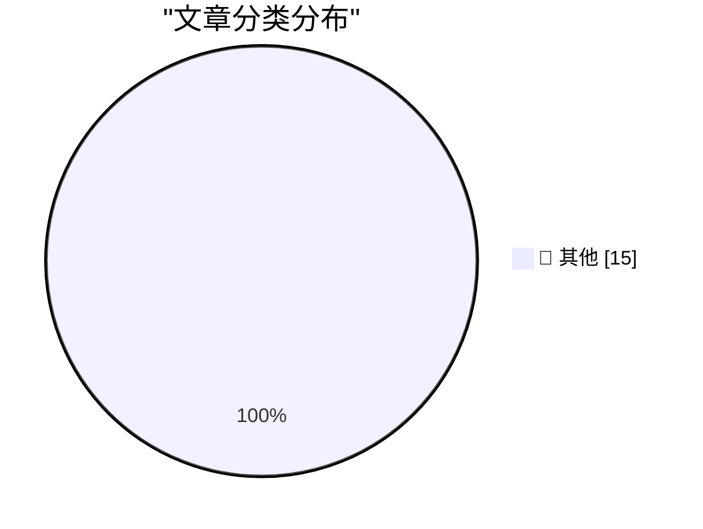

# 📰 AI 博客每日精选 — 2026-11-10

> 来自 Karpathy 推荐的 92 个顶级技术博客，AI 精选 Top 15

## 🏆 今日必读

🥇 **llm-anthropic 0.31**

[llm-anthropic 0.31](https://simonwillison.net/2026/Nov/9/llm-anthropic/) — simonwillison.net · 5 小时前 · 📝 其他

> llm-anthropic 0.31

🥈 **Locating the source of a mysterious beep with Claude**

[Locating the source of a mysterious beep with Claude](https://simonwillison.net/2026/Nov/9/mysterious-beeps/) — simonwillison.net · 5 小时前 · 📝 其他

> Locating the source of a mysterious beep with Claude

🥉 **The Web Is More Than Enough, by Paul Ford**

[The Web Is More Than Enough, by Paul Ford](https://simonwillison.net/2026/Nov/9/hn-50421091/) — simonwillison.net · 1 天前 · 📝 其他

> The Web Is More Than Enough, by Paul Ford

---

## 📊 数据概览

| 扫描源 | 抓取文章 | 时间范围 | 精选 |
|:---:|:---:|:---:|:---:|
| 83/92 | 2571 篇 → 32 篇 | 48h | **15 篇** |

### 分类分布

---

## 📝 其他

### 1. llm-anthropic 0.31

[llm-anthropic 0.31](https://simonwillison.net/2026/Nov/9/llm-anthropic/) — **simonwillison.net** · 5 小时前 · ⭐ 15/30

> llm-anthropic 0.31

---

### 2. Locating the source of a mysterious beep with Claude

[Locating the source of a mysterious beep with Claude](https://simonwillison.net/2026/Nov/9/mysterious-beeps/) — **simonwillison.net** · 5 小时前 · ⭐ 15/30

> Locating the source of a mysterious beep with Claude

---

### 3. The Web Is More Than Enough, by Paul Ford

[The Web Is More Than Enough, by Paul Ford](https://simonwillison.net/2026/Nov/9/hn-50421091/) — **simonwillison.net** · 1 天前 · ⭐ 15/30

> The Web Is More Than Enough, by Paul Ford

---

### 4. Hide your slop PR descriptions behind 

[Hide your slop PR descriptions behind 

](https://simonwillison.net/2026/Nov/9/details-summary/) — **simonwillison.net** · 1 天前 · ⭐ 15/30

> Hide your slop PR descriptions behind 

---

### 5. parse_number() as a SQLite extension: C vs Rust

[parse_number() as a SQLite extension: C vs Rust](https://simonwillison.net/2026/Nov/8/sqlite-parse-number-c-vs-rust/) — **simonwillison.net** · 1 天前 · ⭐ 15/30

> parse_number() as a SQLite extension: C vs Rust

---

### 6. [Sponsor] WorkOS: Let Agents Use Your Tools Without Giving Them Free Rein

[[Sponsor] WorkOS: Let Agents Use Your Tools Without Giving Them Free Rein](https://www.workos.com/airlock?utm_source=daringfireball&amp;utm_medium=newsletter&amp;utm_campaign=q42026) — **daringfireball.net** · 49 分钟前 · ⭐ 15/30

> [Sponsor] WorkOS: Let Agents Use Your Tools Without Giving Them Free Rein

---

### 7. Bloomberg Was Onto Megaspeed’s Game a Year Ago

[Bloomberg Was Onto Megaspeed’s Game a Year Ago](https://www.bloomberg.com/news/features/2025-12-22/nvidia-partner-megaspeed-draws-china-chip-smuggling-concerns-in-us) — **daringfireball.net** · 5 小时前 · ⭐ 15/30

> Bloomberg Was Onto Megaspeed’s Game a Year Ago

---

### 8. Short-Seller Culper Research Published Information on Jensen Huang’s Affair Back in May

[Short-Seller Culper Research Published Information on Jensen Huang’s Affair Back in May](https://culperresearch.com/wp-content/uploads/2026/05/Culper_NVDA_5-13-2026.pdf) — **daringfireball.net** · 8 小时前 · ⭐ 15/30

> Short-Seller Culper Research Published Information on Jensen Huang’s Affair Back in May

---

### 9. Tesla Brain Drain

[Tesla Brain Drain](https://electrek.co/2026/11/09/tesla-deep-bench-gone-musk-admits-talent-shortage/) — **daringfireball.net** · 8 小时前 · ⭐ 15/30

> Tesla Brain Drain

---

### 10. Rubio Warned Officials About Jensen Huang’s Affair With a Chinese Spy

[Rubio Warned Officials About Jensen Huang’s Affair With a Chinese Spy](https://www.nytimes.com/2026/11/08/us/politics/rubio-nvidia-ceo-chinese-spy.html?unlocked_article_code=1.PFE.dLW7.D8C1YUYhNooj) — **daringfireball.net** · 11 小时前 · ⭐ 15/30

> Rubio Warned Officials About Jensen Huang’s Affair With a Chinese Spy

---

### 11. Jensen Huang Betrayed Nvidia, Not Just His Family

[Jensen Huang Betrayed Nvidia, Not Just His Family](https://www.nytimes.com/2026/11/06/us/politics/chinese-spy-agency-nvidia-jensen-huang.html?unlocked_article_code=1.O1E.DRyO.9mNcxhaxhtlI) — **daringfireball.net** · 1 天前 · ⭐ 15/30

> Jensen Huang Betrayed Nvidia, Not Just His Family

---

### 12. Nvidia CEO Jensen Huang Was Banging a Chinese Spy, Who Was Feeding Information Back to Beijing

[Nvidia CEO Jensen Huang Was Banging a Chinese Spy, Who Was Feeding Information Back to Beijing](https://www.nytimes.com/2026/11/08/technology/nvidia-investigation-jensen-huang-china.html?unlocked_article_code=1.O1E.Soow.6UjrM7Ch-C8L) — **daringfireball.net** · 1 天前 · ⭐ 15/30

> Nvidia CEO Jensen Huang Was Banging a Chinese Spy, Who Was Feeding Information Back to Beijing

---

### 13. Pluralistic: America cannot undo Trumpism (09 Nov 2026)

[Pluralistic: America cannot undo Trumpism (09 Nov 2026)](https://pluralistic.net/2026/11/09/brunch-is-canceled-forever/) — **pluralistic.net** · 20 小时前 · ⭐ 15/30

> Pluralistic: America cannot undo Trumpism (09 Nov 2026)

---

### 14. Blunt Banhammer Blocks Basic Bots Ballistically

[Blunt Banhammer Blocks Basic Bots Ballistically](https://shkspr.mobi/blog/2026/11/blunt-banhammer-blocks-basic-bots-ballistically/) — **shkspr.mobi** · 16 小时前 · ⭐ 15/30

> Blunt Banhammer Blocks Basic Bots Ballistically

---

### 15. Some thoughts on restaurant menu QR codes

[Some thoughts on restaurant menu QR codes](https://shkspr.mobi/blog/2026/11/some-thoughts-on-restaurant-menu-qr-codes/) — **shkspr.mobi** · 1 天前 · ⭐ 15/30

> Some thoughts on restaurant menu QR codes

---

*生成于 2026-11-10 05:04 | 扫描 83 源 → 获取 2571 篇 → 精选 15 篇*
*基于 [Hacker News Popularity Contest 2025](https://refactoringenglish.com/tools/hn-popularity/) RSS 源列表，由 [Andrej Karpathy](https://x.com/karpathy) 推荐*
*由「懂点儿AI」制作，欢迎关注同名微信公众号获取更多 AI 实用技巧 💡*
