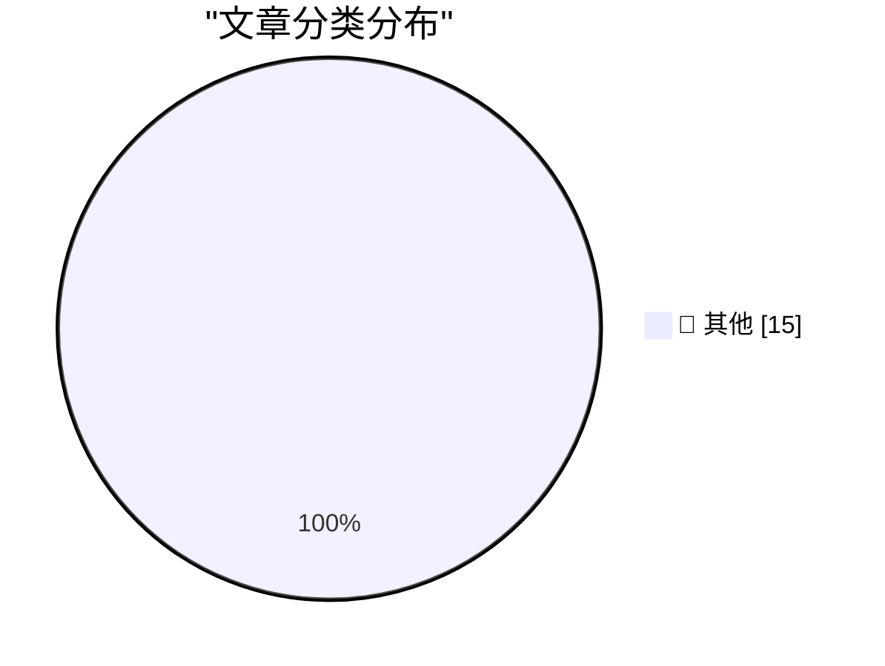

# 📰 AI 博客每日精选 — 2026-11-11

> 来自 Karpathy 推荐的 92 个顶级技术博客，AI 精选 Top 15

## 🏆 今日必读

🥇 **llm-gemini 0.36**

[llm-gemini 0.36](https://simonwillison.net/2026/Nov/10/llm-gemini/) — simonwillison.net · 7 小时前 · 📝 其他

> llm-gemini 0.36

🥈 **Introducing Our Smallest, Most Efficient Model: Muse Ember**

[Introducing Our Smallest, Most Efficient Model: Muse Ember](https://simonwillison.net/2026/Nov/10/muse-ember/) — simonwillison.net · 20 小时前 · 📝 其他

> Introducing Our Smallest, Most Efficient Model: Muse Ember

🥉 **Quoting Prompting Claude Fable 5.2**

[Quoting Prompting Claude Fable 5.2](https://simonwillison.net/2026/Nov/10/prompting-claude-fable-52/) — simonwillison.net · 22 小时前 · 📝 其他

> Quoting Prompting Claude Fable 5.2

---

## 📊 数据概览

| 扫描源 | 抓取文章 | 时间范围 | 精选 |
|:---:|:---:|:---:|:---:|
| 82/92 | 2545 篇 → 49 篇 | 48h | **15 篇** |

### 分类分布

---

## 📝 其他

### 1. llm-gemini 0.36

[llm-gemini 0.36](https://simonwillison.net/2026/Nov/10/llm-gemini/) — **simonwillison.net** · 7 小时前 · ⭐ 15/30

> llm-gemini 0.36

---

### 2. Introducing Our Smallest, Most Efficient Model: Muse Ember

[Introducing Our Smallest, Most Efficient Model: Muse Ember](https://simonwillison.net/2026/Nov/10/muse-ember/) — **simonwillison.net** · 20 小时前 · ⭐ 15/30

> Introducing Our Smallest, Most Efficient Model: Muse Ember

---

### 3. Quoting Prompting Claude Fable 5.2

[Quoting Prompting Claude Fable 5.2](https://simonwillison.net/2026/Nov/10/prompting-claude-fable-52/) — **simonwillison.net** · 22 小时前 · ⭐ 15/30

> Quoting Prompting Claude Fable 5.2

---

### 4. Yonkers Rises

[Yonkers Rises](https://simonwillison.net/2026/Nov/10/yonkers-rises/) — **simonwillison.net** · 23 小时前 · ⭐ 15/30

> Yonkers Rises

---

### 5. llm-anthropic 0.31

[llm-anthropic 0.31](https://simonwillison.net/2026/Nov/9/llm-anthropic/) — **simonwillison.net** · 1 天前 · ⭐ 15/30

> llm-anthropic 0.31

---

### 6. Locating the source of a mysterious beep with Claude

[Locating the source of a mysterious beep with Claude](https://simonwillison.net/2026/Nov/9/mysterious-beeps/) — **simonwillison.net** · 1 天前 · ⭐ 15/30

> Locating the source of a mysterious beep with Claude

---

### 7. The Web Is More Than Enough, by Paul Ford

[The Web Is More Than Enough, by Paul Ford](https://simonwillison.net/2026/Nov/9/hn-50421091/) — **simonwillison.net** · 1 天前 · ⭐ 15/30

> The Web Is More Than Enough, by Paul Ford

---

### 8. Hide your slop PR descriptions behind 

[Hide your slop PR descriptions behind 

](https://simonwillison.net/2026/Nov/9/details-summary/) — **simonwillison.net** · 1 天前 · ⭐ 15/30

> Hide your slop PR descriptions behind 

---

### 9. Glue work is still harmful in the age of AI

[Glue work is still harmful in the age of AI](https://seangoedecke.com/glue-work-is-still-harmful-in-the-age-of-ai/) — **seangoedecke.com** · 3 小时前 · ⭐ 15/30

> Glue work is still harmful in the age of AI

---

### 10. Microsoft Fixes Nearly 1,100 Security Vulnerabilities

[Microsoft Fixes Nearly 1,100 Security Vulnerabilities](https://krebsonsecurity.com/2026/11/microsoft-fixes-nearly-1100-security-vulnerabilities/) — **krebsonsecurity.com** · 5 小时前 · ⭐ 15/30

> Microsoft Fixes Nearly 1,100 Security Vulnerabilities

---

### 11. Gary Marcus: ‘Just Say No to Anthropic’s IPO’

[Gary Marcus: ‘Just Say No to Anthropic’s IPO’](https://garymarcus.substack.com/p/just-say-no-to-anthropics-ipo?r=3k69a0) — **daringfireball.net** · 5 小时前 · ⭐ 15/30

> Gary Marcus: ‘Just Say No to Anthropic’s IPO’

---

### 12. Altar II Keyboard on Kickstarter

[Altar II Keyboard on Kickstarter](https://www.kickstarter.com/projects/electronicamaterials/altar-ii/) — **daringfireball.net** · 6 小时前 · ⭐ 15/30

> Altar II Keyboard on Kickstarter

---

### 13. Bloomberg: ‘Nvidia Intervened in U.S. Probe of Megaspeed Chip Smuggling’

[Bloomberg: ‘Nvidia Intervened in U.S. Probe of Megaspeed Chip Smuggling’](https://www.bloomberg.com/news/articles/2026-11-09/nvidia-intervened-in-us-probe-of-megaspeed-chip-smuggling) — **daringfireball.net** · 10 小时前 · ⭐ 15/30

> Bloomberg: ‘Nvidia Intervened in U.S. Probe of Megaspeed Chip Smuggling’

---

### 14. Regarding Graveyards and Indispensable Men

[Regarding Graveyards and Indispensable Men](https://www.youtube.com/watch?v=vydmUCGQnyI) — **daringfireball.net** · 10 小时前 · ⭐ 15/30

> Regarding Graveyards and Indispensable Men

---

### 15. Steven Levy on John Ternus

[Steven Levy on John Ternus](https://www.wired.com/story/i-spent-30-minutes-with-apples-ceo-now-i-know-why-john-ternus-got-the-job/) — **daringfireball.net** · 11 小时前 · ⭐ 15/30

> Steven Levy on John Ternus

---

*生成于 2026-11-11 03:38 | 扫描 82 源 → 获取 2545 篇 → 精选 15 篇*
*基于 [Hacker News Popularity Contest 2025](https://refactoringenglish.com/tools/hn-popularity/) RSS 源列表，由 [Andrej Karpathy](https://x.com/karpathy) 推荐*
*由「懂点儿AI」制作，欢迎关注同名微信公众号获取更多 AI 实用技巧 💡*
