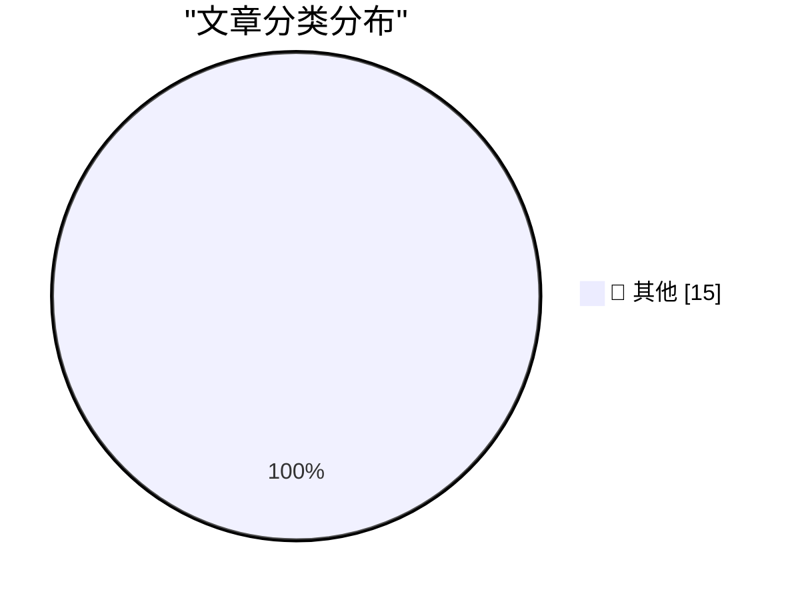

# 📰 AI 博客每日精选 — 2026-11-17

> 来自 Karpathy 推荐的 92 个顶级技术博客，AI 精选 Top 15

## 🏆 今日必读

🥇 **llm 0.37.3**

[llm 0.37.3](https://simonwillison.net/2026/Nov/16/llm/) — simonwillison.net · 5 小时前 · 📝 其他

> llm 0.37.3

🥈 **datasette-maplibre 0.1a0**

[datasette-maplibre 0.1a0](https://simonwillison.net/2026/Nov/15/datasette-maplibre/) — simonwillison.net · 1 天前 · 📝 其他

> datasette-maplibre 0.1a0

🥉 **datasette 1.0a43**

[datasette 1.0a43](https://simonwillison.net/2026/Nov/15/datasette/) — simonwillison.net · 1 天前 · 📝 其他

> datasette 1.0a43

---

## 📊 数据概览

| 扫描源 | 抓取文章 | 时间范围 | 精选 |
|:---:|:---:|:---:|:---:|
| 80/92 | 2417 篇 → 30 篇 | 48h | **15 篇** |

### 分类分布

---

## 📝 其他

### 1. llm 0.37.3

[llm 0.37.3](https://simonwillison.net/2026/Nov/16/llm/) — **simonwillison.net** · 5 小时前 · ⭐ 15/30

> llm 0.37.3

---

### 2. datasette-maplibre 0.1a0

[datasette-maplibre 0.1a0](https://simonwillison.net/2026/Nov/15/datasette-maplibre/) — **simonwillison.net** · 1 天前 · ⭐ 15/30

> datasette-maplibre 0.1a0

---

### 3. datasette 1.0a43

[datasette 1.0a43](https://simonwillison.net/2026/Nov/15/datasette/) — **simonwillison.net** · 1 天前 · ⭐ 15/30

> datasette 1.0a43

---

### 4. datasette 0.65.6

[datasette 0.65.6](https://simonwillison.net/2026/Nov/15/datasette-2/) — **simonwillison.net** · 1 天前 · ⭐ 15/30

> datasette 0.65.6

---

### 5. Apple Support Document on the New ‘Full Disk Access’ and ‘System & App Protection Override’ Settings in MacOS 27.3 Beta 2

[Apple Support Document on the New ‘Full Disk Access’ and ‘System & App Protection Override’ Settings in MacOS 27.3 Beta 2](https://support.apple.com/en-us/149699) — **daringfireball.net** · 3 小时前 · ⭐ 15/30

> Apple Support Document on the New ‘Full Disk Access’ and ‘System & App Protection Override’ Settings in MacOS 27.3 Beta 2

---

### 6. ‘Meet the Anthropic Researcher Behind Silicon Valley’s “Consensual Non-Consent” Orgies’

[‘Meet the Anthropic Researcher Behind Silicon Valley’s “Consensual Non-Consent” Orgies’](https://freebeacon.com/america/horrifying-meet-the-anthropic-researcher-behind-silicon-valleys-consensual-non-consent-orgies/) — **daringfireball.net** · 5 小时前 · ⭐ 15/30

> ‘Meet the Anthropic Researcher Behind Silicon Valley’s “Consensual Non-Consent” Orgies’

---

### 7. [Sponsor] Ivy: The To-do List That Ends

[[Sponsor] Ivy: The To-do List That Ends](https://apps.apple.com/app/apple-store/id6747921058?pt=1363339&amp;ct=Daring-Fireball-Post&amp;mt=8) — **daringfireball.net** · 6 小时前 · ⭐ 15/30

> [Sponsor] Ivy: The To-do List That Ends

---

### 8. Developers Continue to Optimize iPhone Apps for the Duo

[Developers Continue to Optimize iPhone Apps for the Duo](https://x.com/arinwaichulis/status/2122397676767522942) — **daringfireball.net** · 6 小时前 · ⭐ 15/30

> Developers Continue to Optimize iPhone Apps for the Duo

---

### 9. Irish Goodbye / French Leave / Leave the English Way

[Irish Goodbye / French Leave / Leave the English Way](https://terriblemaps.co.uk/leaving-a-party-without-saying-goodbye/) — **daringfireball.net** · 6 小时前 · ⭐ 15/30

> Irish Goodbye / French Leave / Leave the English Way

---

### 10. MacOS Golden Gate 27.3b2 Includes New Privacy Controls for Full Disk Access (and More)

[MacOS Golden Gate 27.3b2 Includes New Privacy Controls for Full Disk Access (and More)](https://9to5mac.com/2026/11/16/macos-27-3-includes-new-privacy-controls-for-full-disk-access-and-more/) — **daringfireball.net** · 9 小时前 · ⭐ 15/30

> MacOS Golden Gate 27.3b2 Includes New Privacy Controls for Full Disk Access (and More)

---

### 11. ‘Unlock With Front Camera’ — New Feature for iPhone Duo in iOS 27.3 Beta 2

[‘Unlock With Front Camera’ — New Feature for iPhone Duo in iOS 27.3 Beta 2](https://www.macrumors.com/2026/11/16/iphone-duo-face-unlock/) — **daringfireball.net** · 10 小时前 · ⭐ 15/30

> ‘Unlock With Front Camera’ — New Feature for iPhone Duo in iOS 27.3 Beta 2

---

### 12. Ben Thompson on Nvidia

[Ben Thompson on Nvidia](https://stratechery.com/2026/obituaries/) — **daringfireball.net** · 10 小时前 · ⭐ 15/30

> Ben Thompson on Nvidia

---

### 13. WSJ: ‘Nvidia’s Days as an Open Checkbook for the AI Economy Are Numbered’

[WSJ: ‘Nvidia’s Days as an Open Checkbook for the AI Economy Are Numbered’](https://www.wsj.com/tech/ai/nvidias-days-as-an-open-checkbook-for-the-ai-economy-are-numbered-90c7b388) — **daringfireball.net** · 11 小时前 · ⭐ 15/30

> WSJ: ‘Nvidia’s Days as an Open Checkbook for the AI Economy Are Numbered’

---

### 14. Oprah Gives Everyone in Her Audience a ‘Duo iPhone’

[Oprah Gives Everyone in Her Audience a ‘Duo iPhone’](https://youtu.be/j0Rsv1U3Q7A) — **daringfireball.net** · 13 小时前 · ⭐ 15/30

> Oprah Gives Everyone in Her Audience a ‘Duo iPhone’

---

### 15. Robert Pattinson Is the Next James Bond

[Robert Pattinson Is the Next James Bond](https://variety.com/2026/film/global/robert-pattinson-new-james-bond-007-1236946655/) — **daringfireball.net** · 13 小时前 · ⭐ 15/30

> Robert Pattinson Is the Next James Bond

---

*生成于 2026-11-17 05:36 | 扫描 80 源 → 获取 2417 篇 → 精选 15 篇*
*基于 [Hacker News Popularity Contest 2025](https://refactoringenglish.com/tools/hn-popularity/) RSS 源列表，由 [Andrej Karpathy](https://x.com/karpathy) 推荐*
*由「懂点儿AI」制作，欢迎关注同名微信公众号获取更多 AI 实用技巧 💡*
