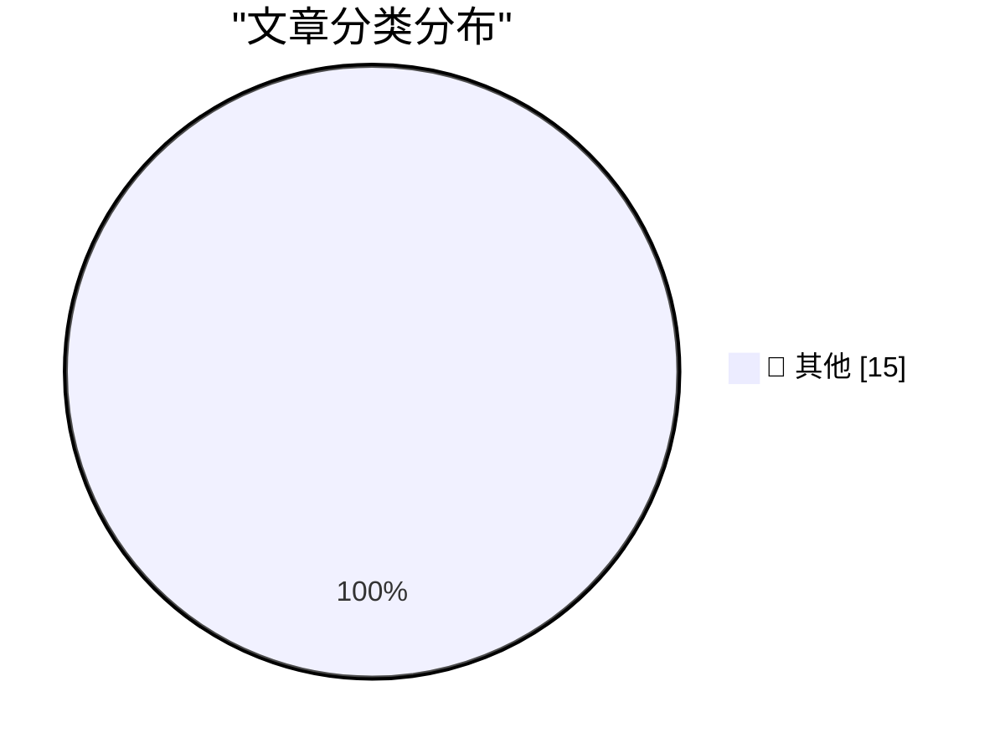

# 📰 AI 博客每日精选 — 2026-11-18

> 来自 Karpathy 推荐的 92 个顶级技术博客，AI 精选 Top 15

## 🏆 今日必读

🥇 **External sandboxes for coding agents**

[External sandboxes for coding agents](https://simonwillison.net/2026/Nov/17/external-sandboxes-for-coding-agents/) — simonwillison.net · 6 小时前 · 📝 其他

> External sandboxes for coding agents

🥈 **GPT‑6.2 Astra and GPT‑6.2 Sol**

[GPT‑6.2 Astra and GPT‑6.2 Sol](https://simonwillison.net/2026/Nov/17/gpt62-astra-and-sol/) — simonwillison.net · 6 小时前 · 📝 其他

> GPT‑6.2 Astra and GPT‑6.2 Sol

🥉 **Running the full server-side Datasette Python app in the browser with service workers and Pyodide**

[Running the full server-side Datasette Python app in the browser with service workers and Pyodide](https://simonwillison.net/2026/Nov/17/datasette-lite/) — simonwillison.net · 12 小时前 · 📝 其他

> Running the full server-side Datasette Python app in the browser with service workers and Pyodide

---

## 📊 数据概览

| 扫描源 | 抓取文章 | 时间范围 | 精选 |
|:---:|:---:|:---:|:---:|
| 82/92 | 2552 篇 → 32 篇 | 48h | **15 篇** |

### 分类分布

---

## 📝 其他

### 1. External sandboxes for coding agents

[External sandboxes for coding agents](https://simonwillison.net/2026/Nov/17/external-sandboxes-for-coding-agents/) — **simonwillison.net** · 6 小时前 · ⭐ 15/30

> External sandboxes for coding agents

---

### 2. GPT‑6.2 Astra and GPT‑6.2 Sol

[GPT‑6.2 Astra and GPT‑6.2 Sol](https://simonwillison.net/2026/Nov/17/gpt62-astra-and-sol/) — **simonwillison.net** · 6 小时前 · ⭐ 15/30

> GPT‑6.2 Astra and GPT‑6.2 Sol

---

### 3. Running the full server-side Datasette Python app in the browser with service workers and Pyodide

[Running the full server-side Datasette Python app in the browser with service workers and Pyodide](https://simonwillison.net/2026/Nov/17/datasette-lite/) — **simonwillison.net** · 12 小时前 · ⭐ 15/30

> Running the full server-side Datasette Python app in the browser with service workers and Pyodide

---

### 4. Quoting Go Proverbs

[Quoting Go Proverbs](https://simonwillison.net/2026/Nov/17/go-proverbs/) — **simonwillison.net** · 22 小时前 · ⭐ 15/30

> Quoting Go Proverbs

---

### 5. llm 0.37.3

[llm 0.37.3](https://simonwillison.net/2026/Nov/16/llm/) — **simonwillison.net** · 1 天前 · ⭐ 15/30

> llm 0.37.3

---

### 6. Attackers Used Optimizely to A/B Test Malware on Top Websites

[Attackers Used Optimizely to A/B Test Malware on Top Websites](https://krebsonsecurity.com/2026/11/attackers-used-optimizely-to-a-b-test-malware-on-top-websites/) — **krebsonsecurity.com** · 2 小时前 · ⭐ 15/30

> Attackers Used Optimizely to A/B Test Malware on Top Websites

---

### 7. SetShot 1.0 (and a Personal Tale of Defaults System Spelunking)

[SetShot 1.0 (and a Personal Tale of Defaults System Spelunking)](https://tidbits.com/2026/11/13/setshot-1-0-tracks-even-more-macos-settings/) — **daringfireball.net** · 10 小时前 · ⭐ 15/30

> SetShot 1.0 (and a Personal Tale of Defaults System Spelunking)

---

### 8. Apple’s Cloud Services Are Having a Bad Day, Including Their Status Page

[Apple’s Cloud Services Are Having a Bad Day, Including Their Status Page](https://www.macrumors.com/2026/11/17/apple-accounts-experiencing-issues/) — **daringfireball.net** · 10 小时前 · ⭐ 15/30

> Apple’s Cloud Services Are Having a Bad Day, Including Their Status Page

---

### 9. Apple Support Document on the New ‘Full Disk Access’ and ‘System & App Protection Override’ Settings in MacOS 27.3 Beta 2

[Apple Support Document on the New ‘Full Disk Access’ and ‘System & App Protection Override’ Settings in MacOS 27.3 Beta 2](https://support.apple.com/en-us/149699) — **daringfireball.net** · 1 天前 · ⭐ 15/30

> Apple Support Document on the New ‘Full Disk Access’ and ‘System & App Protection Override’ Settings in MacOS 27.3 Beta 2

---

### 10. ‘Meet the Anthropic Researcher Behind Silicon Valley’s “Consensual Non-Consent” Orgies’

[‘Meet the Anthropic Researcher Behind Silicon Valley’s “Consensual Non-Consent” Orgies’](https://freebeacon.com/america/horrifying-meet-the-anthropic-researcher-behind-silicon-valleys-consensual-non-consent-orgies/) — **daringfireball.net** · 1 天前 · ⭐ 15/30

> ‘Meet the Anthropic Researcher Behind Silicon Valley’s “Consensual Non-Consent” Orgies’

---

### 11. [Sponsor] Ivy: The To-do List That Ends

[[Sponsor] Ivy: The To-do List That Ends](https://semantical.com/?utm_campaign=df-2026-12) — **daringfireball.net** · 1 天前 · ⭐ 15/30

> [Sponsor] Ivy: The To-do List That Ends

---

### 12. Developers Continue to Optimize iPhone Apps for the Duo

[Developers Continue to Optimize iPhone Apps for the Duo](https://x.com/gregjoz/status/2122393925080252469) — **daringfireball.net** · 1 天前 · ⭐ 15/30

> Developers Continue to Optimize iPhone Apps for the Duo

---

### 13. Irish Goodbye / French Leave / Leave the English Way

[Irish Goodbye / French Leave / Leave the English Way](https://terriblemaps.co.uk/leaving-a-party-without-saying-goodbye/) — **daringfireball.net** · 1 天前 · ⭐ 15/30

> Irish Goodbye / French Leave / Leave the English Way

---

### 14. MacOS Golden Gate 27.3b2 Includes New Privacy Controls for Full Disk Access (and More)

[MacOS Golden Gate 27.3b2 Includes New Privacy Controls for Full Disk Access (and More)](https://9to5mac.com/2026/11/16/macos-27-3-includes-new-privacy-controls-for-full-disk-access-and-more/) — **daringfireball.net** · 1 天前 · ⭐ 15/30

> MacOS Golden Gate 27.3b2 Includes New Privacy Controls for Full Disk Access (and More)

---

### 15. ‘Unlock With Front Camera’ — New Feature for iPhone Duo in iOS 27.3 Beta 2

[‘Unlock With Front Camera’ — New Feature for iPhone Duo in iOS 27.3 Beta 2](https://www.macrumors.com/2026/11/16/iphone-duo-face-unlock/) — **daringfireball.net** · 1 天前 · ⭐ 15/30

> ‘Unlock With Front Camera’ — New Feature for iPhone Duo in iOS 27.3 Beta 2

---

*生成于 2026-11-18 04:59 | 扫描 82 源 → 获取 2552 篇 → 精选 15 篇*
*基于 [Hacker News Popularity Contest 2025](https://refactoringenglish.com/tools/hn-popularity/) RSS 源列表，由 [Andrej Karpathy](https://x.com/karpathy) 推荐*
*由「懂点儿AI」制作，欢迎关注同名微信公众号获取更多 AI 实用技巧 💡*
