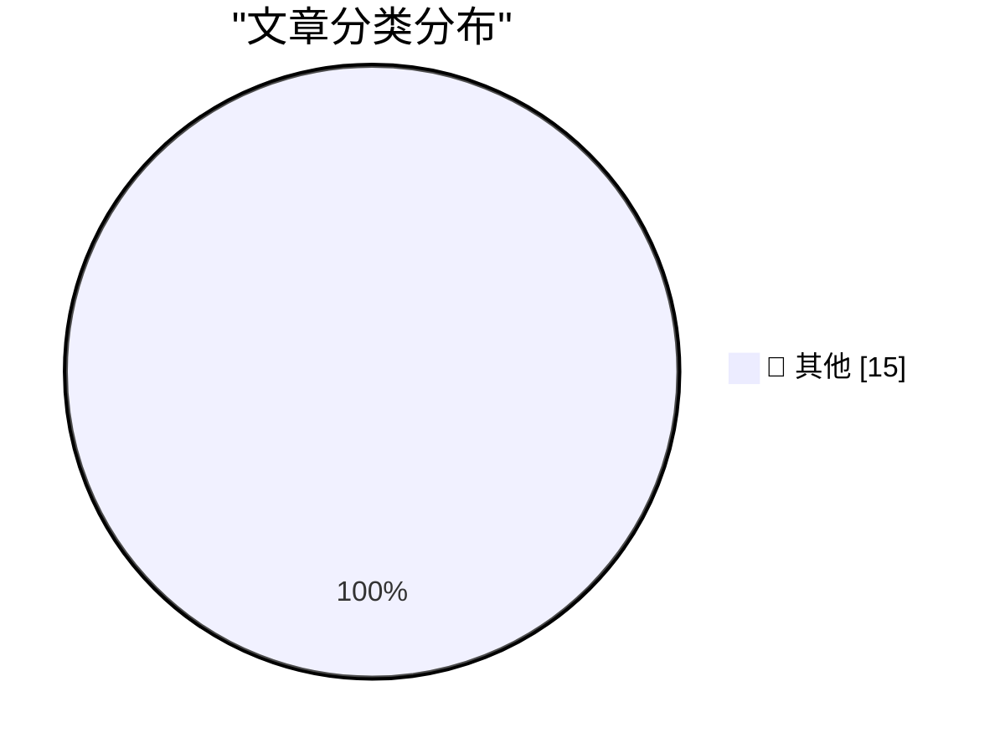

# 📰 AI 博客每日精选 — 2026-11-19

> 来自 Karpathy 推荐的 92 个顶级技术博客，AI 精选 Top 15

## 🏆 今日必读

🥇 **datasette-arrows 0.1a0**

[datasette-arrows 0.1a0](https://simonwillison.net/2026/Nov/18/datasette-arrows/) — simonwillison.net · 11 小时前 · 📝 其他

> datasette-arrows 0.1a0

🥈 **Quoting Daniel Stenberg**

[Quoting Daniel Stenberg](https://simonwillison.net/2026/Nov/18/daniel-stenberg/) — simonwillison.net · 12 小时前 · 📝 其他

> Quoting Daniel Stenberg

🥉 **The PSF end-of-year fundraiser**

[The PSF end-of-year fundraiser](https://simonwillison.net/2026/Nov/18/psf-end-of-year-fundraiser/) — simonwillison.net · 14 小时前 · 📝 其他

> The PSF end-of-year fundraiser

---

## 📊 数据概览

| 扫描源 | 抓取文章 | 时间范围 | 精选 |
|:---:|:---:|:---:|:---:|
| 82/92 | 2548 篇 → 30 篇 | 48h | **15 篇** |

### 分类分布

---

## 📝 其他

### 1. datasette-arrows 0.1a0

[datasette-arrows 0.1a0](https://simonwillison.net/2026/Nov/18/datasette-arrows/) — **simonwillison.net** · 11 小时前 · ⭐ 15/30

> datasette-arrows 0.1a0

---

### 2. Quoting Daniel Stenberg

[Quoting Daniel Stenberg](https://simonwillison.net/2026/Nov/18/daniel-stenberg/) — **simonwillison.net** · 12 小时前 · ⭐ 15/30

> Quoting Daniel Stenberg

---

### 3. The PSF end-of-year fundraiser

[The PSF end-of-year fundraiser](https://simonwillison.net/2026/Nov/18/psf-end-of-year-fundraiser/) — **simonwillison.net** · 14 小时前 · ⭐ 15/30

> The PSF end-of-year fundraiser

---

### 4. External sandboxes for coding agents

[External sandboxes for coding agents](https://simonwillison.net/2026/Nov/17/external-sandboxes-for-coding-agents/) — **simonwillison.net** · 1 天前 · ⭐ 15/30

> External sandboxes for coding agents

---

### 5. GPT‑6.2 Astra and GPT‑6.2 Sol

[GPT‑6.2 Astra and GPT‑6.2 Sol](https://simonwillison.net/2026/Nov/17/gpt62-astra-and-sol/) — **simonwillison.net** · 1 天前 · ⭐ 15/30

> GPT‑6.2 Astra and GPT‑6.2 Sol

---

### 6. Running the full server-side Datasette Python app in the browser with service workers and Pyodide

[Running the full server-side Datasette Python app in the browser with service workers and Pyodide](https://simonwillison.net/2026/Nov/17/datasette-lite/) — **simonwillison.net** · 1 天前 · ⭐ 15/30

> Running the full server-side Datasette Python app in the browser with service workers and Pyodide

---

### 7. Quoting Go Proverbs

[Quoting Go Proverbs](https://simonwillison.net/2026/Nov/17/go-proverbs/) — **simonwillison.net** · 1 天前 · ⭐ 15/30

> Quoting Go Proverbs

---

### 8. I joined the NTP Pool, but not with my Stratum 1 Pi

[I joined the NTP Pool, but not with my Stratum 1 Pi](https://www.jeffgeerling.com/blog/2026/i-joined-the-ntp-pool/) — **jeffgeerling.com** · 1 天前 · ⭐ 15/30

> I joined the NTP Pool, but not with my Stratum 1 Pi

---

### 9. Attackers Used Optimizely to A/B Test Malware on Top Websites

[Attackers Used Optimizely to A/B Test Malware on Top Websites](https://krebsonsecurity.com/2026/11/attackers-used-optimizely-to-a-b-test-malware-on-top-websites/) — **krebsonsecurity.com** · 1 天前 · ⭐ 15/30

> Attackers Used Optimizely to A/B Test Malware on Top Websites

---

### 10. ★ The 50-Yard Line

[★ The 50-Yard Line](https://daringfireball.net/2026/11/the_50-yard_line) — **daringfireball.net** · 8 小时前 · ⭐ 15/30

> ★ The 50-Yard Line

---

### 11. Jensen Huang Tweets

[Jensen Huang Tweets](https://x.com/JensenHuang/status/2122726005219737649) — **daringfireball.net** · 13 小时前 · ⭐ 15/30

> Jensen Huang Tweets

---

### 12. SetShot 1.0 (and a Personal Tale of Defaults System Spelunking)

[SetShot 1.0 (and a Personal Tale of Defaults System Spelunking)](https://tidbits.com/2026/11/13/setshot-1-0-tracks-even-more-macos-settings/) — **daringfireball.net** · 1 天前 · ⭐ 15/30

> SetShot 1.0 (and a Personal Tale of Defaults System Spelunking)

---

### 13. Apple’s Cloud Services Are Having a Bad Day, Including Their Status Page

[Apple’s Cloud Services Are Having a Bad Day, Including Their Status Page](https://www.macrumors.com/2026/11/17/apple-accounts-experiencing-issues/) — **daringfireball.net** · 1 天前 · ⭐ 15/30

> Apple’s Cloud Services Are Having a Bad Day, Including Their Status Page

---

### 14. Pluralistic: Enshittifiers groom us for scammers (18 Nov 2026)

[Pluralistic: Enshittifiers groom us for scammers (18 Nov 2026)](https://pluralistic.net/2026/11/18/malice-v-incompetence/) — **pluralistic.net** · 20 小时前 · ⭐ 15/30

> Pluralistic: Enshittifiers groom us for scammers (18 Nov 2026)

---

### 15. Pluralistic: Remembrance of proteins past (17 Nov 2026)

[Pluralistic: Remembrance of proteins past (17 Nov 2026)](https://pluralistic.net/2026/11/17/mississippi-gosh-darn/) — **pluralistic.net** · 1 天前 · ⭐ 15/30

> Pluralistic: Remembrance of proteins past (17 Nov 2026)

---

*生成于 2026-11-19 04:54 | 扫描 82 源 → 获取 2548 篇 → 精选 15 篇*
*基于 [Hacker News Popularity Contest 2025](https://refactoringenglish.com/tools/hn-popularity/) RSS 源列表，由 [Andrej Karpathy](https://x.com/karpathy) 推荐*
*由「懂点儿AI」制作，欢迎关注同名微信公众号获取更多 AI 实用技巧 💡*
