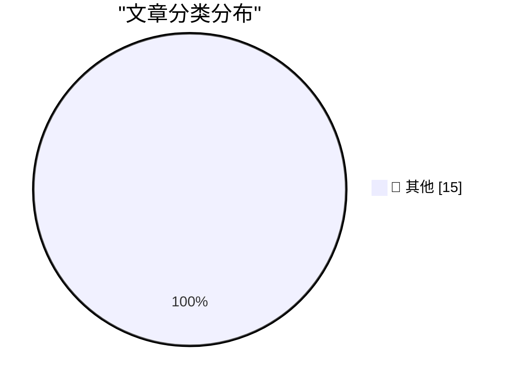

# 📰 AI 博客每日精选 — 2026-11-22

> 来自 Karpathy 推荐的 92 个顶级技术博客，AI 精选 Top 15

## 🏆 今日必读

🥇 **Muru**

[Muru](https://simonwillison.net/2026/Nov/21/muru/) — simonwillison.net · 3 小时前 · 📝 其他

> Muru

🥈 **Quoting Ravi Vakil**

[Quoting Ravi Vakil](https://simonwillison.net/2026/Nov/20/ravi-vakil/) — simonwillison.net · 1 天前 · 📝 其他

> Quoting Ravi Vakil

🥉 **Quoting Levent Alpöge**

[Quoting Levent Alpöge](https://simonwillison.net/2026/Nov/20/levent-alpoge/) — simonwillison.net · 1 天前 · 📝 其他

> Quoting Levent Alpöge

---

## 📊 数据概览

| 扫描源 | 抓取文章 | 时间范围 | 精选 |
|:---:|:---:|:---:|:---:|
| 82/92 | 2548 篇 → 25 篇 | 48h | **15 篇** |

### 分类分布

---

## 📝 其他

### 1. Muru

[Muru](https://simonwillison.net/2026/Nov/21/muru/) — **simonwillison.net** · 3 小时前 · ⭐ 15/30

> Muru

---

### 2. Quoting Ravi Vakil

[Quoting Ravi Vakil](https://simonwillison.net/2026/Nov/20/ravi-vakil/) — **simonwillison.net** · 1 天前 · ⭐ 15/30

> Quoting Ravi Vakil

---

### 3. Quoting Levent Alpöge

[Quoting Levent Alpöge](https://simonwillison.net/2026/Nov/20/levent-alpoge/) — **simonwillison.net** · 1 天前 · ⭐ 15/30

> Quoting Levent Alpöge

---

### 4. To code well, avoid blunders

[To code well, avoid blunders](https://seangoedecke.com/to-code-well-avoid-blunders/) — **seangoedecke.com** · 3 小时前 · ⭐ 15/30

> To code well, avoid blunders

---

### 5. Why output caching doesn't work

[Why output caching doesn't work](https://seangoedecke.com/why-output-caching-doesnt-work/) — **seangoedecke.com** · 1 天前 · ⭐ 15/30

> Why output caching doesn't work

---

### 6. CTO of ‘RansomwareHelp’ Indicted for Wire Fraud

[CTO of ‘RansomwareHelp’ Indicted for Wire Fraud](https://krebsonsecurity.com/2026/11/cto-of-ransomwarehelp-indicted-for-wire-fraud/) — **krebsonsecurity.com** · 1 天前 · ⭐ 15/30

> CTO of ‘RansomwareHelp’ Indicted for Wire Fraud

---

### 7. ★ A Week With the New Privacy Controls in MacOS 27.3 Beta 2

[★ A Week With the New Privacy Controls in MacOS 27.3 Beta 2](https://daringfireball.net/2026/11/a_week_with_the_new_privacy_controls_in_macos_273) — **daringfireball.net** · 7 小时前 · ⭐ 15/30

> ★ A Week With the New Privacy Controls in MacOS 27.3 Beta 2

---

### 8. The U.S. — Utterly Predictably — Has Lost Measles Elimination Status Under Trump and RFK Jr.

[The U.S. — Utterly Predictably — Has Lost Measles Elimination Status Under Trump and RFK Jr.](https://www.wsj.com/health/measles-is-back-it-will-take-years-to-eliminate-it-again-9971736e?st=GKiu3E) — **daringfireball.net** · 9 小时前 · ⭐ 15/30

> The U.S. — Utterly Predictably — Has Lost Measles Elimination Status Under Trump and RFK Jr.

---

### 9. Apple Documents Extra Apple Intelligence Usage Limits Per iCloud+ Paid Tier

[Apple Documents Extra Apple Intelligence Usage Limits Per iCloud+ Paid Tier](https://support.apple.com/en-us/127901) — **daringfireball.net** · 9 小时前 · ⭐ 15/30

> Apple Documents Extra Apple Intelligence Usage Limits Per iCloud+ Paid Tier

---

### 10. The Talk Show: ‘A Whoopsie Treason’

[The Talk Show: ‘A Whoopsie Treason’](https://daringfireball.net/thetalkshow/2026/11/20/ep-457) — **daringfireball.net** · 1 天前 · ⭐ 15/30

> The Talk Show: ‘A Whoopsie Treason’

---

### 11. Pluralistic: Lisa Hanawalt's "I Can't Stop Thinking About Horses and Sex" (20 Nov 2026)

[Pluralistic: Lisa Hanawalt's "I Can't Stop Thinking About Horses and Sex" (20 Nov 2026)](https://pluralistic.net/2026/11/20/intrusive-horse-thoughts/) — **pluralistic.net** · 1 天前 · ⭐ 15/30

> Pluralistic: Lisa Hanawalt's "I Can't Stop Thinking About Horses and Sex" (20 Nov 2026)

---

### 12. Relicensing to CC BY-SA and making it visible in Schema metadata

[Relicensing to CC BY-SA and making it visible in Schema metadata](https://shkspr.mobi/blog/2026/11/relicensing-to-cc-by-sa-and-making-it-visible-in-schema-metadata/) — **shkspr.mobi** · 15 小时前 · ⭐ 15/30

> Relicensing to CC BY-SA and making it visible in Schema metadata

---

### 13. Connect a USB Zigbee Device to HAOS

[Connect a USB Zigbee Device to HAOS](https://shkspr.mobi/blog/2026/11/connect-a-usb-zigbee-device-to-haos/) — **shkspr.mobi** · 1 天前 · ⭐ 15/30

> Connect a USB Zigbee Device to HAOS

---

### 14. Another failed attempt to get the icon for the icon for the .. parent folder

[Another failed attempt to get the icon for the icon for the .. parent folder](https://devblogs.microsoft.com/oldnewthing/20261120-00/?p=112883/) — **devblogs.microsoft.com/oldnewthing** · 1 天前 · ⭐ 15/30

> Another failed attempt to get the icon for the icon for the .. parent folder

---

### 15. What is the Generalized Riemann Hypothesis?

[What is the Generalized Riemann Hypothesis?](https://www.johndcook.com/blog/2026/11/20/grh/) — **johndcook.com** · 1 天前 · ⭐ 15/30

> What is the Generalized Riemann Hypothesis?

---

*生成于 2026-11-22 03:54 | 扫描 82 源 → 获取 2548 篇 → 精选 15 篇*
*基于 [Hacker News Popularity Contest 2025](https://refactoringenglish.com/tools/hn-popularity/) RSS 源列表，由 [Andrej Karpathy](https://x.com/karpathy) 推荐*
*由「懂点儿AI」制作，欢迎关注同名微信公众号获取更多 AI 实用技巧 💡*
