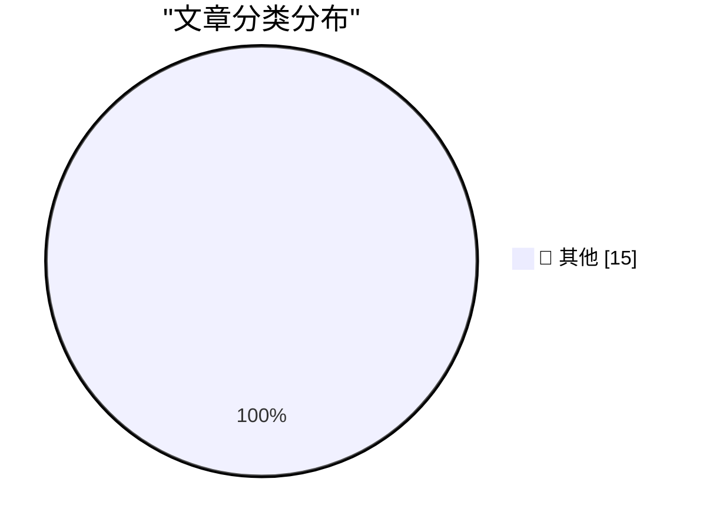

# 📰 AI 博客每日精选 — 2026-11-23

> 来自 Karpathy 推荐的 92 个顶级技术博客，AI 精选 Top 15

## 🏆 今日必读

🥇 **Select Styling Specimens**

[Select Styling Specimens](https://simonwillison.net/2026/Nov/22/select-styling/) — simonwillison.net · 8 小时前 · 📝 其他

> Select Styling Specimens

🥈 **Muru**

[Muru](https://simonwillison.net/2026/Nov/21/muru/) — simonwillison.net · 1 天前 · 📝 其他

> Muru

🥉 **When in doubt, flail about**

[When in doubt, flail about](https://seangoedecke.com/when-in-doubt-flail-about/) — seangoedecke.com · 4 小时前 · 📝 其他

> When in doubt, flail about

---

## 📊 数据概览

| 扫描源 | 抓取文章 | 时间范围 | 精选 |
|:---:|:---:|:---:|:---:|
| 85/92 | 2548 篇 → 21 篇 | 48h | **15 篇** |

### 分类分布

---

## 📝 其他

### 1. Select Styling Specimens

[Select Styling Specimens](https://simonwillison.net/2026/Nov/22/select-styling/) — **simonwillison.net** · 8 小时前 · ⭐ 15/30

> Select Styling Specimens

---

### 2. Muru

[Muru](https://simonwillison.net/2026/Nov/21/muru/) — **simonwillison.net** · 1 天前 · ⭐ 15/30

> Muru

---

### 3. When in doubt, flail about

[When in doubt, flail about](https://seangoedecke.com/when-in-doubt-flail-about/) — **seangoedecke.com** · 4 小时前 · ⭐ 15/30

> When in doubt, flail about

---

### 4. To code well, avoid blunders

[To code well, avoid blunders](https://seangoedecke.com/to-code-well-avoid-blunders/) — **seangoedecke.com** · 1 天前 · ⭐ 15/30

> To code well, avoid blunders

---

### 5. Ivy

[Ivy](https://semantical.com/?utm_campaign=df-2026-12) — **daringfireball.net** · 5 小时前 · ⭐ 15/30

> Ivy

---

### 6. ★ A Week With the New Privacy Controls in MacOS 27.3 Beta 2

[★ A Week With the New Privacy Controls in MacOS 27.3 Beta 2](https://daringfireball.net/2026/11/a_week_with_the_new_privacy_controls_in_macos_273) — **daringfireball.net** · 1 天前 · ⭐ 15/30

> ★ A Week With the New Privacy Controls in MacOS 27.3 Beta 2

---

### 7. The U.S. — Utterly Predictably — Has Lost Measles Elimination Status Under Trump and RFK Jr.

[The U.S. — Utterly Predictably — Has Lost Measles Elimination Status Under Trump and RFK Jr.](https://www.wsj.com/health/measles-is-back-it-will-take-years-to-eliminate-it-again-9971736e?st=GKiu3E) — **daringfireball.net** · 1 天前 · ⭐ 15/30

> The U.S. — Utterly Predictably — Has Lost Measles Elimination Status Under Trump and RFK Jr.

---

### 8. Apple Documents Extra Apple Intelligence Usage Limits Per iCloud+ Paid Tier

[Apple Documents Extra Apple Intelligence Usage Limits Per iCloud+ Paid Tier](https://support.apple.com/en-us/127901) — **daringfireball.net** · 1 天前 · ⭐ 15/30

> Apple Documents Extra Apple Intelligence Usage Limits Per iCloud+ Paid Tier

---

### 9. I don't enjoy being pampered

[I don't enjoy being pampered](https://shkspr.mobi/blog/2026/11/i-dont-enjoy-being-pampered/) — **shkspr.mobi** · 15 小时前 · ⭐ 15/30

> I don't enjoy being pampered

---

### 10. Relicensing to CC BY-SA and making it visible in Schema metadata

[Relicensing to CC BY-SA and making it visible in Schema metadata](https://shkspr.mobi/blog/2026/11/relicensing-to-cc-by-sa-and-making-it-visible-in-schema-metadata/) — **shkspr.mobi** · 1 天前 · ⭐ 15/30

> Relicensing to CC BY-SA and making it visible in Schema metadata

---

### 11. Tranquility

[Tranquility](https://blog.coredump.cx/p/tranquility) — **lcamtuf.substack.com** · 55 分钟前 · ⭐ 15/30

> Tranquility

---

### 12. Levent Alpöge has solved the Riemann Hypothesis with help of Claude! What does it mean?

[Levent Alpöge has solved the Riemann Hypothesis with help of Claude! What does it mean?](https://garymarcus.substack.com/p/levent-alpoge-has-solved-the-riemann) — **garymarcus.substack.com** · 9 小时前 · ⭐ 15/30

> Levent Alpöge has solved the Riemann Hypothesis with help of Claude! What does it mean?

---

### 13. This Week in Package Management: 21 November 2026

[This Week in Package Management: 21 November 2026](https://nesbitt.io/2026/11/21/this-week-in-package-management.html) — **nesbitt.io** · 1 天前 · ⭐ 15/30

> This Week in Package Management: 21 November 2026

---

### 14. Reading List 11/21/2026

[Reading List 11/21/2026](https://www.construction-physics.com/p/reading-list-11212026) — **construction-physics.com** · 1 天前 · ⭐ 15/30

> Reading List 11/21/2026

---

### 15. slopcore

[slopcore](https://geohot.github.io//blog/jekyll/update/2026/11/23/slopcore.html) — **geohot.github.io** · 12 小时前 · ⭐ 15/30

> slopcore

---

*生成于 2026-11-23 04:34 | 扫描 85 源 → 获取 2548 篇 → 精选 15 篇*
*基于 [Hacker News Popularity Contest 2025](https://refactoringenglish.com/tools/hn-popularity/) RSS 源列表，由 [Andrej Karpathy](https://x.com/karpathy) 推荐*
*由「懂点儿AI」制作，欢迎关注同名微信公众号获取更多 AI 实用技巧 💡*
