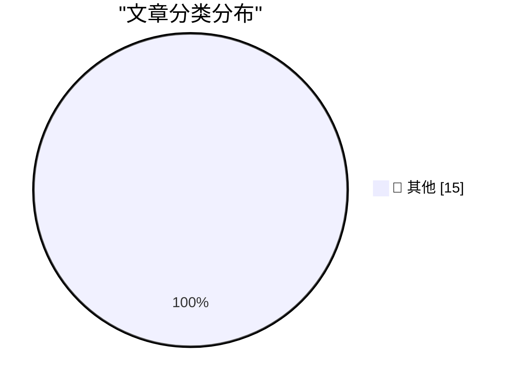

# 📰 AI 博客每日精选 — 2026-11-25

> 来自 Karpathy 推荐的 92 个顶级技术博客，AI 精选 Top 15

## 🏆 今日必读

🥇 **Three LLM inflection points in twelve months**

[Three LLM inflection points in twelve months](https://simonwillison.net/2026/Nov/24/llm-inflection-points/) — simonwillison.net · 6 小时前 · 📝 其他

> Three LLM inflection points in twelve months

🥈 **GPT 6.2 Astra Solves a Historical Mystery**

[GPT 6.2 Astra Solves a Historical Mystery](https://simonwillison.net/2026/Nov/24/astra-historical-mystery/) — simonwillison.net · 13 小时前 · 📝 其他

> GPT 6.2 Astra Solves a Historical Mystery

🥉 **datasette-charts 0.2a0**

[datasette-charts 0.2a0](https://simonwillison.net/2026/Nov/24/datasette-charts/) — simonwillison.net · 1 天前 · 📝 其他

> datasette-charts 0.2a0

---

## 📊 数据概览

| 扫描源 | 抓取文章 | 时间范围 | 精选 |
|:---:|:---:|:---:|:---:|
| 82/92 | 2501 篇 → 48 篇 | 48h | **15 篇** |

### 分类分布

---

## 📝 其他

### 1. Three LLM inflection points in twelve months

[Three LLM inflection points in twelve months](https://simonwillison.net/2026/Nov/24/llm-inflection-points/) — **simonwillison.net** · 6 小时前 · ⭐ 15/30

> Three LLM inflection points in twelve months

---

### 2. GPT 6.2 Astra Solves a Historical Mystery

[GPT 6.2 Astra Solves a Historical Mystery](https://simonwillison.net/2026/Nov/24/astra-historical-mystery/) — **simonwillison.net** · 13 小时前 · ⭐ 15/30

> GPT 6.2 Astra Solves a Historical Mystery

---

### 3. datasette-charts 0.2a0

[datasette-charts 0.2a0](https://simonwillison.net/2026/Nov/24/datasette-charts/) — **simonwillison.net** · 1 天前 · ⭐ 15/30

> datasette-charts 0.2a0

---

### 4. datasette-agent 0.7a1

[datasette-agent 0.7a1](https://simonwillison.net/2026/Nov/24/datasette-agent/) — **simonwillison.net** · 1 天前 · ⭐ 15/30

> datasette-agent 0.7a1

---

### 5. GLM-5.4: Toward Generalized Coding with Our First Loop Transformer

[GLM-5.4: Toward Generalized Coding with Our First Loop Transformer](https://simonwillison.net/2026/Nov/23/glm-54/) — **simonwillison.net** · 1 天前 · ⭐ 15/30

> GLM-5.4: Toward Generalized Coding with Our First Loop Transformer

---

### 6. Ladybird's first alpha release

[Ladybird's first alpha release](https://simonwillison.net/2026/Nov/23/ladybird/) — **simonwillison.net** · 1 天前 · ⭐ 15/30

> Ladybird's first alpha release

---

### 7. Engadget Scoop Claims iPhone 18e Will Have a Camera Plateau

[Engadget Scoop Claims iPhone 18e Will Have a Camera Plateau](https://www.engadget.com/2325828/new-leaks-reveal-the-iphone-18e-will-have-a-redesigned-camera-plateau/) — **daringfireball.net** · 6 小时前 · ⭐ 15/30

> Engadget Scoop Claims iPhone 18e Will Have a Camera Plateau

---

### 8. Trump Made Up to $15M on Nvidia Stock After Huang’s Return

[Trump Made Up to $15M on Nvidia Stock After Huang’s Return](https://www.theguardian.com/technology/2026/nov/24/donald-trump-nvidia-stock-jensen-huang-stock-market) — **daringfireball.net** · 6 小时前 · ⭐ 15/30

> Trump Made Up to $15M on Nvidia Stock After Huang’s Return

---

### 9. Nvidia and Trump’s State Capitalism

[Nvidia and Trump’s State Capitalism](https://www.wsj.com/opinion/nvidia-jensen-huang-donald-trump-130e644c) — **daringfireball.net** · 7 小时前 · ⭐ 15/30

> Nvidia and Trump’s State Capitalism

---

### 10. Patriotism, Trump-Style

[Patriotism, Trump-Style](https://nypost.com/2026/11/23/us-news/trump-suggests-jensen-huang-could-have-moved-to-china-if-not-reinstated-as-nvidia-ceo-sex-sells-fellas/) — **daringfireball.net** · 7 小时前 · ⭐ 15/30

> Patriotism, Trump-Style

---

### 11. ‘The Economy Is a Hostage Situation’

[‘The Economy Is a Hostage Situation’](https://www.theatlantic.com/technology/2026/11/ai-hostage-economy-nvidia-huang/689552/?gift=aQyUJR7AIw1mJWdQ6Ed6yMQrokNaYAmgr0aVusAzQCY&amp;) — **daringfireball.net** · 10 小时前 · ⭐ 15/30

> ‘The Economy Is a Hostage Situation’

---

### 12. I Told You to Bet the Over

[I Told You to Bet the Over](https://www.wsj.com/business/nvidia-jensen-huang-white-house-9ad03961?st=HzeUyV) — **daringfireball.net** · 10 小时前 · ⭐ 15/30

> I Told You to Bet the Over

---

### 13. Restoring a 1982 ‘Star Wars’ Poster From Japan

[Restoring a 1982 ‘Star Wars’ Poster From Japan](https://www.instagram.com/p/DcUk0WjBwVI/) — **daringfireball.net** · 12 小时前 · ⭐ 15/30

> Restoring a 1982 ‘Star Wars’ Poster From Japan

---

### 14. Enron Employees Give Kenneth Lay a Standing Ovation Upon His Return as CEO in 2001

[Enron Employees Give Kenneth Lay a Standing Ovation Upon His Return as CEO in 2001](https://www.threads.com/@meidastouch/post/DgGKhbTAka5) — **daringfireball.net** · 12 小时前 · ⭐ 15/30

> Enron Employees Give Kenneth Lay a Standing Ovation Upon His Return as CEO in 2001

---

### 15. David Sacks’s Pool Boy Is Cocky

[David Sacks’s Pool Boy Is Cocky](https://www.threads.com/@karaswisher/post/DgGBe_XI147) — **daringfireball.net** · 13 小时前 · ⭐ 15/30

> David Sacks’s Pool Boy Is Cocky

---

*生成于 2026-11-25 05:57 | 扫描 82 源 → 获取 2501 篇 → 精选 15 篇*
*基于 [Hacker News Popularity Contest 2025](https://refactoringenglish.com/tools/hn-popularity/) RSS 源列表，由 [Andrej Karpathy](https://x.com/karpathy) 推荐*
*由「懂点儿AI」制作，欢迎关注同名微信公众号获取更多 AI 实用技巧 💡*
