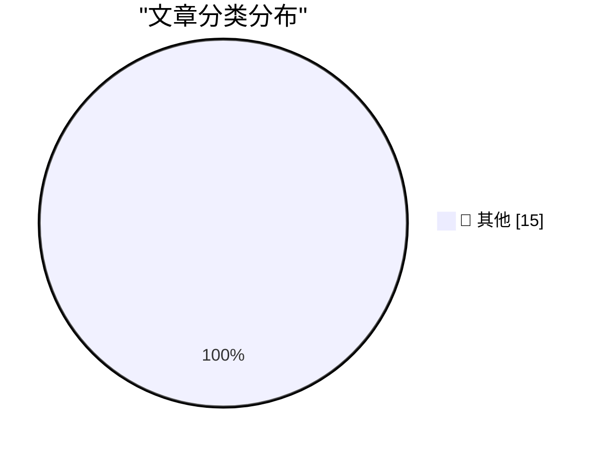

# 📰 AI 博客每日精选 — 2026-11-26

> 来自 Karpathy 推荐的 92 个顶级技术博客，AI 精选 Top 15

## 🏆 今日必读

🥇 **Quoting Scott Aaronson**

[Quoting Scott Aaronson](https://simonwillison.net/2026/Nov/25/scott-aaronson/) — simonwillison.net · 6 小时前 · 📝 其他

> Quoting Scott Aaronson

🥈 **datasette-charts 0.3a0**

[datasette-charts 0.3a0](https://simonwillison.net/2026/Nov/25/datasette-charts/) — simonwillison.net · 11 小时前 · 📝 其他

> datasette-charts 0.3a0

🥉 **Three LLM inflection points in twelve months**

[Three LLM inflection points in twelve months](https://simonwillison.net/2026/Nov/24/llm-inflection-points/) — simonwillison.net · 1 天前 · 📝 其他

> Three LLM inflection points in twelve months

---

## 📊 数据概览

| 扫描源 | 抓取文章 | 时间范围 | 精选 |
|:---:|:---:|:---:|:---:|
| 81/92 | 2472 篇 → 44 篇 | 48h | **15 篇** |

### 分类分布

---

## 📝 其他

### 1. Quoting Scott Aaronson

[Quoting Scott Aaronson](https://simonwillison.net/2026/Nov/25/scott-aaronson/) — **simonwillison.net** · 6 小时前 · ⭐ 15/30

> Quoting Scott Aaronson

---

### 2. datasette-charts 0.3a0

[datasette-charts 0.3a0](https://simonwillison.net/2026/Nov/25/datasette-charts/) — **simonwillison.net** · 11 小时前 · ⭐ 15/30

> datasette-charts 0.3a0

---

### 3. Three LLM inflection points in twelve months

[Three LLM inflection points in twelve months](https://simonwillison.net/2026/Nov/24/llm-inflection-points/) — **simonwillison.net** · 1 天前 · ⭐ 15/30

> Three LLM inflection points in twelve months

---

### 4. GPT 6.2 Astra Solves a Historical Mystery

[GPT 6.2 Astra Solves a Historical Mystery](https://simonwillison.net/2026/Nov/24/astra-historical-mystery/) — **simonwillison.net** · 1 天前 · ⭐ 15/30

> GPT 6.2 Astra Solves a Historical Mystery

---

### 5. datasette-charts 0.2a1

[datasette-charts 0.2a1](https://simonwillison.net/2026/Nov/24/datasette-charts-2/) — **simonwillison.net** · 1 天前 · ⭐ 15/30

> datasette-charts 0.2a1

---

### 6. Ansible Fails waiting for privilege escalation on Ubuntu 26

[Ansible Fails waiting for privilege escalation on Ubuntu 26](https://www.jeffgeerling.com/blog/2026/ansible-fails-become-ubuntu2604/) — **jeffgeerling.com** · 8 小时前 · ⭐ 15/30

> Ansible Fails waiting for privilege escalation on Ubuntu 26

---

### 7. Electrek Speculates on Trump’s Claim He ‘Protected’ Elon Musk After a ‘Very Tough Incident’ During His First Term

[Electrek Speculates on Trump’s Claim He ‘Protected’ Elon Musk After a ‘Very Tough Incident’ During His First Term](https://electrek.co/2026/11/24/trump-protected-elon-musk-first-term-tough-incident/) — **daringfireball.net** · 5 小时前 · ⭐ 15/30

> Electrek Speculates on Trump’s Claim He ‘Protected’ Elon Musk After a ‘Very Tough Incident’ During His First Term

---

### 8. 1Password’s Backend Systems Were Compromised, Revealing Only Customer Account Metadata

[1Password’s Backend Systems Were Compromised, Revealing Only Customer Account Metadata](https://1password.com/blog/update-on-nov-2026-security-incident) — **daringfireball.net** · 7 小时前 · ⭐ 15/30

> 1Password’s Backend Systems Were Compromised, Revealing Only Customer Account Metadata

---

### 9. ‘Trump Wanted Jensen Huang Back. Now, the President Is Alone in Washington’

[‘Trump Wanted Jensen Huang Back. Now, the President Is Alone in Washington’](https://www.cnbc.com/2026/11/24/trump-jensen-huang-nvidia.html) — **daringfireball.net** · 7 小时前 · ⭐ 15/30

> ‘Trump Wanted Jensen Huang Back. Now, the President Is Alone in Washington’

---

### 10. ‘The Life of a Composer’

[‘The Life of a Composer’](https://composer.pablostanley.com/#1) — **daringfireball.net** · 12 小时前 · ⭐ 15/30

> ‘The Life of a Composer’

---

### 11. 20 Percent He Has Other Problems, Which This Margin Is Too Narrow to Contain

[20 Percent He Has Other Problems, Which This Margin Is Too Narrow to Contain](https://www.wsj.com/politics/policy/trump-says-he-protects-brilliant-ceos-like-elon-musk-and-jensen-huang-b977cfda?st=7ctVgP) — **daringfireball.net** · 13 小时前 · ⭐ 15/30

> 20 Percent He Has Other Problems, Which This Margin Is Too Narrow to Contain

---

### 12. Engadget Scoop Claims iPhone 18e Will Have a Camera Plateau

[Engadget Scoop Claims iPhone 18e Will Have a Camera Plateau](https://www.engadget.com/2325828/new-leaks-reveal-the-iphone-18e-will-have-a-redesigned-camera-plateau/) — **daringfireball.net** · 1 天前 · ⭐ 15/30

> Engadget Scoop Claims iPhone 18e Will Have a Camera Plateau

---

### 13. Trump Made Up to $15M on Nvidia Stock After Huang’s Return

[Trump Made Up to $15M on Nvidia Stock After Huang’s Return](https://www.theguardian.com/technology/2026/nov/24/donald-trump-nvidia-stock-jensen-huang-stock-market) — **daringfireball.net** · 1 天前 · ⭐ 15/30

> Trump Made Up to $15M on Nvidia Stock After Huang’s Return

---

### 14. Nvidia and Trump’s State Capitalism

[Nvidia and Trump’s State Capitalism](https://www.wsj.com/opinion/nvidia-jensen-huang-donald-trump-130e644c) — **daringfireball.net** · 1 天前 · ⭐ 15/30

> Nvidia and Trump’s State Capitalism

---

### 15. Patriotism, Trump-Style

[Patriotism, Trump-Style](https://nypost.com/2026/11/23/us-news/trump-suggests-jensen-huang-could-have-moved-to-china-if-not-reinstated-as-nvidia-ceo-sex-sells-fellas/) — **daringfireball.net** · 1 天前 · ⭐ 15/30

> Patriotism, Trump-Style

---

*生成于 2026-11-26 05:56 | 扫描 81 源 → 获取 2472 篇 → 精选 15 篇*
*基于 [Hacker News Popularity Contest 2025](https://refactoringenglish.com/tools/hn-popularity/) RSS 源列表，由 [Andrej Karpathy](https://x.com/karpathy) 推荐*
*由「懂点儿AI」制作，欢迎关注同名微信公众号获取更多 AI 实用技巧 💡*
